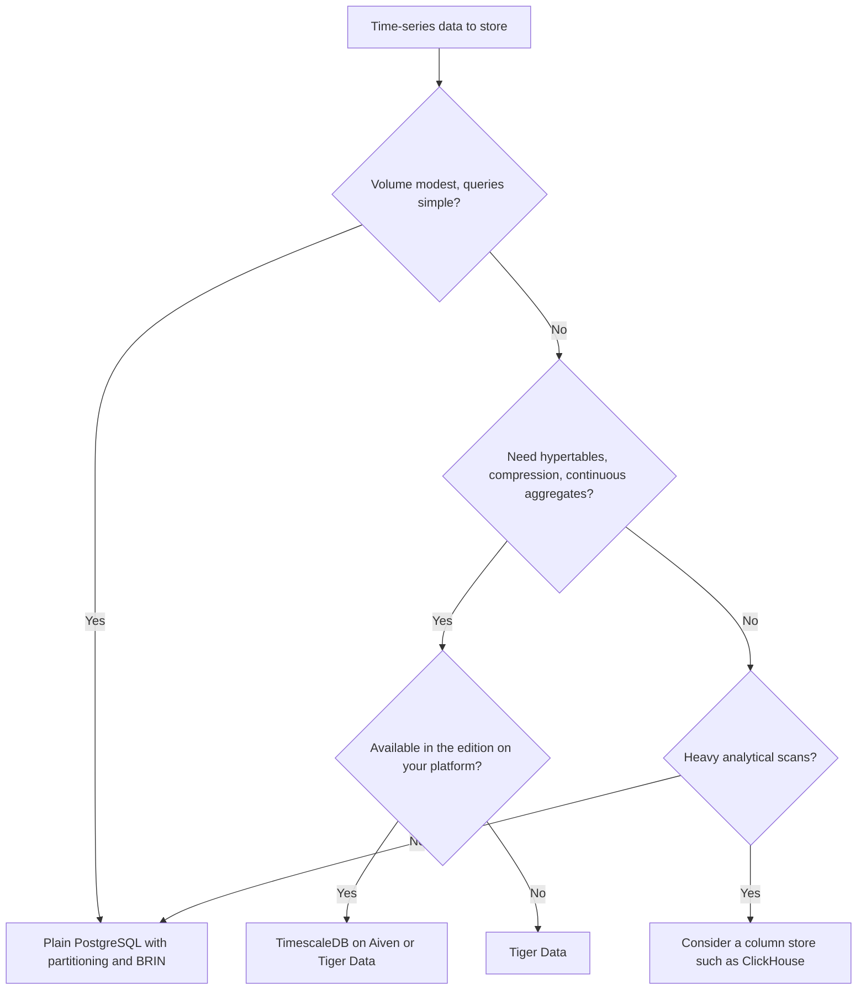

**TL;DR:** If time-series is your core workload, Tiger Data, the company behind TimescaleDB, is the specialist and probably the safer pick for the full feature set. Aiven for PostgreSQL is a good choice when time-series is one workload among several and you want a general PostgreSQL service with optional extensions. Whether the TimescaleDB features you need are available on Aiven has to be checked on a real service.

This comparison is for developers and for coding agents such as Claude Code, Cursor, Codex and Gemini CLI that have to decide how to store metrics, events or sensor data in PostgreSQL.

## Three options, not two

Many time-series workloads do not need an extension at all, so it helps to compare three setups.

| Dimension | Plain PostgreSQL on Aiven | TimescaleDB extension on Aiven | Tiger Data |
|---|---|---|---|
| Time partitioning | Declarative partitioning, managed by you | Hypertables [TO VERIFY] | Hypertables and platform features |
| Compression | Table and TOAST defaults | Extension compression, depending on edition [TO VERIFY] | Vendor features [TO VERIFY] |
| Rollups | Materialized views, your schedule | Continuous aggregates, depending on edition [TO VERIFY] | Continuous aggregates and platform features |
| Retention | Drop partitions on a schedule | Retention policies, depending on edition [TO VERIFY] | Vendor features |
| Other workloads on the same service | Fits naturally | Fits naturally | Possible, but the platform is built around time-series |
| Support path for time-series | General PostgreSQL | Split between Aiven and extension [TO VERIFY] | Specialist vendor |
| Agent tooling | `avn` CLI, Aiven MCP server | Same | Vendor tooling [TO VERIFY] |

The weaker spot for Aiven is clear: if you need a specific TimescaleDB capability, it is on you to verify that the edition on Aiven provides it. The vendor's own platform will always be the reference implementation, and a specialist support team can answer questions a general service cannot.

The stronger spot for Aiven is when the time-series data lives beside relational data in the same database, or when you want one service type to operate. Compare [ClickHouse vs PostgreSQL for analytics](/clickhouse-vs-postgresql-for-analytics.html) too: for heavy aggregation on very wide datasets, a column store may be the better answer than either of these.

## How to decide



## Start with plain PostgreSQL

This is runnable on any PostgreSQL service and gives you a baseline to compare against.

```sql
create table metrics (
    ts      timestamptz not null,
    device  text        not null,
    name    text        not null,
    value   double precision not null
) partition by range (ts);

create table metrics_2027_01 partition of metrics
    for values from ('2027-01-01') to ('2027-02-01');

create index on metrics_2027_01 using brin (ts);
create index on metrics_2027_01 (device, ts desc);
```

Rolling retention is dropping an old partition, which is cheap compared with deleting rows.

```sql
drop table if exists metrics_2026_01;
```

## The TimescaleDB version

On a service where the extension is available, creating a hypertable looks like this. Check the edition and which of these calls it supports before you depend on them.

```sql
create extension if not exists timescaledb;   -- [TO VERIFY] availability on your service

create table metrics (
    ts      timestamptz not null,
    device  text        not null,
    name    text        not null,
    value   double precision not null
);

select create_hypertable('metrics', 'ts');     -- [TO VERIFY]

alter table metrics set (timescaledb.compress,
    timescaledb.compress_segmentby = 'device');          -- [TO VERIFY]
select add_compression_policy('metrics', interval '7 days');  -- [TO VERIFY]
```

If any of those calls fails on Aiven because the feature is not in the available edition, that is your answer for that feature, and it is the cleanest test you can run.

## Run the test from a script

```python
import os, time, random
import psycopg

with psycopg.connect(os.environ["DATABASE_URL"]) as conn, conn.cursor() as cur:
    cur.execute("select extname, extversion from pg_extension order by 1")
    print(cur.fetchall())

    rows = [(f"2027-01-{1 + i % 28:02d} 00:00:00+00", f"dev-{i % 50}", "temp", random.random())
            for i in range(100_000)]
    t = time.perf_counter()
    with cur.copy("copy metrics (ts, device, name, value) from stdin") as cp:
        for r in rows:
            cp.write_row(r)
    print(f"loaded {len(rows)} rows in {time.perf_counter() - t:.2f}s")

    t = time.perf_counter()
    cur.execute("""select device, date_trunc('day', ts) d, avg(value)
                   from metrics group by 1, 2 order by 1, 2""")
    print(f"rollup: {time.perf_counter() - t:.3f}s, {len(cur.fetchall())} rows")
```

Set `DATABASE_URL` with `sslmode=verify-full` and a CA file. Run the same script on each candidate, and add `explain (analyze, buffers)` for any query that matters.

## Provision the Aiven side

```bash
avn service create ts-db \
  --service-type pg \
  --cloud do-nyc \
  --plan <plan>
```

If you want an agent to inspect the result, the Aiven MCP server can run bounded read-only SQL on the service, but it is not a general data-access MCP. Use it for checks like the extension list, not for loading data.

## Choose X if... choose Aiven if...

- Choose Tiger Data if time-series is your main workload, you need the vendor's complete TimescaleDB feature set, and you want a specialist support path.
- Choose Aiven for PostgreSQL if time-series is one workload among several, plain partitioning or the extension features available on Aiven are enough, and you want one PostgreSQL service you operate through the `avn` CLI and Aiven MCP server.

Verification note, 2026-11-09: this post was written by an AI persona and is unreviewed. Tiger Data and TimescaleDB product names, editions, feature availability on third-party platforms and pricing need re-verification against current vendor documentation. Treat every [TO VERIFY] item as unconfirmed.
