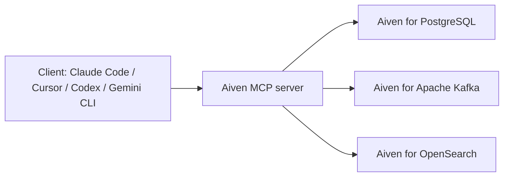

**TL;DR:** The Aiven MCP server lets a coding agent create and manage Aiven for PostgreSQL, Apache Kafka and OpenSearch services, and run bounded read-only SQL. This page leads with what it can do and three prompts to try, then covers client setup for Claude Code, Cursor, Codex and Gemini CLI. The baseline this page is meant to improve is a 1.97% landing-to-signup rate and 1 first request in 20.

## What it can do

Start with the prompts, because that is what decides whether anyone installs it.

| Task | Example prompt | Service |
|---|---|---|
| Create | "Create a PostgreSQL service called app-db in do-nyc" | Aiven for PostgreSQL |
| Inspect | "List the topics on my Kafka service" | Aiven for Apache Kafka |
| Check | "Is my OpenSearch service running, and which plan is it on?" | Aiven for OpenSearch |
| Query | "Run SELECT count(*) FROM orders, read-only" | Aiven for PostgreSQL |

The tool names behind these prompts are not listed here because they change; ask your client to enumerate the server's tools [TO VERIFY].

## What it does not do

It is a provisioning and management server with bounded read-only SQL. It is not a general data-access MCP server. It will not replace your app's database driver, run your migrations or stream data from Kafka into your code. If you need an MCP server that does arbitrary queries, compare options in [Best MCP servers for PostgreSQL in 2026](/best-mcp-servers-for-postgresql-in-2026.html).



## Try it now: three prompts

Paste these one at a time into any connected client.

```text
1. List my Aiven services with their type, plan, cloud and state.
2. Create an Aiven for PostgreSQL service named demo-db in do-nyc on the
   cheapest plan. Tell me the plan before you create it.
3. On demo-db, run a read-only query that returns current_database() and
   the number of tables in the public schema.
```

The second prompt creates something that can cost money after any free allowance. Make the agent state the plan first, and delete the service when you are done.

## Client setup

Each client has its own file. Endpoint and auth are placeholders [TO VERIFY].

```bash
# Claude Code
export AIVEN_TOKEN="$(fnox get AIVEN_TOKEN)"   # or your secret manager
claude mcp add --transport http aiven <aiven-mcp-endpoint> \
  --header "Authorization: Bearer $AIVEN_TOKEN"
```

```json
{
  "mcpServers": {
    "aiven": {
      "url": "<aiven-mcp-endpoint>",
      "headers": { "Authorization": "Bearer ${env:AIVEN_TOKEN}" }
    }
  }
}
```

Use the JSON shape for Cursor (`.cursor/mcp.json`) and, with `httpUrl` in place of `url`, for Gemini CLI's `settings.json` [TO VERIFY]. For Codex:

```toml
[mcp_servers.aiven]
url = "<aiven-mcp-endpoint>"
bearer_token_env_var = "AIVEN_TOKEN"   # [TO VERIFY]
```

## After install: sign up and permissions

The server acts on your Aiven project, so you need an account and a token. For solo users this is where first requests tend to stall: the person who signs up is the admin, but a teammate on a shared project may not have rights to create services. Check this before prompt 2. The tracker's measure for this page, a first-request rate of 1 in 20, suggests most installs never reach a first call, so keep the sequence short: sign up, create a token, add the server, run prompt 1.

To go from there to an app, follow [create, connect and query Postgres](/aiven-mcp-for-postgresql-create-connect-query.html).

## What to verify

- [ ] The MCP endpoint and auth scheme against current Aiven docs.
- [ ] Each client's config key names (Cursor, Codex, Gemini CLI marked [TO VERIFY]).
- [ ] Prompt 1 returns your services and not an auth error.
- [ ] You hold admin rights, or a role allowed to create services, on the project.
- [ ] SQL run through the server is read-only, and your token is not in any committed file.
- [ ] The 1.97% and 1-in-20 baselines are re-measured before and after any page change.
