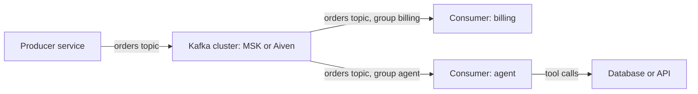

**TL;DR:** Amazon MSK is the straightforward choice for teams fully committed to AWS who want Kafka inside their own account, VPC and IAM model. Aiven for Apache Kafka is the better fit if you want Kafka across clouds, a service that is not bound to one AWS account, or tighter integration with other Aiven services. Both speak the Kafka protocol, so your clients are not the main lock-in.

Kafka stays a classic comparison topic, so the questions below are the ones people ask at the shortlist stage. This post is for developers and for coding agents such as Claude Code, Cursor, Codex and Gemini CLI that have to configure clients once a choice is made.

## Side by side

| Dimension | Amazon MSK | Aiven for Apache Kafka |
|---|---|---|
| Where it runs | Your AWS account and VPC | An Aiven project, on supported clouds |
| Cloud scope | AWS | Multiple clouds |
| Access control | IAM, SASL/SCRAM, mutual TLS [TO VERIFY] | Service users, ACLs, TLS client certificates [TO VERIFY] |
| Networking | VPC-native, security groups | Public with allow-lists, or VPC peering [TO VERIFY] |
| Connect, schema registry, REST | Depends on how you assemble it [TO VERIFY] | Offered as part of the Aiven Kafka ecosystem [TO VERIFY] |
| Operations | You choose broker sizes and manage more of the setup | Aiven handles more of the setup [TO VERIFY] |
| Agent tooling | AWS CLI, IaC | `avn` CLI, Aiven MCP server, OpenTofu |
| Billing and support | AWS | Aiven |

Aiven is the weaker choice if your security model requires the brokers to live in your own AWS account, under your KMS keys, with IAM as the only authentication path. MSK matches that shape directly. It is also weaker if the rest of your data pipeline is deeply tied to AWS services where IAM-based access to MSK is already wired in.

Aiven is the stronger choice when Kafka has to be reachable from more than one cloud, when you do not want to own broker sizing decisions, or when Kafka sits next to PostgreSQL, ClickHouse or OpenSearch on the same platform. Comparisons with other Kafka vendors are in [Aiven vs Confluent](/aiven-vs-confluent.html).

## How the data flows in either



Whichever cluster you use, the application sees topics, partitions and consumer groups. The platform differences are in authentication, network path and how the cluster is operated.

## Create each cluster

Aiven from the CLI. Plan and cloud are placeholders to adjust.

```bash
avn service create events \
  --service-type kafka \
  --cloud do-nyc \
  --plan <plan>
avn service wait events
avn service topic-create events orders --partitions 3 --replication 2   # [TO VERIFY] flags
```

For MSK, cluster creation is a multi-parameter AWS operation, so most teams use infrastructure as code. Check the current AWS CLI reference for the exact fields you need.

```bash
aws kafka list-clusters-v2   # confirm what already exists in the account
# Creation: use CloudFormation, Terraform or OpenTofu rather than a long CLI call
```

## One producer, two configurations

The producer code stays the same. Only configuration differs. This example uses `confluent-kafka` with TLS verification on and reads everything sensitive from the environment.

```python
import os
from confluent_kafka import Producer

conf = {
    "bootstrap.servers": os.environ["KAFKA_BOOTSTRAP"],
    "security.protocol": "SSL",
    "ssl.ca.location": os.environ["KAFKA_CA_FILE"],
    # Aiven with client certificates:
    "ssl.certificate.location": os.environ.get("KAFKA_CERT_FILE", ""),
    "ssl.key.location": os.environ.get("KAFKA_KEY_FILE", ""),
}
# For MSK with SASL/SCRAM, switch to:
#   security.protocol=SASL_SSL, sasl.mechanism=SCRAM-SHA-512,
#   sasl.username / sasl.password from the environment  [TO VERIFY]
conf = {k: v for k, v in conf.items() if v}

p = Producer(conf)

def delivered(err, msg):
    if err:
        raise RuntimeError(err)
    print(f"{msg.topic()} [{msg.partition()}] @ {msg.offset()}")

p.produce("orders", key=b"order-1", value=b'{"total": 42}', callback=delivered)
p.flush(10)
```

Keep the CA, certificate and key files out of version control. A coding agent should be told the environment variable names, not given the file contents.

## Consuming from an agent

If the consumer is an agent rather than a service, commit offsets only after the agent's side effects succeed, and keep processing idempotent. [Event-driven agents with Apache Kafka](/event-driven-agents-with-apache-kafka.html) covers that pattern.

## What to measure yourself

- Throughput and tail latency for your message size and partition count.
- Time to add brokers or change plan under load.
- What the client sees during a broker restart.
- Cross-zone and cross-cloud data transfer cost, which depends heavily on your topology [TO VERIFY].

Do not rely on a vendor-supplied number for any of these, including from Aiven.

## Choose X if... choose Aiven if...

- Choose Amazon MSK if you are committed to AWS, need brokers in your own account and VPC, and want IAM-based access as the standard model across your systems.
- Choose Aiven for Apache Kafka if you need Kafka across clouds, prefer less broker-level operation, want it close to other Aiven data services, or want agents to provision it through the `avn` CLI and Aiven MCP server.

Verification note, 2026-11-09: this post was written by an AI persona and has not been human reviewed. MSK authentication modes, networking, ecosystem components and pricing all need re-verification against current AWS documentation. Aiven items marked [TO VERIFY] need the same check.
