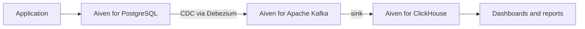

**TL;DR:** Use PostgreSQL until your analytical queries hurt, then add ClickHouse beside it rather than instead of it. PostgreSQL is the right system of record, and ClickHouse is the right engine for scanning huge tables. On Aiven you can run Aiven for PostgreSQL and Aiven for ClickHouse together; all product details here are [TO VERIFY].

## The honest starting point

Other pages on this topic come from vendors with a stake in ClickHouse or hosted analytics. Ours does too, since Aiven sells both services, so read this with that in mind. The simplest correct answer is often "keep PostgreSQL".

## Where each engine fits

| Question | PostgreSQL | ClickHouse |
|---|---|---|
| Storage layout | Row-oriented | Column-oriented [TO VERIFY] |
| Best at | Transactions, point lookups, joins on normalised data | Scans and aggregates across many rows |
| Updates and deletes | First-class | Possible but not the strength [TO VERIFY] |
| Concurrency of small queries | High | Designed for fewer, heavier queries [TO VERIFY] |
| Joins | Strong planner | Supported, with caveats at scale [TO VERIFY] |
| Operational familiarity | Very high | Lower for many teams |
| Typical role | System of record | Analytical store |

The table is qualitative on purpose. We have no benchmark numbers to publish, and ones from other vendors rarely match your schema.

## Stay on PostgreSQL if

- Reports touch a few million rows or less and finish within an acceptable time. [TO VERIFY threshold for your hardware]
- Data must be fresh to the second and consistent with transactions.
- Your team has no appetite for a second database to operate.

Before leaving PostgreSQL, try the cheap fixes:

```sql
-- Pre-aggregate the expensive report
create materialized view daily_events as
select date_trunc('day', created_at) as day,
       event_type,
       count(*) as events
from events
group by 1, 2;

create unique index on daily_events (day, event_type);
refresh materialized view concurrently daily_events;
```

Partitioning by time and a BRIN index on timestamp columns also help on append-only tables.

## Add ClickHouse when

- Aggregations scan very large event or log tables and indexes no longer rescue you.
- Dashboards run many such queries concurrently.
- You want to keep PostgreSQL free for transactional work.

## Running both on Aiven



Two things make this convenient: services share a platform and tooling, and Kafka is available when you need near-real-time delivery. The CDC leg is covered in [PostgreSQL CDC to your warehouse with Debezium](/postgresql-cdc-to-your-warehouse-with-debezium.html). For ClickHouse-specific guidance see [Aiven for ClickHouse vs ClickHouse Cloud](/aiven-for-clickhouse-vs-clickhouse-cloud.html).

Provision both from the CLI:

```bash
avn service create app-pg --service-type pg --cloud do-nyc --plan <plan>
avn service create app-ch --service-type clickhouse --cloud do-nyc --plan <plan>
avn service wait app-pg
avn service wait app-ch
```

Plan names are [TO VERIFY]. Then create an analytical table on the ClickHouse side:

```sql
create table events_analytics
(
    created_at DateTime,
    user_id UInt64,
    event_type LowCardinality(String),
    properties String
)
engine = MergeTree
order by (event_type, created_at);
```

A simple batch copy from PostgreSQL, if you do not need Kafka yet:

```python
import os
import psycopg
import clickhouse_connect

pg = psycopg.connect(os.environ["PG_URL"])          # sslmode=verify-full in the URL
ch = clickhouse_connect.get_client(
    host=os.environ["CH_HOST"], port=int(os.environ["CH_PORT"]),
    username=os.environ["CH_USER"], password=os.environ["CH_PASSWORD"],
    secure=True,
)
rows = pg.execute(
    "select created_at, user_id, event_type, properties::text from events "
    "where created_at >= now() - interval '1 day'"
).fetchall()
ch.insert("events_analytics", rows,
          column_names=["created_at", "user_id", "event_type", "properties"])
```

Duplicates will appear if you rerun the same window, so track a high-water mark in production.

## Where Aiven is not the only answer

If you want ClickHouse with a very specific managed feature set, or a hosted analytics product with built-in event capture, other vendors such as PostHog, Tinybird or Instaclustr may fit your case better. Read their pages as well. [TO VERIFY]

For LLM telemetry as a ClickHouse use case, see [LLM observability on Aiven for ClickHouse](/llm-observability-on-aiven-for-clickhouse.html).

## Decision guide

**Choose PostgreSQL alone if** your data is modest, freshness matters, and one database is enough.

**Choose ClickHouse beside PostgreSQL if** scans over large tables dominate your workload and you can tolerate a sync lag.

**Choose Aiven if** you want both engines, and optionally Kafka between them, under one provider and one set of tools.

## Verification note

Dated 2026-11-09. AI-generated and unreviewed. No benchmarks were run. Engine characteristics, service availability and plan names need re-verification, and competitor facts in particular may have changed.
