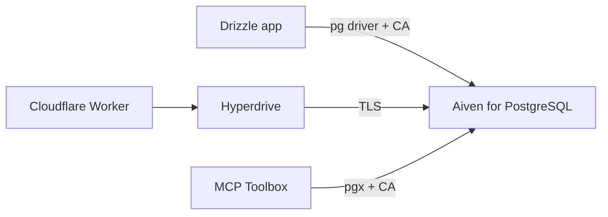

**TL;DR:** Drizzle, Cloudflare Hyperdrive and Google's MCP Toolbox each connect to PostgreSQL, but each wants the TLS settings in a different place. This guide gives one config per tool for Aiven for PostgreSQL using the project CA, plus a check that proves verification is on. Coding agents already read those tools' docs, where other managed Postgres vendors appear and Aiven does not; the upstream submissions are the fix, and this post is the working reference.

## What every tool needs

Three values from the Aiven Console: host, port and the project CA certificate (`ca.pem`). The user is `avnadmin` by default for admin work, but create an application role for real use:

```sql
CREATE ROLE app_rw LOGIN PASSWORD :'app_password';
GRANT CONNECT ON DATABASE defaultdb TO app_rw;
GRANT USAGE ON SCHEMA public TO app_rw;
GRANT SELECT, INSERT, UPDATE, DELETE ON ALL TABLES IN SCHEMA public TO app_rw;
```

Export the URL once. Nothing in this post contains a real credential:

```bash
export DATABASE_URL='postgres://app_rw:<password>@<host>:<port>/defaultdb?sslmode=require'
```



## Drizzle

Drizzle sits on a driver. With `node-postgres` you pass the CA through `ssl`.

```bash
npm install drizzle-orm pg
npm install -D drizzle-kit
```

```typescript
// db.ts
import fs from "node:fs";
import { Pool } from "pg";
import { drizzle } from "drizzle-orm/node-postgres";

const pool = new Pool({
  connectionString: process.env.DATABASE_URL, // remove sslmode from the URL if the driver complains about overriding ssl
  ssl: { ca: fs.readFileSync("./ca.pem", "utf8"), rejectUnauthorized: true },
});

export const db = drizzle(pool);
```

```typescript
// drizzle.config.ts
import { defineConfig } from "drizzle-kit";
import fs from "node:fs";

export default defineConfig({
  dialect: "postgresql",
  schema: "./schema.ts",
  dbCredentials: {
    url: process.env.DATABASE_URL!,
    ssl: { ca: fs.readFileSync("./ca.pem", "utf8") },
  },
});
```

Expected output of `npx drizzle-kit push`: schema changes applied without a TLS error. Config option shapes vary between drizzle-kit versions [TO VERIFY].

## Cloudflare Hyperdrive

Hyperdrive pools connections from Workers to an origin database. Create the config with the CLI:

```bash
npx wrangler hyperdrive create aiven-pg \
  --connection-string="$DATABASE_URL"
```

Expected output: a Hyperdrive config id to place in `wrangler.toml`. For CA handling, Cloudflare documents SSL modes and a CA certificate option; confirm the current flags before relying on them [TO VERIFY].

```toml
# wrangler.toml
name = "aiven-hyperdrive-demo"
main = "src/index.ts"
compatibility_date = "2026-11-01"
compatibility_flags = ["nodejs_compat"]

[[hyperdrive]]
binding = "HYPERDRIVE"
id = "<hyperdrive-config-id>"
```

```typescript
// src/index.ts
import { Client } from "pg";

export default {
  async fetch(_req: Request, env: { HYPERDRIVE: Hyperdrive }) {
    const client = new Client({ connectionString: env.HYPERDRIVE.connectionString });
    await client.connect();
    const { rows } = await client.query("SELECT now() AS ts, ssl_is_used() AS ssl");
    await client.end();
    return Response.json(rows[0]);
  },
};
```

Hyperdrive's origin connection and the Worker-to-Hyperdrive connection are separate hops. Verify the origin hop, which is the one that crosses to Aiven.

## Google MCP Toolbox

MCP Toolbox for Databases reads a `tools.yaml` with sources and tools. Field names are version-dependent [TO VERIFY].

```yaml
sources:
  aiven-pg:
    kind: postgres
    host: <host>
    port: <port>
    database: defaultdb
    user: ${DB_USER}
    password: ${DB_PASSWORD}

tools:
  list-recent-orders:
    kind: postgres-sql
    source: aiven-pg
    description: "Return the 10 most recent orders."
    statement: "SELECT id, status, created_at FROM orders ORDER BY created_at DESC LIMIT 10"
```

Whether this source kind accepts a CA file or an `sslmode` parameter is not something this post can confirm [TO VERIFY]. If it does not, state that in the upstream PR rather than working around it with verification off. Compare with [running a PostgreSQL MCP server on Runtime](/run-a-postgresql-mcp-server-on-aiven-runtime.html) for a read-only role setup.

## Comparison of TLS handling

| Tool | Where the CA goes | Verification mode |
|---|---|---|
| Drizzle (node-postgres) | `ssl.ca` option | `rejectUnauthorized: true` |
| Hyperdrive | Config-time option [TO VERIFY] | Set at config creation [TO VERIFY] |
| MCP Toolbox | Source settings [TO VERIFY] | [TO VERIFY] |

## When this goes wrong

1. **`self-signed certificate in certificate chain`.** The CA is missing or wrong. Re-download `ca.pem` from the project, not from another service.
2. **Drizzle ignores your `ssl` object.** A `sslmode` in the URL can take precedence in some driver versions. Remove it from the URL when you pass `ssl` explicitly.
3. **Worker returns a connection error but `psql` works.** Hyperdrive is using different TLS settings than `psql`. Recreate the config and check the SSL mode.
4. **`permission denied`.** The application role lacks grants on new tables.
5. **Passing locally, failing in CI.** `ca.pem` is not in the CI checkout.

## What to verify

- `ssl_is_used()` returns true from every tool.
- A deliberately wrong CA makes the connection fail. If it still connects, verification is off.
- No password in the repo or in `wrangler.toml`.
