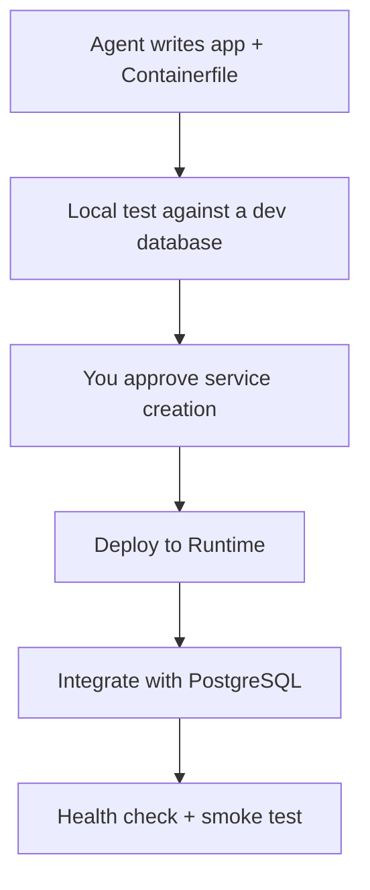

**TL;DR:** This guide walks a coding agent through building a small PostgreSQL-backed web app and deploying it to Aiven Runtime. The database connection comes from a service integration rather than a pasted password. Every step lists the output to expect, and the last section covers failures and rollback.

## The task you give the agent

Paste something like this into Claude Code, Cursor, Codex or Gemini CLI:

```text
Build a small HTTP service in Python that stores and lists notes in PostgreSQL.
Read DATABASE_URL from the environment. Verify TLS with the CA file at ./ca.pem.
Add a /healthz endpoint. Write a Containerfile. Do not create any Aiven
service; stop and tell me the command you want to run instead.
```

The last line matters. Creating a service costs money and is outside code changes, so the agent proposes and you decide. The same rule applies if you hand it the Aiven MCP server: it can provision, so require confirmation.



## Step 1: the app

```python
# app.py
import os
import psycopg
from fastapi import FastAPI

app = FastAPI()

def conn():
    return psycopg.connect(os.environ["DATABASE_URL"], autocommit=True)

@app.on_event("startup")
def init():
    with conn() as c:
        c.execute("CREATE TABLE IF NOT EXISTS notes (id serial PRIMARY KEY, body text NOT NULL)")

@app.get("/healthz")
def healthz():
    with conn() as c:
        c.execute("SELECT 1")
    return {"ok": True}

@app.post("/notes")
def add(body: str):
    with conn() as c:
        row = c.execute("INSERT INTO notes (body) VALUES (%s) RETURNING id", (body,)).fetchone()
    return {"id": row[0]}

@app.get("/notes")
def list_notes():
    with conn() as c:
        return [{"id": i, "body": b} for i, b in c.execute("SELECT id, body FROM notes ORDER BY id DESC LIMIT 50")]
```

Expected: `uv run uvicorn app:app` starts and `/healthz` returns `{"ok":true}` against your dev database.

## Step 2: the container

```dockerfile
FROM python:3.12-slim
WORKDIR /app
RUN pip install --no-cache-dir uv
COPY pyproject.toml uv.lock ./
RUN uv sync --frozen --no-dev
COPY . .
EXPOSE 8080
CMD ["uv", "run", "uvicorn", "app:app", "--host", "0.0.0.0", "--port", "8080"]
```

Expected: `docker build -t notes:1 .` ends without error. Runtime builds from Containerfiles, Dockerfiles and Compose files; which file name it prefers and how it detects an application versus a data service is covered in [Runtime for agents](/runtime-agent-docs-deploy-integrations-prompts.html) [TO VERIFY].

## Step 3: create the database (your approval)

```bash
avn service create notes-db --service-type pg --cloud do-nyc --plan <plan>
avn service wait notes-db
```

Expected: the service reaches `RUNNING`. For a first trial, the free plan id `free-1-5gb` may apply [TO VERIFY].

## Step 4: deploy and integrate

Deploy the repository to Aiven Runtime and add an integration from the application service to `notes-db`. The Console flow is the safest path; a CLI or manifest route may exist [TO VERIFY]. Expected: after the integration, the app's environment contains `DATABASE_URL`, and the app restarts.

## Step 5: smoke test

```bash
curl -s https://<app-host>/healthz
curl -s -X POST "https://<app-host>/notes?body=hello"
curl -s https://<app-host>/notes
```

Expected output: `{"ok":true}`, then `{"id":1}`, then a list with the `hello` note.

## Responsibility split

| Task | Agent | You |
|---|---|---|
| Write and test code | Yes | Review |
| Containerfile | Yes | Review |
| Create database | Propose | Approve and run |
| Integration | Describe | Approve |
| Secrets | Never writes them to files | Confirms none are committed |

## When this goes wrong

1. **Build fails on Runtime but works locally.** Check that the build context includes `uv.lock` and that the right file is detected as the application. See the manifest notes in [Runtime for agents](/runtime-agent-docs-deploy-integrations-prompts.html).
2. **`KeyError: 'DATABASE_URL'` at startup.** The integration is missing or the app started before it applied. Add it and restart.
3. **TLS handshake error.** The server certificate is not trusted by your client. Fix verification with the project CA; do not turn it off.
4. **Health check fails after deploy.** The app listens on a different port than Runtime expects. Confirm the exposed port [TO VERIFY].
5. **Bad release.** Redeploy the previous image tag. If the release changed the schema, make sure the old code still runs against it. Rolling forward with a fix is often safer than a down-migration.

For the networking background on why the integration replaces manual peering and secrets work, read [the plumbing tax](/the-plumbing-tax-before-a-feature-ships.html).

## What to verify

- The app logs show a TLS connection.
- No password appears in `git log -p`.
- The smoke test passes from outside the platform.
