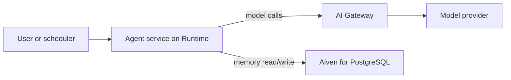

**TL;DR:** This tutorial deploys a small agent to Aiven Runtime. Memory lives in Aiven for PostgreSQL, model calls go through AI Gateway, and every secret arrives as an environment variable. Each step shows the output to expect, and the last section covers what to do when it fails.

## What you are building

An agent service with three parts: the agent loop (Claude Agent SDK or OpenAI Agents SDK), a memory table in PostgreSQL, and a model endpoint behind AI Gateway. The agent runs as an application service on Aiven Runtime, integrated with the database so the connection URI is injected for you.



## Before you start

- An Aiven account and a PostgreSQL service. Create it yourself or have your coding agent propose the command and wait for your approval.
- An AI Gateway base URL and key from your Aiven project [TO VERIFY: where to find them].
- A container image build file in your repo.

## Step 1: create the memory table

```sql
CREATE TABLE IF NOT EXISTS agent_memory (
  id          BIGSERIAL PRIMARY KEY,
  session_id  TEXT NOT NULL,
  role        TEXT NOT NULL CHECK (role IN ('user', 'assistant', 'tool')),
  content     TEXT NOT NULL,
  created_at  TIMESTAMPTZ NOT NULL DEFAULT now()
);
CREATE INDEX IF NOT EXISTS agent_memory_session_idx
  ON agent_memory (session_id, created_at);
```

Expected output: `CREATE TABLE` and `CREATE INDEX`. Run it with `psql "$DATABASE_URL" -f schema.sql`.

## Step 2: write the agent

This sketch keeps the SDK call generic, since SDK method names change between releases [TO VERIFY against the current Claude Agent SDK or OpenAI Agents SDK docs].

```python
import os
import psycopg

DB = os.environ["DATABASE_URL"]
GATEWAY_URL = os.environ["AI_GATEWAY_BASE_URL"]   # <gateway-host> base URL
GATEWAY_KEY = os.environ["AI_GATEWAY_API_KEY"]
MODEL = os.environ.get("AGENT_MODEL", "<model-name>")

def load_history(conn, session_id, limit=20):
    rows = conn.execute(
        "SELECT role, content FROM agent_memory WHERE session_id = %s "
        "ORDER BY created_at DESC LIMIT %s", (session_id, limit)).fetchall()
    return [{"role": r, "content": c} for r, c in reversed(rows)]

def remember(conn, session_id, role, content):
    conn.execute(
        "INSERT INTO agent_memory (session_id, role, content) VALUES (%s, %s, %s)",
        (session_id, role, content))

def run_turn(session_id, user_text, call_model):
    # call_model(messages) wraps your SDK client pointed at GATEWAY_URL
    with psycopg.connect(DB, autocommit=True) as conn:
        history = load_history(conn, session_id)
        remember(conn, session_id, "user", user_text)
        reply = call_model(history + [{"role": "user", "content": user_text}])
        remember(conn, session_id, "assistant", reply)
        return reply
```

Point your SDK client at `GATEWAY_URL` with `GATEWAY_KEY`. Whether the gateway speaks an OpenAI-compatible or Anthropic-compatible protocol for your chosen model needs checking [TO VERIFY]. See [AI Gateway quickstart](/ai-gateway-quickstart-base-url-keys-models.html) for the connection details.

## Step 3: containerize

```dockerfile
FROM python:3.12-slim
WORKDIR /app
COPY pyproject.toml uv.lock ./
RUN pip install uv && uv sync --frozen --no-dev
COPY . .
EXPOSE 8080
CMD ["uv", "run", "python", "-m", "agent.server"]
```

Expected output of `docker build .`: a final `naming to ...` line and no errors. Build locally first so Runtime failures are not your first signal.

## Step 4: deploy and integrate

In the Aiven Console, deploy the app to Runtime and integrate it with the PostgreSQL service [TO VERIFY: current Runtime deploy flow, manifest filename and CLI]. Set `AI_GATEWAY_BASE_URL` and `AI_GATEWAY_API_KEY` as secrets, never in the image.

Expected result: the service shows as running and `DATABASE_URL` is present in its environment.

## Step 5: verify

```bash
curl -s -X POST https://<app-host>/chat \
  -H 'content-type: application/json' \
  -d '{"session_id":"smoke-1","text":"Remember that my project is called Atlas."}'
```

Then check memory landed:

```sql
SELECT role, left(content, 60) FROM agent_memory WHERE session_id = 'smoke-1';
```

Expected: one `user` row and one `assistant` row.

## Design notes

| Choice | Why | Trade-off |
|---|---|---|
| Plain table for memory | Simple, queryable, backed up with the service | No semantic recall; add pgvector later, see [pgvector agent memory and RAG](/pgvector-agent-memory-and-rag-on-managed-postgresql.html) |
| Gateway for models | One place for keys and routing | One more hop to monitor |
| Env vars for secrets | Nothing in the image | You must rotate by redeploying or restarting [TO VERIFY] |

## When this goes wrong

1. **Agent starts then exits.** Check the logs for `KeyError: 'DATABASE_URL'`. The integration is missing; add it and restart.
2. **SSL errors on connect.** Use `sslmode=require`, or `verify-full` with the project CA file. Do not disable verification.
3. **Model calls return 401 or 404.** Recheck the base URL, key and model name against the gateway docs.
4. **Memory grows without bound.** Add a retention job that deletes rows past your chosen window, and summarize older turns.
5. **Duplicate rows after retries.** Add an idempotency key per turn.

## What to verify

- No secrets in the image or repo.
- The agent role can only touch `agent_memory`.
- A restart keeps conversation history.
