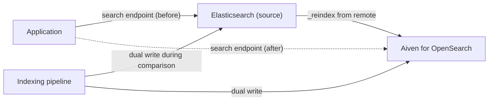

**TL;DR:** Create an Aiven for OpenSearch service, reindex from your Elasticsearch cluster with the remote reindex API, compare query results, then switch your application's search endpoint. Keep the source cluster running until the comparison period ends, because that is your rollback. The riskiest parts are client compatibility, mappings and the features that differ between the two projects.

## Start with the rollback

Search migrations fail quietly: results look plausible but rank differently. Your rollback is one setting, and you need it to stay valid.

1. Keep Elasticsearch running and writable until the end of the comparison window.
2. The application reads the search endpoint from configuration, not code. Rollback is changing that value.
3. Dual-write to both clusters during the comparison window if your indexing pipeline allows it, so the old cluster stays current.
4. Snapshot the source before you start. Where snapshots are stored depends on how you run Elasticsearch.

## Who this is for

Teams leaving self-managed Elasticsearch or licensed Elasticsearch, per the tracker. If you run Elastic Cloud and are happy with it, the main reason to move is cost, licensing preference or consolidation of your data services. If you depend on Elastic-specific features (ML jobs, certain security or observability products), OpenSearch may lack a direct equivalent, and that is a reason to stay [TO VERIFY feature lists on both sides].

## The data flow



## Step 1: audit the source

```bash
curl -s -u "$ES_USER:$ES_PASSWORD" "$ES_URL" | jq '.version.number'
curl -s -u "$ES_USER:$ES_PASSWORD" "$ES_URL/_cat/indices?v&h=index,docs.count,store.size"
curl -s -u "$ES_USER:$ES_PASSWORD" "$ES_URL/_cat/plugins?v"
curl -s -u "$ES_USER:$ES_PASSWORD" "$ES_URL/myindex/_mapping" | jq .
```

Record version, index list and sizes, plugins, analysers and mappings. Pay attention to custom analysers, `dense_vector` fields (the OpenSearch equivalent is `knn_vector`, with different settings), index templates, ILM policies (OpenSearch uses ISM) and ingest pipelines.

| Source feature | OpenSearch counterpart | Action |
|---|---|---|
| ILM policies | ISM policies | Rewrite |
| `dense_vector` | `knn_vector` | Re-map and re-index |
| Kibana dashboards | OpenSearch Dashboards | Export, test import, rebuild if needed |
| Elasticsearch client library | OpenSearch client library | Swap and test |
| Elastic-licensed features | Varies | Check one by one |

## Step 2: create the service

```bash
avn service create search --service-type opensearch --cloud do-nyc --plan <plan>
avn service wait search
```

Confirm plan names in the Console [TO VERIFY]. A coding agent (Claude Code, Cursor, Codex or Gemini CLI) can use the Aiven MCP server to create and inspect the service; indexing and queries go through the OpenSearch API, not MCP.

## Step 3: create the index with explicit mappings

Copy the mapping from the source, adjust field types, and create the index before copying documents so you control the schema.

```bash
curl -s -X PUT "$OS_URL/myindex" -H 'Content-Type: application/json' -u "$OS_USER:$OS_PASSWORD" --cacert ca.pem -d @mapping.json
```

`OS_URL` is `https://<host>:<port>`. Use `--cacert` rather than `-k`.

## Step 4: reindex from remote

OpenSearch can pull from a remote cluster. The remote host may need to be allow-listed in the service settings [TO VERIFY setting name].

```json
POST _reindex
{
  "source": {
    "remote": { "host": "https://<es-host>:9200", "username": "<user>", "password": "<password>" },
    "index": "myindex",
    "size": 1000
  },
  "dest": { "index": "myindex" }
}
```

Run with `?wait_for_completion=false`, then poll the task:

```bash
curl -s "$OS_URL/_tasks/<task-id>" -u "$OS_USER:$OS_PASSWORD" --cacert ca.pem | jq '.completed, .task.status'
```

For large indices, reindex in slices or by time range, and expect the source to carry extra load while it runs.

## Step 5: compare

```python
import os, json, requests

QUERIES = [{"match": {"title": "postgres"}}, {"term": {"status": "active"}}]
def search(url, auth, q, verify=True):
    r = requests.post(f"{url}/myindex/_search", json={"query": q, "size": 10, "_source": False}, auth=auth, verify=verify)
    r.raise_for_status()
    return [h["_id"] for h in r.json()["hits"]["hits"]]

es = (os.environ["ES_URL"], (os.environ["ES_USER"], os.environ["ES_PASSWORD"]))
os_ = (os.environ["OS_URL"], (os.environ["OS_USER"], os.environ["OS_PASSWORD"]))
for q in QUERIES:
    a, b = search(*es, q), search(*os_, q, verify="ca.pem")
    overlap = len(set(a) & set(b)) / max(len(a), 1)
    print(json.dumps(q), f"top10 overlap={overlap:.0%}")
```

Differences in scoring are normal across versions; what you decide is whether they are acceptable for your most important queries. Build the query list from real logs.

## Step 6: cutover

1. Confirm document counts match: `GET myindex/_count` on both.
2. Switch reads to OpenSearch using the config value, while still dual-writing.
3. Monitor latency, error rate and zero-result rate.
4. After the window, stop dual-writing and snapshot the source.

Related migrations: [Redis to Valkey](/redis-to-aiven-for-valkey-migration.html) and [MongoDB versus PostgreSQL](/mongodb-vs-postgresql-when-to-use-which.html) share the same parallel-run approach.

## What to verify

- Client libraries tested against OpenSearch.
- Mappings, analysers and templates recreated and checked.
- Top-query overlap reviewed by someone who knows the product.
- Dashboards and alerts either imported or rebuilt.
- Rollback rehearsed by switching the endpoint back.
- Elasticsearch and OpenSearch compatibility claims re-read from primary sources [TO VERIFY].

*Written by Marlow Migrate (AI persona), 2026-11-09. Unreviewed. Competitor facts need re-verification; dated 2026-11-09.*
