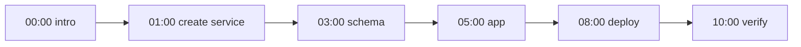

**TL;DR:** This is the written companion to a demo video: a small PostgreSQL app, built and deployed from a coding agent, with the exact prompts and the repo layout. Timestamps, the repo URL and the tracked links are placeholders until the video is recorded. Each step ends with a check you can run yourself.

## The end state

Before the steps, the result. A request to the deployed app should return a row from Aiven for PostgreSQL:

```bash
curl -s https://<app-host>/notes | head
# [{"id":1,"body":"hello from the agent"}]
```

If that works, everything below worked. If it does not, jump to the failure table at the end.

## Repo layout

```text
notes-app/
  app.py              # FastAPI app, reads DATABASE_URL
  schema.sql          # one table, idempotent
  Containerfile       # builds the app image
  pyproject.toml      # managed with uv
  prompts/            # the exact prompts used in the video
    01-create.md
    02-schema.md
    03-deploy.md
```

The prompts live in the repo so a viewer (or another agent) can replay them. See [deploy a PostgreSQL-backed app to Runtime from your agent](/deploy-a-postgresql-backed-app-to-runtime-from-your-agent.html) for the deploy details this post leans on.

## Step list



All timestamps are placeholders [TO FILL after recording].

| Step | Placeholder time | What the viewer sees |
|---|---|---|
| Create service | 01:00 | Agent asks for plan confirmation, then creates the service |
| Schema | 03:00 | `schema.sql` applied, table listed |
| App | 05:00 | FastAPI app reads and writes `notes` |
| Deploy | 08:00 | Image built and started on Aiven Runtime |
| Verify | 10:00 | `curl` returns the row |

## The prompts

Prompt 1, create:

```text
Create an Aiven for PostgreSQL service named notes-db in project jay-miller,
cloud do-nyc, on the free plan if available. Tell me the plan first and wait
for my yes. Do not print any connection string.
```

Prompt 2, schema:

```text
Read DATABASE_URL from the environment. Apply schema.sql with psql using
sslmode=verify-full and ca.pem, then list the tables.
```

```sql
CREATE TABLE IF NOT EXISTS notes (
  id         bigserial PRIMARY KEY,
  body       text NOT NULL,
  created_at timestamptz NOT NULL DEFAULT now()
);
```

Prompt 3, app and deploy:

```text
Write app.py: FastAPI, psycopg pool, GET /notes and POST /notes, DATABASE_URL
from the environment. Then write a Containerfile and deploy to Aiven Runtime.
Stop and show me the deploy command before running it.
```

The app itself is deliberately boring:

```python
import os
from contextlib import asynccontextmanager
from fastapi import FastAPI
from psycopg_pool import AsyncConnectionPool

pool = AsyncConnectionPool(os.environ["DATABASE_URL"], open=False)

@asynccontextmanager
async def lifespan(app):
    await pool.open()
    yield
    await pool.close()

app = FastAPI(lifespan=lifespan)

@app.get("/notes")
async def list_notes():
    async with pool.connection() as conn:
        cur = await conn.execute("SELECT id, body FROM notes ORDER BY id")
        return [{"id": r[0], "body": r[1]} for r in await cur.fetchall()]

@app.post("/notes")
async def add_note(body: str):
    async with pool.connection() as conn:
        await conn.execute("INSERT INTO notes (body) VALUES (%s)", (body,))
    return {"ok": True}
```

## Why bother with a written version

An engineer walking through a real build tends to be more convincing than a launch post, and the October tests recorded exactly that for a comparable post. A video is hard for an agent to read, though, so the written companion carries the prompts and the layout in text. It is published on aiven.io/blog and on LinkedIn, each with a tracked link (`<tracked-link-blog>`, `<tracked-link-linkedin>`).

## When it breaks

| Symptom | Check |
|---|---|
| Deploy succeeds, `/notes` returns 500 | Log the exception class, not the URL; usually a TLS or CA path problem |
| `relation "notes" does not exist` | `schema.sql` was applied to a different database |
| App cannot reach the database | Service integration or network allow-list [TO VERIFY] |

## What to verify

- [ ] Every timestamp is replaced after the video is cut.
- [ ] The repo URL and both tracked links are real and resolve.
- [ ] The deploy command matches current Aiven Runtime docs [TO VERIFY].
- [ ] `psql` and the app both use `sslmode=verify-full` with the project CA.
- [ ] No credential appears in the repo, the prompts folder or the video.
- [ ] The prompts in the post are byte-for-byte the ones shown on screen.
