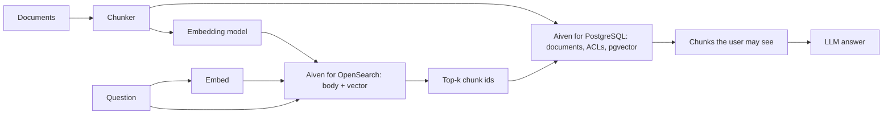

**TL;DR:** This is Part 2 of the AI inference series: a build of hybrid-search RAG where Aiven for OpenSearch retrieves and Aiven for PostgreSQL with pgvector stores documents and metadata. The post claims no results. It ships a harness that measures recall@k and MRR for keyword, vector and hybrid retrieval, so you can publish numbers that are yours.

## The measurement first

The point of "measured" is a table like this, filled by your run:

| Retriever | recall@5 | MRR | p50 latency |
|---|---|---|---|
| keyword only | _run it_ | _run it_ | _run it_ |
| vector only | _run it_ | _run it_ | _run it_ |
| hybrid | _run it_ | _run it_ | _run it_ |

Every cell is empty on purpose. A post that arrives with numbers it cannot back up is worse than one that tells you how to produce them. The tracker's reasoning was that one measured build makes the architecture citable; the measurement has to be real for that to hold.

## Architecture



OpenSearch returns chunk ids. PostgreSQL turns ids into text and applies permissions, which keeps access control in one place. If your corpus is small, drop OpenSearch and query `pgvector` directly as in [pgvector on managed PostgreSQL](/pgvector-agent-memory-and-rag-on-managed-postgresql.html). The OpenSearch half is detailed in [OpenSearch for agents](/opensearch-agent-docs-hybrid-search-rag.html).

## Provision

```bash
avn service create rag-os --service-type opensearch --cloud do-nyc --plan <plan>
avn service create rag-pg --service-type pg --cloud do-nyc --plan <plan>
avn service wait rag-os && avn service wait rag-pg
```

Pick plans from the Console. Export `OPENSEARCH_URL` and `DATABASE_URL`, and keep both out of logs.

## Schema in PostgreSQL

```sql
CREATE EXTENSION IF NOT EXISTS vector;

CREATE TABLE chunks (
  chunk_id  text PRIMARY KEY,
  doc_id    text NOT NULL,
  body      text NOT NULL,
  acl       text[] NOT NULL DEFAULT '{}',
  embedding vector(384)          -- match your model
);
CREATE INDEX ON chunks USING hnsw (embedding vector_cosine_ops);
```

## The harness

```python
import os, time, json
import psycopg
from opensearchpy import OpenSearch

os_client = OpenSearch(os.environ["OPENSEARCH_URL"], ca_certs="ca.pem", verify_certs=True)

def keyword(q, k):
    r = os_client.search(index="chunks", body={"size": k, "query": {"match": {"body": q}}})
    return [h["_id"] for h in r["hits"]["hits"]]

def hybrid(q, qvec, k):
    body = {"size": k, "query": {"hybrid": {"queries": [
        {"match": {"body": q}},
        {"knn": {"embedding": {"vector": qvec, "k": 20}}}]}}}
    r = os_client.search(index="chunks", body=body,
                         params={"search_pipeline": "hybrid-pipeline"})
    return [h["_id"] for h in r["hits"]["hits"]]

def vector(qvec, k):
    with psycopg.connect(os.environ["DATABASE_URL"]) as c:
        rows = c.execute(
            "SELECT chunk_id FROM chunks ORDER BY embedding <=> %s::vector LIMIT %s",
            (str(qvec), k)).fetchall()
    return [r[0] for r in rows]

def score(retrieve, cases, k=5):
    hits, rr, lat = 0, 0.0, []
    for case in cases:
        t = time.perf_counter()
        ids = retrieve(case)
        lat.append(time.perf_counter() - t)
        if case["gold"] in ids[:k]:
            hits += 1
            rr += 1.0 / (ids.index(case["gold"]) + 1)
    n = len(cases)
    lat.sort()
    return {"recall@k": hits / n, "mrr": rr / n, "p50_s": lat[n // 2]}
```

`cases` is a list of `{"q": ..., "gold": "<chunk_id>"}` you write by hand from your own documents. Fifty good cases beat five hundred auto-generated ones, though I have no evidence for a specific sample size and you should choose one you can defend.

## Controls that keep it honest

- Same chunks, same embedding model and same `k` for all three retrievers.
- Warm the cache with a throwaway pass before timing.
- Record service plan, OpenSearch version and pgvector version next to the results [TO VERIFY each from the Console].
- Report failures, including queries where keyword search beats hybrid. They exist.

## Where this is the wrong build

If one PostgreSQL database holds your documents and the corpus is modest, the two-service build is more machinery than you need. OpenSearch earns its place when keyword relevance and analyzers matter. Whether Aiven appears in other vendors' vector database roundups is a separate matter; competitor lists change, so re-check them before citing [TO VERIFY, dated 2026-11-09].

## What to verify

- [ ] Index dimension, column dimension and embedding model output all match.
- [ ] The hybrid search pipeline exists before the first hybrid query.
- [ ] The gold set was written before looking at retriever output.
- [ ] Results table filled from your run, with versions and plans recorded.
- [ ] TLS verification on for both services; no credentials in the repo.
- [ ] Any published number links to the harness commit that produced it.
