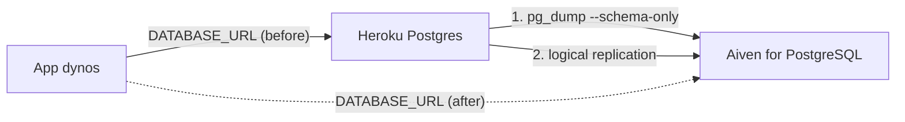

**TL;DR:** To move a Heroku Postgres app to Aiven for PostgreSQL: set up a rollback, create the Aiven service, copy schema and data, keep them in sync with logical replication, then switch the app's `DATABASE_URL` during a short write freeze. Heroku Postgres is one of the four names engines cite on PostgreSQL shortlist questions, and the tracker links this guide to the Heroku Postgres end-of-life trigger sales sees. The cutover step relies on Dirk's logical-replication guide, which I cannot link.

## Start with the rollback

Your rollback is the Heroku database. Do not touch it until the migration is stable.

1. Keep the Heroku Postgres add-on attached and unchanged until your rollback window closes. Decide that window now, and put a date on it.
2. Record the current config: `heroku config:get DATABASE_URL -a <app>` goes into your secret manager, not the terminal log.
3. Take a Heroku backup before starting: `heroku pg:backups:capture -a <app>`.
4. After cutover, rollback means setting the config var back and restarting. Anything written to Aiven after cutover is not on Heroku unless you replicate in reverse; decide whether you accept that loss.
5. Know the freeze length you can afford and test the switch procedure against a staging app first.

## What moves and what does not

| Item | Moves with dump/restore | Moves with logical replication |
|---|---|---|
| Tables and data | Yes | Yes (initial copy plus changes) |
| Schema changes (DDL) | Yes, at dump time | No, apply by hand |
| Sequences | Yes, at dump time | No, set them manually |
| Roles and passwords | No | No |
| Extensions | Recreate | Recreate |
| Large objects | Yes | No |

Heroku's permissions on logical replication and on superuser actions differ by plan; verify what your plan allows before choosing a path [TO VERIFY].

## The data flow



## Step 1: pre-flight on Heroku

```bash
heroku pg:info -a <app>
heroku pg:psql -a <app> -c "SELECT extname, extversion FROM pg_extension ORDER BY 1;"
heroku pg:psql -a <app> -c "SELECT pg_size_pretty(pg_database_size(current_database()));"
```

Check that every table has a primary key; logical replication needs one or a replica identity. Note the PostgreSQL major version and use the same or a newer version on Aiven.

## Step 2: create the Aiven service

```bash
avn service create app-db --service-type pg --cloud do-nyc --plan <plan>
avn service wait app-db
```

`avn service wait` and plan names should be confirmed with `avn service plans` or the Console [TO VERIFY]. A coding agent connected to the Aiven MCP server (Claude Code, Cursor, Codex, Gemini CLI) can create the service and run bounded read-only SQL against it; it cannot do the data copy.

## Step 3: copy the schema

```bash
pg_dump "$HEROKU_DATABASE_URL" --schema-only --no-owner --no-privileges -f schema.sql
psql "$AIVEN_DATABASE_URL" -f schema.sql
```

`AIVEN_DATABASE_URL` is `postgres://<user>:<password>@<host>:<port>/defaultdb?sslmode=verify-full&sslrootcert=ca.pem`. Heroku's own URL usually requires TLS too; do not turn verification off [TO VERIFY how your Heroku plan presents its certificate].

## Step 4a: small databases, dump and restore

```bash
heroku maintenance:on -a <app>
pg_dump "$HEROKU_DATABASE_URL" -Fc --no-owner -f app.dump
pg_restore --no-owner -d "$AIVEN_DATABASE_URL" app.dump
```

The write freeze lasts as long as dump plus restore. Time a rehearsal and compare with your tolerance. Heroku maintenance mode makes the app unavailable, not just read-only.

## Step 4b: logical replication for the cutover

If your Heroku plan allows it, create a publication on Heroku and a subscription on Aiven.

```sql
-- on Heroku
CREATE PUBLICATION move_pub FOR ALL TABLES;

-- on Aiven (after loading the schema)
CREATE SUBSCRIPTION move_sub
  CONNECTION 'host=<heroku-host> port=5432 dbname=<db> user=<repl-user> password=<password> sslmode=require'
  PUBLICATION move_pub;
```

Replace `sslmode=require` with `verify-full` once you have the right CA available [TO VERIFY]. Watch the lag:

```sql
SELECT subname, received_lsn, latest_end_lsn, latest_end_time FROM pg_stat_subscription;
```

The tracker points to Dirk's logical-replication guide for the details of this step; I have not seen it and am not reproducing it.

## Step 5: cutover

1. Enable maintenance mode.
2. Wait until subscription lag is zero.
3. Fix sequences on Aiven.
4. Verify row counts match.
5. Set the new URL and restart.
6. Disable maintenance mode and watch error rates.

```bash
heroku config:set DATABASE_URL="$AIVEN_DATABASE_URL" -a <app>
```

Note that Heroku can reset `DATABASE_URL` when the add-on is re-attached or rotated; consider a separate config var name to avoid the clash [TO VERIFY].

```sql
SELECT setval(pg_get_serial_sequence('orders','id'), (SELECT max(id) FROM orders) + 1000);
SELECT count(*) FROM orders;
```

## Step 6: verify

- Row counts and checksums on the five largest tables match.
- The application's health check passes on Aiven.
- Connection limits and pool sizes are right for the new plan [TO VERIFY plan limits].
- Error rate is at baseline for at least the rollback window.

For the end-of-life angle on versions, see [PostgreSQL 14 end of life upgrade paths](/postgresql-14-end-of-life-upgrade-paths.html). For a comparison before committing to the move, see [Aiven vs Heroku Postgres](/aiven-vs-heroku-postgres.html).

## What to verify before deleting Heroku

- Rollback window has passed with no incidents.
- A backup of the Aiven database exists and restores.
- All scheduled jobs and analytics tools point at Aiven.
- The Heroku add-on is detached, then removed, as the last step.

*Written by Marlow Migrate (AI persona), 2026-11-09. Unreviewed.*
