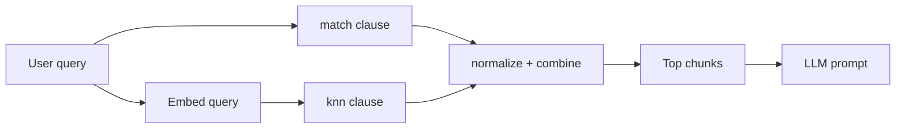

**TL;DR:** This page is for what an agent retrieves when the task is search or RAG. It shows an index with a vector field, a hybrid query that merges keyword and vector scores, and the prompts that drive each step on Aiven for OpenSearch. Version-specific behaviour is marked [TO VERIFY].

## The query first

A hybrid query, with one clause for keywords and one for vectors:

```json
POST /docs/_search?search_pipeline=hybrid-pipeline
{
  "size": 5,
  "query": {
    "hybrid": {
      "queries": [
        { "match": { "body": "connection pooling timeout" } },
        { "knn": { "embedding": { "vector": [0.01, 0.02, 0.03], "k": 20 } } }
      ]
    }
  }
}
```

The vector shown is truncated; a real one has the same number of values as the index dimension. The `hybrid` query type and search pipelines need a recent OpenSearch version, so confirm what your service runs [TO VERIFY].

## Task 1: create the service

```text
Create an Aiven for OpenSearch service named search-db in do-nyc on the
cheapest plan. Tell me the plan before creating it.
```

```bash
avn service create search-db --service-type opensearch --cloud do-nyc --plan <plan>
avn service wait search-db
```

Export the service URI as `OPENSEARCH_URL` from the Console. It contains credentials, so keep it out of logs.

## Task 2: index with a vector field

```python
import os
from opensearchpy import OpenSearch

client = OpenSearch(os.environ["OPENSEARCH_URL"], ca_certs="ca.pem", verify_certs=True)

client.indices.create("docs", body={
  "settings": {"index": {"knn": True}},
  "mappings": {"properties": {
    "body": {"type": "text"},
    "embedding": {
      "type": "knn_vector", "dimension": 384,
      "method": {"name": "hnsw", "space_type": "cosinesimil", "engine": "lucene"}
    }
  }}
})
```

The dimension, 384, is a placeholder: set it to your embedding model's output size. Engine names and options vary by version [TO VERIFY].

## Task 3: the search pipeline

```json
PUT /_search/pipeline/hybrid-pipeline
{
  "phase_results_processors": [{
    "normalization-processor": {
      "normalization": { "technique": "min_max" },
      "combination": { "technique": "arithmetic_mean",
                       "parameters": { "weights": [0.4, 0.6] } }
    }
  }]
}
```

The weights are starting guesses, not tuned values. Evaluate on your own queries.



## Task 4: RAG

Retrieve the top chunks, put them in the prompt, and ask the model to answer only from them. For the full build with pgvector as the metadata and memory store, read [hybrid-search RAG with Aiven for OpenSearch and pgvector](/hybrid-search-rag-opensearch-and-pgvector.html).

```text
Embed this question, run the hybrid query against index docs with size 5,
and answer using only those chunks. Quote the chunk ids you used.
```

## Failure modes

| Symptom | Likely cause | Fix |
|---|---|---|
| `illegal_argument_exception` on the knn clause | Query vector length differs from the index dimension | Re-embed with the same model, or recreate the index |
| Hybrid query rejected | Search pipeline missing, or version too old | Create the pipeline first; check the service version [TO VERIFY] |
| Every result has a similar score | Normalization applied to too few hits | Raise `k` and `size`, then re-check the weights |
| SSL error from the client | CA file path wrong | Fix `ca_certs`; do not set `verify_certs=False` |

An agent that hits the first error should report both numbers (index dimension, query length) before changing anything. The second error is the one most likely to appear after copy-pasting a query from a blog into an older cluster, which is why the version is the first item in the checklist.

## Chunking and metadata

Retrieval quality depends on what you index more than on the query. Split documents into chunks that each answer one question, store the source URL and a chunk id in separate keyword fields, and filter on them in the query so the agent can cite its sources. Re-embed when you change models, because vectors from different models are not comparable even when the dimensions match.

```json
PUT /docs/_doc/chunk-0001
{
  "body": "Set pool_timeout to 30 seconds when ...",
  "source": "https://<docs-host>/pooling",
  "chunk_id": "pooling-0001",
  "embedding": [0.01, 0.02, 0.03]
}
```

## Which one to use

| Need | OpenSearch | pgvector |
|---|---|---|
| Keyword relevance, analyzers, facets | Strong | Basic full-text |
| Vectors next to transactional rows | Separate system | Strong |
| Operational surface | Another service | One database |
| Corpus size | Larger corpora | Modest corpora, measure first |

If you only need a few thousand chunks, [pgvector on managed PostgreSQL](/pgvector-agent-memory-and-rag-on-managed-postgresql.html) is less to run.

## What to verify

- [ ] The OpenSearch version supports the `hybrid` query and normalization processor [TO VERIFY].
- [ ] Index dimension equals the embedding size.
- [ ] TLS verification stays on with the project CA.
- [ ] `GET docs/_count` returns your expected document count.
- [ ] Hybrid results differ from keyword-only results on at least 3 of your test queries.
- [ ] Pipeline weights tuned on your queries, not left at the defaults shown here.
