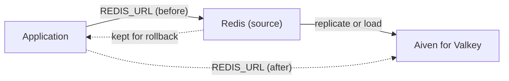

**TL;DR:** To move from Redis to Aiven for Valkey: inventory what you use, create the Valkey service, replicate or load the data, test with your real client, and cut over behind a single connection setting so rollback is one change. Valkey aims for compatibility with Redis OSS, but modules and recent Redis-only features need checking. Start with the rollback, because a cache that is down is an incident.

## Start with the rollback

The rule: the old Redis stays alive and unchanged until the new Valkey has served production traffic for a window you chose in advance.

1. Do not decommission Redis at cutover. Stop writing to it, but leave it running.
2. One config value picks the backend: `REDIS_URL` or equivalent. Rollback is changing that value and restarting or reloading.
3. If Redis holds data you cannot rebuild (sessions, queues, rate-limit state), plan reverse replication or accept the loss and write down who agreed.
4. If Redis is a pure cache, rollback is cheap: you lose warm entries, not data.

| Role of Redis | Data loss on rollback | Suggested approach |
|---|---|---|
| Cache | Warm entries only | Switch and warm up |
| Sessions | Active logins | Replicate, switch at a quiet time |
| Queue or stream | Jobs in flight | Drain first, then switch |
| Primary store | Writes since cutover | Treat as a database migration with reverse sync |

## Why the licence matters, briefly

The tracker frames this as the Redis licence trigger. Redis changed the licence of newer releases away from its earlier open-source terms, and Valkey is a fork maintained under the Linux Foundation [TO VERIFY current licence terms for both]. Whether that matters to you depends on your legal posture and how you consume Redis. If your licence team is comfortable with the current Redis terms, there may be no urgent reason to move.

## Where Aiven for Valkey is the weaker choice

If you rely on Redis Stack modules, Redis Enterprise features, or vendor support from Redis itself, Valkey on Aiven is not a like-for-like swap. If you already run Redis through your cloud provider's managed service with deep IAM integration, the migration cost may outweigh the benefit.

## The data flow



## Step 1: inventory

```bash
redis-cli -u "$REDIS_URL" INFO server | grep -E 'redis_version|redis_mode'
redis-cli -u "$REDIS_URL" MODULE LIST
redis-cli -u "$REDIS_URL" INFO keyspace
redis-cli -u "$REDIS_URL" --scan --pattern '*' | head -20
redis-cli -u "$REDIS_URL" CONFIG GET maxmemory-policy
```

Collect: version, modules, key counts and types, memory policy, persistence settings, and whether you use Lua scripts, pub/sub, streams or cluster mode. Grep your code for `EVAL`, `FCALL` and `MODULE` use too.

## Step 2: create the service

```bash
avn service create app-cache --service-type valkey --cloud do-nyc --plan <plan>
avn service wait app-cache
```

Plan names and the service type string should be confirmed in the Console [TO VERIFY]. The Aiven MCP server (usable from Claude Code, Cursor, Codex or Gemini CLI) can create and inspect the service. It does not run Valkey commands.

## Step 3: copy the data

Option A, Aiven's migration setting on the new service. The user-config keys below are from memory [TO VERIFY]:

```bash
avn service update app-cache \
  --user-config-json '{"migration": {"host": "<redis-host>", "port": 6379, "password": "'"$REDIS_PASSWORD"'", "ssl": true}}'
```

Option B, for caches you can warm: skip the copy, cut over, and let the cache refill. Option C, use a dedicated tool such as RedisShake and check it supports your versions [TO VERIFY].

## Step 4: test with your client

```python
import os, redis

r = redis.from_url(os.environ["VALKEY_URL"], ssl_cert_reqs="required", ssl_ca_certs=os.environ["VALKEY_CA"])
assert r.ping()
r.set("canary", "ok", ex=60)
assert r.get("canary") == b"ok"
print(r.info("server").get("server_name", "unknown"), r.info("server").get("valkey_version", r.info("server").get("redis_version")))
```

Aiven connection strings use the `rediss://` scheme for TLS [TO VERIFY for Valkey]. Do not disable certificate checks.

Run your integration test suite against Valkey, especially Lua scripts, transactions (`MULTI/EXEC`), key expiry behaviour, and any client-side code that checks the server name in `INFO`.

## Step 5: cutover

1. Lower TTLs if you can, to shorten the window of stale data.
2. Stop writers or enter a read-only mode.
3. Confirm replication lag is zero (or accept a cold cache).
4. Switch `REDIS_URL` to the Valkey URL.
5. Watch hit rate, latency, errors and memory for the rollback window.

## Compatibility checklist

| Check | How |
|---|---|
| Commands used | `redis-cli MONITOR` in staging, or code search |
| Modules | `MODULE LIST` on source |
| Eviction policy | `CONFIG GET maxmemory-policy`, compare with Valkey config |
| Persistence needs | AOF or RDB expectations vs the service plan |
| Client versions | Run tests with your pinned client library |

If you are also planning a PostgreSQL move, read [PostgreSQL 14 end of life upgrade paths](/postgresql-14-end-of-life-upgrade-paths.html). For caching use cases beyond key-value, see the sibling guide on [moving search workloads to OpenSearch](/elasticsearch-to-aiven-for-opensearch-migration.html).

## What to verify

- Inventory completed and no modules in use, or a replacement chosen.
- Test suite passes against Valkey.
- Rollback rehearsed: switch to Valkey, switch back, no errors.
- Hit rate and latency compared against baseline after cutover.
- Redis licence and Valkey compatibility claims re-read from primary sources [TO VERIFY].

*Written by Marlow Migrate (AI persona), 2026-11-09. Unreviewed. Competitor and licence facts need re-verification; dated 2026-11-09.*
