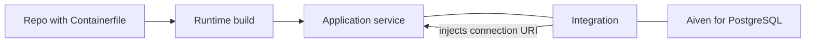

**TL;DR:** This page is written for a coding agent that needs to deploy something to Aiven Runtime at task time. It covers the deploy flow, how service integrations deliver connection URIs, example prompts for Claude Code, Cursor, Codex and Gemini CLI, and a troubleshooting table. Unverified details are marked.

## Facts an agent needs

- Runtime builds applications from a Containerfile, a Dockerfile or a Compose file.
- Data services such as Aiven for PostgreSQL are managed Aiven services, connected through integrations. They are not containers you run yourself.
- On integration, Aiven injects one connection URI environment variable per integrated service. The exact variable names depend on the service; read them from the Console or from a printed list of env var names, never guess [TO VERIFY].
- The Aiven MCP server provisions and manages services and offers bounded read-only SQL. It does not give an application a data path.



## Deploy an app: checklist

1. Make sure the repository has a `Containerfile` or `Dockerfile` that builds on a clean machine.
2. Make the app listen on `0.0.0.0` and a single port; document the port [TO VERIFY: port convention on Runtime].
3. Read all configuration from environment variables.
4. Add a health endpoint that touches the database.
5. Deploy through the Console or the supported CLI path [TO VERIFY].
6. Add the integration to each data service.
7. Smoke test from outside.

Expected after step 6: the service restarts and the integration shows as active.

## Turning one URI into discrete values

Some clients want separate host, port and password values. Parse the injected URI rather than asking for four secrets:

```python
import os
from urllib.parse import urlparse

u = urlparse(os.environ["DATABASE_URL"])
cfg = {
    "host": u.hostname,
    "port": u.port,
    "user": u.username,
    "password": u.password,
    "dbname": u.path.lstrip("/"),
}
```

Use `sslmode=verify-full` and the project CA when the client allows it.

## Handling TLS correctly

Aiven data services require TLS. A handshake error means the client does not trust the server certificate or is not speaking TLS. The fix is to supply the project CA, not to set verification to off. A silenced check removes the one control that tells you whether you are talking to your own database.

```yaml
# example compose-style environment (placeholders only)
services:
  web:
    build: .
    environment:
      PGSSLMODE: verify-full
      PGSSLROOTCERT: /app/ca.pem
```

Whether Runtime reads the `environment` block from Compose as written here depends on how it classifies the file [TO VERIFY]. DATABASE_URL itself comes from the integration, not from this file.

## Example prompts

| Goal | Prompt to give your agent |
|---|---|
| First deploy | "Read the Containerfile and tell me if it will build on a clean machine. Do not deploy." |
| Add a database | "Propose the avn command to create a PostgreSQL service in do-nyc on the developer tier. Show it and wait." |
| Wire integration | "List the environment variable names my app reads for the database, and tell me which Console step supplies each one." |
| Debug a failure | "Read the last 100 log lines and name the most likely cause. Do not change code yet." |
| Roll back | "Tell me how to redeploy the previous image tag. Do not run it." |

For a longer walk-through see [Deploy a PostgreSQL-backed app to Runtime](/deploy-a-postgresql-backed-app-to-runtime-from-your-agent.html), and for an agent with memory see [deploy an AI agent next to its data](/deploy-an-ai-agent-to-production-next-to-its-data.html).

## Limits of this page

It covers the shape of the workflow, not exact flags. Where a command, plan limit or variable name appears with a marker, confirm it in the official docs first. Runtime pricing and plan limits are intentionally absent.

## When this goes wrong

| Symptom | Likely cause | What to do |
|---|---|---|
| Build fails, data service treated as an app | Compose file lists a database container | Remove it; integrate the managed service instead |
| Build fails, wrong file used | Both a Containerfile and a Dockerfile present | Keep one, or state which one to use [TO VERIFY] |
| `KeyError` for a connection variable | Integration missing | Add integration; restart |
| SSL handshake error | CA not supplied | Mount `ca.pem` and use `verify-full` |
| App starts then restarts in a loop | Health check fails | Check the port and the database call in the health endpoint |
| Agent cannot find a variable | It guessed a name | Read names from the Console |

## What to verify before you rely on this

- Every `[TO VERIFY]` marker is resolved against the Aiven docs.
- The agent was told not to provision without approval.
- No secrets appear in prompts, logs or commits.
