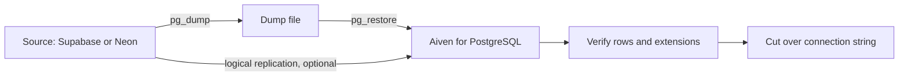

**TL;DR:** People searching for a Supabase alternative or a Neon alternative usually want one of three things: lower cost, more control, or a plain database. Aiven for PostgreSQL fits the second and third and is a poor fit if you depend on Supabase's backend features or Neon's branching. All product facts are [TO VERIFY].

## First, why are you leaving?

The right alternative depends on the reason.

| Reason | What to look for | Is Aiven a fit? |
|---|---|---|
| Need more control over cloud and region | Provider with many clouds | Often yes [TO VERIFY] |
| Outgrowing a platform's database limits | Plan-based sizing | Often yes [TO VERIFY] |
| Want only the database, not a backend bundle | Managed PostgreSQL | Yes |
| Need Kafka, ClickHouse or OpenSearch beside PostgreSQL | One provider for several services | Yes |
| Rely on branching or scale-to-zero | Neon-like features | Probably not |
| Rely on auth, storage and generated APIs | Backend platform | Probably not |

Be honest with yourself about the last two rows. If the main reason you chose a platform was a feature, an alternative has to replace that feature.

## Supabase alternative

What you would replace:

- **Authentication:** bring your own provider.
- **File storage:** use object storage.
- **Generated APIs:** write your own, or use a tool such as PostgREST yourself. [TO VERIFY]
- **Realtime:** use PostgreSQL LISTEN/NOTIFY or Kafka.

What you keep: PostgreSQL, SQL, and most application code that uses a standard driver. For a direct comparison see [Aiven vs Supabase](/aiven-vs-supabase.html).

## Neon alternative

What you would give up: copy-on-write branching per pull request, and scale-to-zero. [TO VERIFY] What you would gain: plan-based service, clouds and regions of your choice, and neighbouring services. Direct comparison: [Aiven vs Neon](/aiven-vs-neon.html).

## A migration path



Write the rollback first: keep the source database running and read-only until you have verified the target and your application has run on it for a defined period.

Create the target:

```bash
avn service create app-pg \
  --service-type pg \
  --cloud do-nyc \
  --plan <plan>
avn service wait app-pg
```

Check extensions on the source before you move anything:

```sql
select extname, extversion from pg_extension order by 1;
```

Dump and restore, with credentials in environment variables:

```bash
pg_dump --no-owner --no-privileges --format=custom \
  "$SOURCE_DATABASE_URL" -f app.dump

pg_restore --no-owner --no-privileges \
  --dbname "$TARGET_DATABASE_URL" app.dump
```

The target URL should use `sslmode=verify-full` with the CA file from the Aiven Console:

```bash
export TARGET_DATABASE_URL="postgres://<user>:<password>@<host>:<port>/defaultdb?sslmode=verify-full&sslrootcert=./ca.pem"
```

Verify counts before cutting over:

```sql
select 'users' as table_name, count(*) from users
union all
select 'orders', count(*) from orders;
```

Run the same query on both sides and compare. Then change `DATABASE_URL` in your secret manager, redeploy, and watch error rates. If you plan to run the app on Aiven too, see [Aiven Runtime agent docs](/runtime-agent-docs-deploy-integrations-prompts.html).

## Things that commonly break

- **Roles and row-level security policies** that refer to platform-specific roles. [TO VERIFY]
- **Extensions** that are not available on the target.
- **Connection limits** and pooling settings. Check what the plan allows. [TO VERIFY]
- **Hard-coded hostnames** in application config or CI.

## Decision guide

**Choose to stay on Supabase if** you use its auth, storage and APIs heavily.

**Choose to stay on Neon if** branching and scale-to-zero shape your workflow.

**Choose Aiven if** you want just PostgreSQL as a managed service, need specific clouds or regions, or expect to add Kafka, ClickHouse or OpenSearch beside it.

## Verification note

Dated 2026-11-09. AI-generated and unreviewed. Aiven has had no alternatives pages until now, so treat this one as a first draft. All competitor features, extension support, limits and migration tooling need re-verification, and competitor facts in particular may have changed.
