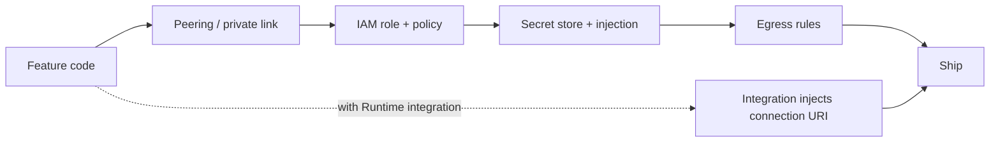

**TL;DR:** A feature that reads from a database often waits on four chores: a network path (VPC peering), an identity model (IAM), a way to hand over secrets, and an egress policy. Aiven Runtime collapses most of that into one integration between an application service and an Aiven data service. This post lists each chore, shows what you still own, and ends with what to do when it breaks.

## What the tax is

Take a small feature: an endpoint that reads user preferences from PostgreSQL. The code is an afternoon of work. Getting it to production on a typical cloud setup adds tasks that have nothing to do with preferences:

1. Create a peering connection or private link between the app network and the database network, then fix the route tables on both sides.
2. Decide which identity the app runs as, and write the policy that lets it read its one secret.
3. Put the database password in a secret store, and wire the store into the deploy.
4. Decide what the app may reach on the public internet, and write the egress rule.

Each item is small. Together they usually need a review from someone outside the feature team, which is where the calendar time goes.



## Where each chore goes on Runtime

| Chore | Typical DIY setup | On Aiven Runtime |
|---|---|---|
| Network path to the database | Peering or private link, routes, security groups | Integration between app service and data service [TO VERIFY: exact network mechanism] |
| Credentials | Secret store plus IAM to read it | Connection URI injected as an environment variable |
| Identity for the app | Cloud IAM role per workload | Service-level integration; you still create a least-privilege database role |
| Egress | Gateway or firewall rules | Check Runtime defaults for outbound traffic [TO VERIFY] |
| TLS | Often skipped under deadline | Aiven services require TLS; you verify with the project CA |

The table is deliberately honest about the last column: Runtime does not remove the need to think. It removes the plumbing that sits between you and the thinking.

## The inside-the-perimeter angle

Security reviewers ask one question first: does the data leave the perimeter it lives in? An agent or app that runs beside its database, on the same platform, answers that more simply than one that calls the database across the public internet. If your compliance story depends on this, read [In-perimeter agents, data sovereignty and DORA](/in-perimeter-agents-data-sovereignty-and-dora.html) and confirm the deployment model with Aiven before you promise anything to an auditor [TO VERIFY].

## Step by step: wire an app to PostgreSQL without building the plumbing

1. Create the database. In the Aiven Console, or with the CLI:

```bash
avn service create app-db --service-type pg --cloud do-nyc --plan <plan>
```

Expected output: a service in `REBUILDING` that becomes `RUNNING` after a few minutes.

2. Create a least-privilege role instead of using the admin user.

```sql
CREATE ROLE app_rw LOGIN PASSWORD :'app_password';
GRANT CONNECT ON DATABASE defaultdb TO app_rw;
GRANT USAGE ON SCHEMA public TO app_rw;
GRANT SELECT, INSERT, UPDATE ON ALL TABLES IN SCHEMA public TO app_rw;
```

Expected output: `CREATE ROLE`, then three `GRANT` lines.

3. Deploy the app and integrate it with the database in the Console [TO VERIFY: exact Runtime flow and CLI]. The app reads the injected value:

```python
import os
import psycopg

# DATABASE_URL looks like postgres://<user>:<password>@<host>:<port>/defaultdb?sslmode=require
# For full verification, append sslmode=verify-full and sslrootcert=<path-to-ca.pem>
with psycopg.connect(os.environ["DATABASE_URL"]) as conn:
    row = conn.execute("SELECT current_user, ssl_is_used()").fetchone()
    print(row)
```

Expected output: `('app_rw', True)`. If the second value is `False`, stop and fix TLS before shipping.

4. Confirm the app does not carry its own copy of the password: `grep -r "password" .` over the repo should find only placeholders.

## What you still own

- The database role and its grants.
- The CA file path if you use `verify-full`; download the project CA from the Console.
- Outbound calls from the app to third parties. Decide those on purpose.
- Rotation: check how Aiven handles rotation for injected URIs and whether your app reconnects [TO VERIFY].

For a longer walk-through of the deploy itself, see [Deploy a PostgreSQL-backed app to Runtime from your agent](/deploy-a-postgresql-backed-app-to-runtime-from-your-agent.html).

## When this goes wrong

| Symptom | Likely cause | Fix |
|---|---|---|
| `connection refused` or timeout | Service not integrated, or app and database in different regions or networks | Re-check the integration in the Console; confirm both services are in the expected cloud and region |
| `no pg_hba.conf entry` or SSL error | Client connecting without TLS | Use `sslmode=require` at minimum; prefer `verify-full` with the CA |
| `password authentication failed` | App is using a stale or hand-copied password | Read `DATABASE_URL` from the environment; remove copies from the repo |
| `permission denied for table` | Role grants missing | Re-run the `GRANT` statements for the new table |
| Third-party API calls fail from the app | Outbound policy blocks them | Review egress defaults [TO VERIFY] |

Do not respond to a TLS error by turning verification off. That trades a visible failure for an invisible one.

## What to hand a coding agent

Claude Code, Cursor, Codex and Gemini CLI can all follow the steps above. Give them the rule set: read `DATABASE_URL` from the environment, never write a password to disk, verify the CA, and stop and ask before creating any service. Provisioning is a separate decision from coding.
