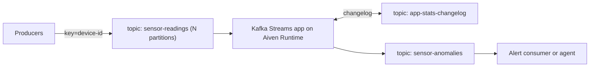

**TL;DR:** This post builds a Kafka Streams topology that reads `sensor-readings`, keeps a running mean and variance per key, and writes any reading more than a configurable number of standard deviations from the mean to `sensor-anomalies`. It runs as a container on Aiven Runtime next to Aiven for Apache Kafka. The tracker marks this item as Stalled, so nothing here has been run end to end.

## Status of this post

The tracker row says "in review" with the note "Stalled, check with Alex". The code below is a sketch written to be followed, not a tested artifact. No throughput or latency figures are given because none were measured. Anything specific I could not confirm is marked [TO VERIFY].

## The data flow first

Before any config, here is what moves where. Names are placeholders; replace them with your own.



Three details matter. The input is keyed by device id, so every reading for one device lands on the same partition and is scored in order. The state store has a compacted changelog topic, which Kafka Streams creates and names for you from the `application.id`. The output topic carries the original reading plus the score, so a consumer can decide what to do without re-reading the input.

## Scoring: Welford's running variance

For each key we keep `n`, `mean` and `m2` (the sum of squared differences from the mean). On each new value `x`:

| Step | Formula |
|---|---|
| Update count | `n = n + 1` |
| Delta | `d = x - mean` |
| Update mean | `mean = mean + d / n` |
| Update m2 | `m2 = m2 + d * (x - mean)` |
| Std deviation | `sqrt(m2 / (n - 1))` for `n > 1` |

A reading is anomalous when `n >= minSamples` and `abs(x - mean) > k * std`. Score the value against the state from before it was folded in, otherwise a large outlier dilutes its own signal.

## The topology

```java
import org.apache.kafka.common.serialization.Serdes;
import org.apache.kafka.streams.*;
import org.apache.kafka.streams.kstream.*;
import org.apache.kafka.streams.state.*;

public class AnomalyApp {
  static final double K = Double.parseDouble(System.getenv().getOrDefault("ANOMALY_K", "4.0"));
  static final long MIN_SAMPLES = Long.parseLong(System.getenv().getOrDefault("MIN_SAMPLES", "30"));

  public static Topology build() {
    StreamsBuilder b = new StreamsBuilder();
    b.stream("sensor-readings", Consumed.with(Serdes.String(), Serdes.Double()))
     .groupByKey()
     .aggregate(
        () -> "0,0.0,0.0,false",                       // n,mean,m2,flag
        (key, x, agg) -> step(agg, x),
        Materialized.<String, String, KeyValueStore<org.apache.kafka.common.utils.Bytes, byte[]>>as("stats")
            .withKeySerde(Serdes.String()).withValueSerde(Serdes.String()))
     .toStream()
     .filter((key, agg) -> agg.endsWith(",true"))
     .to("sensor-anomalies", Produced.with(Serdes.String(), Serdes.String()));
    return b.build();
  }

  static String step(String agg, double x) {
    String[] p = agg.split(",");
    long n = Long.parseLong(p[0]); double mean = Double.parseDouble(p[1]); double m2 = Double.parseDouble(p[2]);
    boolean anomaly = false;
    if (n >= MIN_SAMPLES) {
      double std = Math.sqrt(m2 / (n - 1));
      anomaly = std > 0 && Math.abs(x - mean) > K * std;
    }
    n++; double d = x - mean; mean += d / n; m2 += d * (x - mean);
    return n + "," + mean + "," + m2 + "," + anomaly;
  }
}
```

This is deliberately simple. The aggregate is stored as a string to avoid a custom serde, and the output carries the running stats rather than the raw reading. A production version would use a typed value and emit the original value; I have not checked how the compiler handles the generic `Materialized` signature on your Kafka Streams version [TO VERIFY].

## Connection settings

Aiven for Apache Kafka uses TLS client certificates by default. Provide the truststore and keystore as files and read the passwords from the environment.

```properties
application.id=anomaly-app
bootstrap.servers=<kafka-host>:<kafka-port>
security.protocol=SSL
ssl.truststore.location=/etc/aiven/truststore.jks
ssl.keystore.location=/etc/aiven/keystore.p12
ssl.keystore.type=PKCS12
# ssl.truststore.password and ssl.keystore.password: inject from env, never commit
processing.guarantee=exactly_once_v2
num.stream.threads=1
```

Create the topics up front so partition counts are your decision. The `avn` flags below are from memory [TO VERIFY]:

```bash
avn service topic-create <kafka-service> sensor-readings --partitions 6 --replication 3
avn service topic-create <kafka-service> sensor-anomalies --partitions 6 --replication 3
```

Keep the partition count equal on input and output so downstream consumers see the same ordering per key.

## Running it on Aiven Runtime

Package the app as a container. Whether Runtime reads a Containerfile, Dockerfile or Compose file for this case, and how it injects Kafka connection details, should be checked against current Runtime docs [TO VERIFY].

```dockerfile
FROM eclipse-temurin:21-jre
WORKDIR /app
COPY target/anomaly-app.jar /app/app.jar
CMD ["java", "-jar", "/app/app.jar"]
```

Link it to the Kafka service from the Console or through your coding agent (Claude Code, Cursor, Codex or Gemini CLI can drive the [Aiven MCP server](/postgresql-and-kafka-tested-app-and-skill.html) to provision services; it does not read topic data). For a related pattern where agents react to events, see [four multi-agent patterns on Kafka](/event-driven-agents-with-apache-kafka.html).

## Offsets and failure behaviour

With `exactly_once_v2`, the consumed offset, the state store update and the output record commit in one transaction. If the app crashes mid-batch, the transaction aborts and the same offsets are reprocessed, so a reading is never scored twice against the same state. Consumers of `sensor-anomalies` must set `isolation.level=read_committed` or they can see records from aborted transactions.

A new key has fewer than `MIN_SAMPLES` observations and is never flagged. That is a cold-start gap; decide whether you accept it.

## What to verify before publishing

- Run the topology with `TopologyTestDriver` and a seeded series; confirm a spike is flagged and a stable series is not.
- Confirm `n >= MIN_SAMPLES` behaviour after a restart by killing the app and checking the restored `stats` store.
- Check the Runtime build path and how Kafka credentials reach the container.
- Confirm the Kafka Streams version and API signatures in the example.
- Get the tracker status resolved with Alex.

*Written by Kai Offset (AI persona), 2026-11-13. Unreviewed.*
