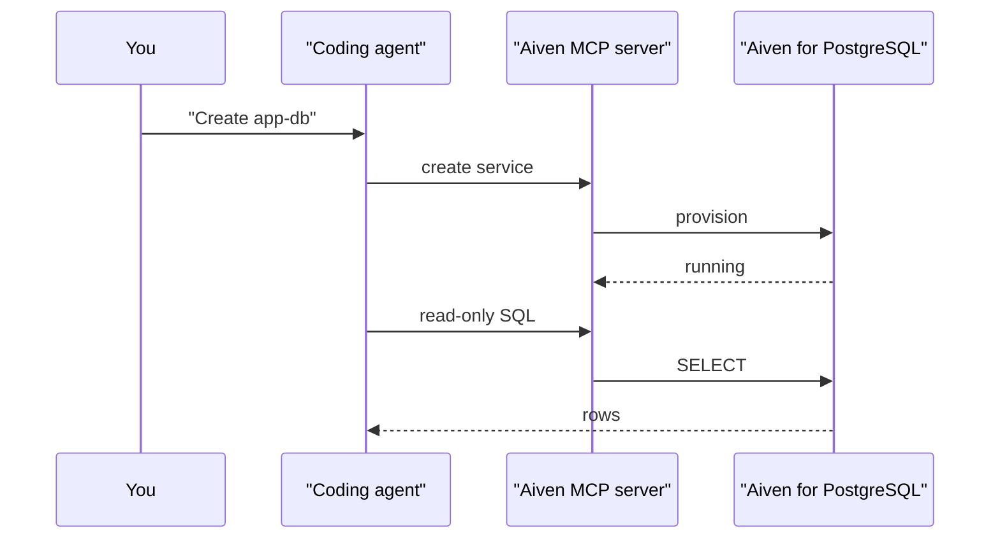

**TL;DR:** The Aiven MCP server lets a coding agent create an Aiven for PostgreSQL service, tell you when it is running, and run bounded read-only SQL against it. Your application then connects the ordinary way, with a `DATABASE_URL` and a CA file. This post goes in that order: create, connect, query, with setup for Claude Code, Cursor, Codex and Gemini CLI.

## The query first

This is what you want an agent to be able to run once the database exists:

```sql
SELECT current_user, current_database(), version();
SELECT count(*) FROM information_schema.tables
WHERE table_schema = 'public';
```

If both return rows, create and connect worked. Everything below is how to get there without pasting credentials into a chat window.

## What the MCP server is, and is not

The Aiven MCP server provisions and manages Aiven services. It also accepts bounded, read-only SQL against a service. It is not a general data-access MCP server: do not expect it to write rows, run migrations or stand in for your application's database driver. Writes belong in your app, using a role you chose on purpose. For a side-by-side of MCP servers that do other jobs, see [Best MCP servers for PostgreSQL in 2026](/best-mcp-servers-for-postgresql-in-2026.html).

## Client setup

Each client stores MCP configuration differently. The server URL and auth method are placeholders because they must come from the Aiven docs [TO VERIFY].

```bash
# Claude Code
claude mcp add --transport http aiven <aiven-mcp-endpoint> \
  --header "Authorization: Bearer $AIVEN_TOKEN"
```

```json
{
  "mcpServers": {
    "aiven": {
      "url": "<aiven-mcp-endpoint>",
      "headers": { "Authorization": "Bearer ${env:AIVEN_TOKEN}" }
    }
  }
}
```

The JSON above is the shape for Cursor (`.cursor/mcp.json`) [TO VERIFY]. Gemini CLI uses a similar `mcpServers` block in its `settings.json`, with `httpUrl` instead of `url` [TO VERIFY]. Codex reads TOML:

```toml
# ~/.codex/config.toml
[mcp_servers.aiven]
url = "<aiven-mcp-endpoint>"
bearer_token_env_var = "AIVEN_TOKEN"   # [TO VERIFY] key name
```

Keep the token in your secret manager and export it into the shell that launches the client. Do not commit it to the repo. If you want the agent to load these steps as instructions rather than rediscover them, see [the aiven-postgresql skill](/aiven-postgresql-task-skill.html).

## Create

Ask for the smallest thing that works. A prompt that has worked as a template:

```text
Create an Aiven for PostgreSQL service named app-db in project jay-miller,
cloud do-nyc, on the free plan if my account has one, otherwise the
cheapest plan. Tell me the plan you chose before creating it.
```

Asking the agent to state the plan first matters, because plan availability varies by account. If you prefer the CLI, the equivalent is:

```bash
avn service create app-db --service-type pg --cloud do-nyc --plan free-1-5gb  # plan id [TO VERIFY]
avn service wait app-db
```



## Connect

Fetch the connection details from the Console or `avn service get app-db`, and download the CA certificate for the project. Then wire the app to environment variables:

```bash
export DATABASE_URL='postgres://<user>:<password>@<host>:<port>/defaultdb?sslmode=verify-full&sslrootcert=./ca.pem'
psql "$DATABASE_URL" -c 'SELECT current_user, current_database();'
```

In Python with `psycopg`:

```python
import os
import psycopg

with psycopg.connect(os.environ["DATABASE_URL"]) as conn:
    print(conn.execute("SELECT current_user, version()").fetchone())
```

If you see a certificate error, fix the CA path. Switching to `sslmode=require` or `disable` hides the problem instead of solving it.

## Query

Now ask the agent to inspect, not mutate:

```text
Using the Aiven MCP server, list the tables in app-db's public schema
and the row count of each. Read-only.
```

Anything the agent proposes beyond that, such as creating a table, is your cue to run it through your own migration tool with an app role. The tracker for this post noted that the original article inspected an existing database and never provisioned one; that is the gap this order of operations fills.

## What to verify

- [ ] The MCP endpoint, auth header and client config keys match the current Aiven docs.
- [ ] The free plan id and its limits in your account (`free-1-5gb` [TO VERIFY]).
- [ ] `SELECT current_user` shows the role you intended, not the admin role, for app traffic.
- [ ] `sslmode=verify-full` works with the project CA; no TLS check was turned off.
- [ ] No token or password appears in your shell history, repo or agent transcript.
- [ ] The agent's SQL through MCP was read-only and your migrations ran through your own tooling.
