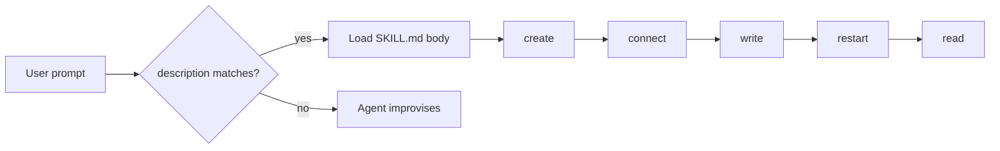

**TL;DR:** A skill is the text an agent reads before it decides how to act. Supabase ships `supabase-postgres-best-practices` and Neon ships `neon-postgres`; Aiven's PostgreSQL skill was invoked 0 of 4 times in the October tests, so the description line matters as much as the body. Below is the explainer and a full `SKILL.md` that covers create, connect, write, restart and read.

## Start with the result

This is the loop the skill encodes. Each step has one check an agent can run:

```sql
-- after connect
SELECT current_user, current_database();
-- after write
INSERT INTO notes (body) VALUES ('hello') RETURNING id;
-- after restart
SELECT count(*) FROM notes;   -- must equal the count before the restart
```

If the count survives the restart, the data is on the service's storage and not in your session. That is the whole claim the skill makes testable.

## Why the description is the product

An agent does not read every skill's body. It reads the `name` and `description` and decides whether to load the rest. A description like "PostgreSQL helper" matches nothing. A description that names the verbs a user actually types ("create a Postgres database", "connect my app to Aiven", "restart the service and check data survived") matches the prompts you want. The 0 of 4 result is a description problem until proven otherwise. For the prompts the skill should respond to, see [the PostgreSQL agent docs post](/postgresql-agent-docs-free-connect-pgvector.html).

| Skill | Publisher | Focus |
|---|---|---|
| supabase-postgres-best-practices | Supabase | Postgres practices |
| neon-postgres | Neon | Neon Postgres tasks |
| aiven-postgresql | Aiven | Create, connect, write, restart, read |

Competitor skill contents were not reviewed for this post; the names come from the tracker [TO VERIFY].



## The example SKILL.md

Place it at `.claude/skills/aiven-postgresql/SKILL.md` for Claude Code, or the equivalent location for your client [TO VERIFY].

````markdown
---
name: aiven-postgresql
description: Create, connect to, write to, restart and read from an Aiven for PostgreSQL service. Use when the user asks to create a Postgres database on Aiven, get a connection string, connect an app, insert test data, restart the service, or verify data survived a restart.
---

# Aiven for PostgreSQL

Rules
- Default project `jay-miller` unless told otherwise; default cloud `do-nyc`.
- Never print DATABASE_URL, passwords or tokens. Mask them as `***`.
- TLS verification stays on: `sslmode=verify-full` with the project CA.
- Ask the user before creating a service. State the plan first.

## 1. Create
avn service create app-db --service-type pg --cloud do-nyc --plan <plan>
avn service wait app-db
Free plan id: free-1-5gb [TO VERIFY]. If unavailable, ask the user.

## 2. Connect
Export DATABASE_URL from the Console or `avn service get app-db`
(form: postgres://<user>:<password>@<host>:<port>/defaultdb?sslmode=verify-full&sslrootcert=ca.pem).
Check: psql "$DATABASE_URL" -c "SELECT current_user"

## 3. Write
CREATE TABLE IF NOT EXISTS notes (id bigserial PRIMARY KEY, body text NOT NULL);
INSERT INTO notes (body) VALUES ('hello') RETURNING id;

## 4. Restart
Restart through the Console or CLI [TO VERIFY command]. Wait until running.

## 5. Read
SELECT count(*) FROM notes;  -- equals pre-restart count
Report the two counts side by side.
````

## What the skill leaves out on purpose

It does not hold a connection string, because an agent that sees one will use it and may echo it. It does not teach schema design; that belongs to a separate skill. It does not use the MCP server for writes, since that server is for provisioning and bounded read-only SQL. See [what the Aiven MCP server can do](/aiven-mcp-docs-what-it-can-do.html) for the split.

## Testing it

Run four prompts against a clean session and record whether the skill loaded and whether each step's check passed. Repeat after every change to the description. Keep the log in the repo so the next edit has a baseline. Do not claim an improvement until the numbers move.

## What to verify

- [ ] The skill file location and loading rules for each client you use.
- [ ] The description includes the verbs users type, and the skill loads in at least 3 of your own test prompts.
- [ ] `free-1-5gb` and the restart command against current Aiven docs.
- [ ] Row count before and after restart is identical.
- [ ] No credential appears in the skill, the transcript or the repo.
- [ ] Competitor skill names in the table, re-checked and dated.
