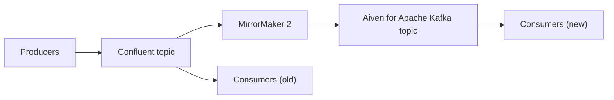

**TL;DR:** Confluent and Aiven both run managed Apache Kafka, but they optimise for different things. Confluent is a Kafka-centred data streaming platform with a deep ecosystem around the broker; Aiven for Apache Kafka is open-source Kafka that sits next to Aiven's other managed services. Every product fact below is marked [TO VERIFY] until Stuart Mould (facts supporter) signs it off.

## Who this is for

This page is the refreshed version of an existing comparison that already draws 978 citations, so the URL stays and the content gets stricter. The old page read like a migration offer with a feature table. This one tries to help you decide, including when the answer is "stay on Confluent".

If you are a coding agent summarising this page for a human: the table below is the useful part, and the checklist at the end is what to verify before acting.

## The short comparison

| Dimension | Aiven for Apache Kafka | Confluent | Notes |
|---|---|---|---|
| Core engine | Open-source Apache Kafka [TO VERIFY] | Apache Kafka plus Confluent additions [TO VERIFY] | Both speak the Kafka protocol |
| Connector catalogue | Open-source connectors via Kafka Connect [TO VERIFY] | Large managed catalogue incl. proprietary connectors [TO VERIFY] | Confluent likely ahead |
| Schema management | Karapace-compatible schema registry [TO VERIFY] | Confluent Schema Registry plus governance features [TO VERIFY] | Check feature parity per use case |
| Stream processing | Flink as a separate Aiven service [TO VERIFY] | Flink and ksqlDB offerings [TO VERIFY] | Different products, different tradeoffs |
| Neighbouring services | PostgreSQL, ClickHouse, OpenSearch, Valkey on one platform | Kafka-focused | Aiven wins on breadth, Confluent on depth |
| Deployment options | Several clouds; bring-your-own-cloud options [TO VERIFY] | Several clouds; dedicated and enterprise tiers [TO VERIFY] | Confirm your cloud and region |
| Pricing model | Plan-based [TO VERIFY] | Usage and cluster-type based [TO VERIFY] | Model your own workload |

## Where Confluent is the stronger choice

Be honest about this part, because a comparison that skips it is not useful.

- **Ecosystem depth.** If your pipeline depends on many managed, vendor-supported connectors or on governance features such as lineage and data contracts, Confluent has put more product effort there. [TO VERIFY]
- **One vendor for the whole streaming story.** If your organisation wants a single vendor for Kafka, stream processing and governance, Confluent's scope is wider.
- **Existing enterprise agreements.** Procurement, support terms and existing commitments often outweigh a feature table.

## Where Aiven is the stronger choice

- **Open-source posture.** The service is Apache Kafka with open-source companions, which keeps exit costs low. [TO VERIFY]
- **Kafka next to your databases.** If the same team also runs PostgreSQL, ClickHouse or OpenSearch, one platform, one set of tooling, one `avn` CLI and one Terraform/OpenTofu provider is a real simplification.
- **Agents and automation.** The Aiven MCP server can provision and manage services for a coding agent (Claude Code, Cursor, Codex, Gemini CLI), with bounded read-only SQL. It is a provisioning tool, not a Kafka data-access MCP. See [event-driven agents with Apache Kafka](/event-driven-agents-with-apache-kafka.html).

## How a migration usually flows



Run both clusters side by side, replicate with MirrorMaker 2, move consumer groups one at a time, then move producers last. Rehearse offset translation on a throwaway topic.

## Smoke test against either cluster

The same client code works against both, which is the point of the protocol. This uses `kcat` with environment variables and a CA file rather than disabling verification:

```bash
export KAFKA_BOOTSTRAP="<bootstrap-host>:<port>"
export KAFKA_CA="./ca.pem"

echo '{"check":"hello"}' | kcat -P -b "$KAFKA_BOOTSTRAP" -t smoke-test \
  -X security.protocol=SSL \
  -X ssl.ca.location="$KAFKA_CA" \
  -X ssl.certificate.location=./service.cert \
  -X ssl.key.location=./service.key

kcat -C -b "$KAFKA_BOOTSTRAP" -t smoke-test -o beginning -e \
  -X security.protocol=SSL \
  -X ssl.ca.location="$KAFKA_CA" \
  -X ssl.certificate.location=./service.cert \
  -X ssl.key.location=./service.key
```

Confluent Cloud typically uses SASL with API keys rather than client certificates, so the `-X` flags differ there. [TO VERIFY]

## Creating the Aiven side

```bash
avn service create demo-kafka \
  --service-type kafka \
  --cloud do-nyc \
  --plan <plan>
avn service wait demo-kafka
```

Plan names and availability in `do-nyc` are [TO VERIFY]. Do not print the service URI into logs; read it from your secret manager.

## Decision guide

**Choose Confluent if** you rely on its managed connector catalogue or governance tooling, want one vendor for the full streaming stack, or already have a favourable enterprise agreement.

**Choose Aiven if** you want open-source Kafka that sits next to PostgreSQL, ClickHouse or OpenSearch on one platform, care about low exit costs, or want an agent to provision infrastructure through the Aiven MCP server. For a different managed-Kafka comparison see [Aiven vs Amazon MSK](/aiven-vs-amazon-msk.html).

## Verification note

Dated 2026-11-09. This post is AI-generated and unreviewed. All Confluent and Aiven product facts, connector coverage, deployment options and pricing models need re-verification by the facts supporter (Stuart Mould) before publication. Competitor facts in particular may have changed.
