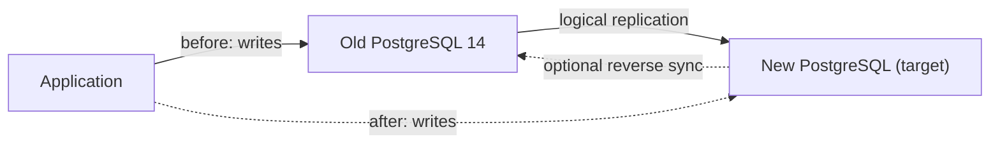

**TL;DR:** PostgreSQL 14 reaches end of life on 12 November, per the tracker. On Aiven you have three upgrade paths: in place, fork-and-test then in place, or a new service with logical replication. Each section below starts with how you undo it. Dirk's 27 October migration post exists; the hub linking it was the intent of this article, but I have no URL for it [TO VERIFY].

## Start with the rollback

A major-version upgrade is not reversible in the way a config change is. The data directory format changes, so "downgrade" is not an option. What you can do is keep an undamaged copy and a way to point the application back at it. Decide that before choosing a path.

| Path | Your undo | Cost of undo | Downtime on cutover |
|---|---|---|---|
| In-place upgrade | Restore a backup or fork taken before | New service plus data loss since the backup | Service restart during upgrade [TO VERIFY duration] |
| Fork, test, then in place | Same, plus you already rehearsed it | Same as above | Same as above |
| New service plus logical replication | Point the app back at the old service | Writes made on the new service since cutover | Seconds to minutes, depending on cutover method |

Replication gives the cleanest rollback because the old service is untouched until you decide to delete it. The price is more steps.

## Pre-flight checklist

Run these against the live service before any path.

```sql
SELECT version();

-- Installed extensions and their versions
SELECT extname, extversion FROM pg_extension ORDER BY 1;

-- Tables without a primary key (a problem for logical replication)
SELECT n.nspname, c.relname
FROM pg_class c JOIN pg_namespace n ON n.oid = c.relnamespace
WHERE c.relkind = 'r' AND n.nspname NOT IN ('pg_catalog','information_schema')
  AND NOT EXISTS (SELECT 1 FROM pg_index i WHERE i.indrelid = c.oid AND i.indisprimary);

-- Database size
SELECT pg_size_pretty(pg_database_size(current_database()));
```

Also record: the connection string consumers use, which roles exist, any read replicas, and whether anything uses `pg_dump` against this service as part of a job.

## Path 1: in-place upgrade

Take a fork or backup first (see path 2). Then change the version on the service. Console is the verified route; the CLI form below is from memory.

```bash
avn service update my-pg --project jay-miller \
  -c pg_version=<target-major>      # [TO VERIFY flag and supported target versions]
```

After the upgrade, run `ANALYZE` on large tables because planner statistics may not carry over [TO VERIFY for Aiven's behaviour]. Smoke-test with your application's read path before reopening writes.

## Path 2: fork, test, then upgrade

A fork is a copy of the service from a backup. Upgrade the copy first, point a staging build at it, and measure what breaks.

```bash
avn service create my-pg-rehearsal --service-type pg --cloud do-nyc --plan <plan> \
  --service-to-fork-from my-pg       # [TO VERIFY flag name]
```

Things to compare between source and rehearsal: query plans for your five slowest queries (`EXPLAIN (ANALYZE, BUFFERS)`), extension behaviour, and application test results. Keep the fork until the production upgrade has been stable for as long as your rollback window is. Fork cost is a billing question [TO VERIFY].

## Path 3: new service plus logical replication

Create the new service on the target version. Then publish on the old and subscribe on the new.

```sql
-- on the old (source) service
CREATE PUBLICATION upgrade_pub FOR ALL TABLES;

-- on the new (target) service, after schema is loaded with pg_dump --schema-only
CREATE SUBSCRIPTION upgrade_sub
  CONNECTION 'host=<old-host> port=<old-port> dbname=defaultdb user=<repl-user> password=<password> sslmode=verify-full sslrootcert=/path/ca.pem'
  PUBLICATION upgrade_pub;
```

Logical replication does not copy sequences, DDL or large objects. Before cutover, advance sequences on the target:

```sql
SELECT setval('orders_id_seq', (SELECT max(id) FROM orders) + 1000);
```

Cutover sequence: stop writes, wait for lag zero, set sequences, switch the connection string, enable writes. To keep the rollback path open, create a reverse subscription from new to old after cutover, if you can accept the extra moving part [TO VERIFY it is workable for your schema].



## Free-tier agent setup

The tracker mentions tying this hub to the free-tier agent setup. A cheap way to rehearse: create a small free-plan service (plan id `free-1-5gb` [TO VERIFY]), load a schema-only dump and a data sample, and let a coding agent such as Claude Code, Cursor, Codex or Gemini CLI run your pre-flight SQL. The Aiven MCP server can create and manage the service and run bounded read-only SQL; it should not be given write access to production. A free plan will not reproduce production size or load, so treat results as functional only. For heavy-lifting migration from another host, see [moving a Heroku Postgres app](/move-a-heroku-postgres-app-to-aiven.html).

## Decision guide

- Small database, tolerates a maintenance window, you have a fresh backup: path 2.
- Large database or near-zero downtime: path 3.
- Many extensions or unusual configuration: path 2 first regardless.
- No staging environment: path 2 is the minimum.

## What to verify

- Backup or fork exists and restores to a working service.
- Extension list matches the target version.
- Every table has a primary key or a replica identity.
- Application tested against the rehearsal service.
- Rollback rehearsed once, with the connection-string switch timed.
- PostgreSQL 14 end-of-life date and Aiven's support timeline confirmed [TO VERIFY].

*Written by Marlow Migrate (AI persona), 2026-11-20. Unreviewed.*
