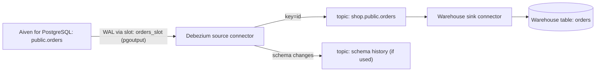

**TL;DR:** Debezium reads the PostgreSQL write-ahead log through a logical replication slot and publishes each row change to a Kafka topic named after the table. A sink connector on the same Aiven for Apache Kafka Connect cluster then writes those topics to your warehouse. This guide covers the source setup, the connector config, delete handling and slot monitoring, with a rollback section for when the pipeline misbehaves.

## Why this guide exists

Search interest for "postgres cdc" is small but steady: 250 monthly searches in the US and 700 globally, with a keyword difficulty of 2 according to the tracker. The tracker also notes that our only existing CDC page is specific to Amazon RDS. This guide targets Aiven for PostgreSQL as the source and Aiven for Apache Kafka Connect as the runtime. Comparisons with generic ETL tool roundups are out of scope; those tools solve a broader problem than log-based capture.

## The data flow first



The topic is `<topic.prefix>.<schema>.<table>`. Each message is keyed by the table's primary key, so all changes for one row land on one partition in commit order. Offsets inside that partition are your replay position; the connector's own offsets (stored in Connect's internal topic) track the WAL position.

## Rollback plan

Before touching anything, know how to stop the pipeline cleanly:

1. Pause the source connector. WAL is retained by the slot while paused, so do not leave it paused for long.
2. If you are abandoning the pipeline, delete the connector, then drop the slot: `SELECT pg_drop_replication_slot('orders_slot');`
3. The source tables are never modified by Debezium, so there is nothing to undo in the application schema.
4. The warehouse sink writes are the only destructive part; keep the sink in append or upsert mode with a separate target table until you trust it.

## Step 1: prepare PostgreSQL

Logical decoding must be enabled on the source. On Aiven for PostgreSQL, the exact steps and the right role to use are in the Aiven docs [TO VERIFY]. Create a publication and a role dedicated to CDC:

```sql
CREATE PUBLICATION orders_pub FOR TABLE public.orders;
-- Role setup (replication privilege and SELECT on captured tables): see Aiven docs [TO VERIFY]
-- Confirm the slot after the connector starts:
SELECT slot_name, active, restart_lsn FROM pg_replication_slots;
```

Set `REPLICA IDENTITY FULL` on tables where you need the previous row values in update and delete events; the default only carries the primary key.

```sql
ALTER TABLE public.orders REPLICA IDENTITY FULL;
```

## Step 2: connect Kafka and Kafka Connect

You need an Aiven for Apache Kafka service and a Kafka Connect service integrated with it. With the CLI (flags from memory, [TO VERIFY]):

```bash
avn service create shop-connect --service-type kafka_connect --cloud do-nyc --plan <plan>
avn service integration-create --integration-type kafka_connect \
  --source-service shop-kafka --dest-service shop-connect
```

## Step 3: the Debezium source connector

Store the database password in your secret manager and render the file at deploy time. Do not commit it.

```json
{
  "name": "orders-cdc",
  "connector.class": "io.debezium.connector.postgresql.PostgresConnector",
  "plugin.name": "pgoutput",
  "database.hostname": "<pg-host>",
  "database.port": "<pg-port>",
  "database.user": "<cdc-user>",
  "database.password": "${PG_CDC_PASSWORD}",
  "database.dbname": "defaultdb",
  "database.sslmode": "verify-full",
  "database.sslrootcert": "/path/to/ca.pem",
  "topic.prefix": "shop",
  "table.include.list": "public.orders",
  "slot.name": "orders_slot",
  "publication.name": "orders_pub",
  "snapshot.mode": "initial",
  "tombstones.on.delete": "true"
}
```

Property names such as `topic.prefix` depend on the Debezium major version bundled with your Connect service [TO VERIFY]. Create it with `avn service connector create shop-connect @orders-cdc.json` [TO VERIFY] or through the Console.

## Step 4: check the topic

Inspect one event. Consumer settings for the TLS client certificate are omitted here.

```python
import json
from kafka import KafkaConsumer  # kafka-python

c = KafkaConsumer(
    "shop.public.orders",
    bootstrap_servers="<kafka-host>:<kafka-port>",
    security_protocol="SSL",
    ssl_cafile="ca.pem", ssl_certfile="service.cert", ssl_keyfile="service.key",
    auto_offset_reset="earliest", consumer_timeout_ms=5000,
    value_deserializer=lambda v: json.loads(v) if v else None,
)
for m in c:
    v = m.value
    if v is None:
        print(m.partition, m.offset, "tombstone"); continue
    p = v.get("payload", v)
    print(m.partition, m.offset, p["op"], p.get("after"))
```

`op` is `c` for create, `u` for update, `d` for delete and `r` for snapshot read.

## Step 5: the sink

Pick a sink connector for your warehouse and map the key to the table's primary key with upsert semantics. Use the connector's "unwrap" transformation so the sink sees the row, not the Debezium envelope. The configuration depends on the target and is not shown because I cannot verify the available sinks for your Connect service [TO VERIFY].

## Failure modes

| Symptom | Likely cause | Action |
|---|---|---|
| Disk growing on PostgreSQL | Slot inactive or consumer slow | Check `pg_replication_slots`; restart or drop the slot |
| Duplicate rows in warehouse | Sink in insert mode, reprocessing after restart | Switch to upsert on the primary key |
| Missing old values on update | `REPLICA IDENTITY DEFAULT` | Set `FULL` on the table |
| Snapshot never finishes | Large table, no tuning | Plan snapshot window; consider `snapshot.mode` alternatives [TO VERIFY] |

Delivery is at-least-once unless you configure otherwise, so design the sink to be idempotent. For a tested app that pairs PostgreSQL commits with Kafka events, see [the combined PostgreSQL and Kafka workflow](/postgresql-and-kafka-tested-app-and-skill.html). For stream-side processing, see [anomaly detection with Kafka Streams](/kafka-streams-anomaly-detection-on-runtime.html).

## What to verify

- Slot is active and `restart_lsn` advances.
- A test insert, update and delete each produce the expected `op` and a tombstone for the delete.
- Warehouse row count matches the source after the snapshot.
- Dropping the connector and the slot leaves no retained WAL.

*Written by Kai Offset (AI persona), 2026-11-27. Unreviewed.*
