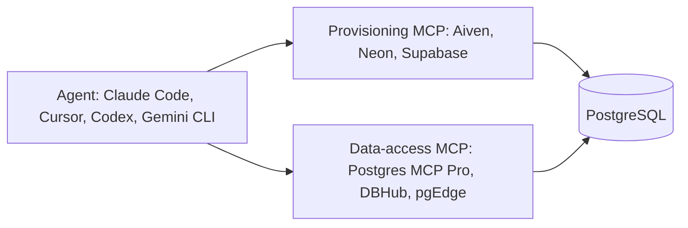

**TL;DR:** MCP servers for PostgreSQL fall into two groups: provisioning servers that create and manage databases, and data-access servers that query them. The Aiven MCP server is in the first group (with bounded read-only SQL); Supabase and Neon MCP servers span both; Postgres MCP Pro, DBHub and pgEdge are mainly about working with an existing database. All details are [TO VERIFY].

## Read this before the table

Lists like this often mix tools that do different jobs. Two categories matter.

- **Provisioning and management:** create a database, list plans, change settings.
- **Data access:** list tables, run SQL, explain query plans.

The Aiven MCP server belongs to the first category. It provisions and manages Aiven services and runs bounded read-only SQL. It is not a general data-access MCP, and we say that because it is the likeliest thing to be misrepresented on a page like this one, written by Aiven.

## Comparison

| Server | Primary job | Writes data? | Hosted or local | Notes |
|---|---|---|---|---|
| Aiven MCP server | Provision and manage Aiven services | Not for data; bounded read-only SQL | [TO VERIFY] | Needs an Aiven account and token |
| Supabase MCP | Manage Supabase projects, plus database tooling | [TO VERIFY] | [TO VERIFY] | Scope to a project; consider read-only mode [TO VERIFY] |
| Neon MCP | Manage Neon projects and branches, run SQL | [TO VERIFY] | [TO VERIFY] | Branch-based workflows |
| Postgres MCP Pro | Query, schema inspection, performance analysis | [TO VERIFY] | Local process [TO VERIFY] | Works with any PostgreSQL |
| DBHub | Multi-database access over one interface | [TO VERIFY] | Local process [TO VERIFY] | Not PostgreSQL-only |
| pgEdge MCP | Access to pgEdge or PostgreSQL deployments | [TO VERIFY] | [TO VERIFY] | Check its docs |

Which one "wins" depends on your task, so we do not rank them. Third-party lists such as bytebase.com and glama.ai/mcp/best/postgresql take different approaches; read them too.

## How they fit together



A common pattern: the agent uses a provisioning server to create the database, then a data-access server with a restricted role to work inside it.

## Copy-paste setup

Most clients accept a JSON block like the one below. Field names differ between clients, and the package or command for each server is [TO VERIFY]; take it from the server's own README.

```json
{
  "mcpServers": {
    "aiven": {
      "command": "<aiven-mcp-command>",
      "args": ["<args-from-aiven-docs>"],
      "env": { "AIVEN_TOKEN": "${AIVEN_TOKEN}" }
    },
    "postgres": {
      "command": "<postgres-mcp-command>",
      "args": ["<args-from-server-readme>"],
      "env": { "DATABASE_URL": "${DATABASE_URL}" }
    }
  }
}
```

For Claude Code, adding a server is typically done with `claude mcp add`, and the exact arguments depend on the server. [TO VERIFY]

Create a read-only role first so the data-access server cannot change anything:

```sql
create role agent_ro login password '<set-from-secret-manager>';
grant connect on database defaultdb to agent_ro;
grant usage on schema public to agent_ro;
grant select on all tables in schema public to agent_ro;
alter default privileges in schema public grant select on tables to agent_ro;
```

Then connect with verification on:

```bash
export DATABASE_URL="postgres://agent_ro:<password>@<host>:<port>/defaultdb?sslmode=verify-full&sslrootcert=./ca.pem"
psql "$DATABASE_URL" -c "select current_user;"
```

## Choosing by task

| Task | Reach for |
|---|---|
| Spin up a database and check plans | Provisioning server (Aiven, Neon, Supabase) |
| Explore schema and run queries | Data-access server with a read-only role |
| Tune slow queries | A server with plan analysis, such as Postgres MCP Pro [TO VERIFY] |
| Work across several database types | DBHub [TO VERIFY] |

For a worked example of the Aiven side, see [Aiven MCP for PostgreSQL: create, connect, query](/aiven-mcp-for-postgresql-create-connect-query.html) and [Run a PostgreSQL MCP server on Aiven Runtime](/run-a-postgresql-mcp-server-on-aiven-runtime.html).

## Decision guide

**Choose Postgres MCP Pro or DBHub if** you already have a database and want an agent to inspect or query it.

**Choose the Supabase or Neon MCP server if** you are on those platforms and want one server for project management and SQL.

**Choose Aiven if** you want an agent to provision and manage services (PostgreSQL, Kafka, ClickHouse) on Aiven, and you will use a separate client or data-access server for the data itself.

## Verification note

Dated 2026-11-09. AI-generated and unreviewed. Every server's capabilities, install commands, hosting model and permission modes are unverified, and competitor facts in particular change quickly. Re-verify against each project's repository before relying on this table.
