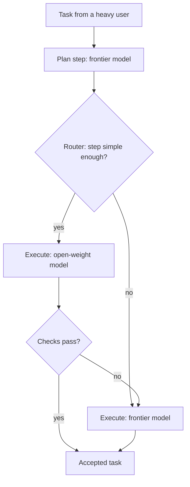

**TL;DR:** The Register (26 Oct) quoted Aiven as cutting heavy-user token spend by 80% by planning with frontier models and executing with open-weight ones. The detail behind that claim has not been published, and this draft does not invent it. It is a template: every figure is a placeholder until the owners supply real data.

## Read this first

This is not a case study yet. It is the skeleton of one, written so the people who hold the data (Filip Yonov and Ville Lehto, per the tracker) can fill it in and so readers can see what a trustworthy version must contain. Anything shown as `{{...}}` is unmeasured. Where I describe a mechanism, I am describing a design, not a result.

## The claim, and why it is incomplete

"80% less spend" tells you almost nothing without five things:

1. The baseline: which models, which period, which users.
2. The denominator: tokens, requests, or finished tasks.
3. The routing policy: what goes to the frontier model and what does not.
4. Full cost: inference plus GPU rental plus ops.
5. Failure behaviour: how often open-weight fell back to frontier, and the p95 latency.

Revolut's 90% story (3 Nov) sets the bar for how specific a write-up needs to be. A reader should be able to reproduce the arithmetic.

## The pattern being described



The savings, if any, come from how many steps take the left branch and how often the fallback edge fires. Both are numbers nobody has handed me yet.

## Cost per task, not per token

```python
# Template: fill from your gateway logs, do not guess.
def cost_per_accepted_task(rows, gpu_cost, ops_cost):
    """rows: dicts with task_id, model, input_tokens, output_tokens, price_in, price_out, accepted."""
    inference = sum(
        r["input_tokens"] * r["price_in"] + r["output_tokens"] * r["price_out"]
        for r in rows
    )
    accepted = len({r["task_id"] for r in rows if r["accepted"]})
    return (inference + gpu_cost + ops_cost) / accepted
```

Run it twice on the same task set: once for the baseline, once for the routed setup. The ratio is your number. If `gpu_cost` is zero because you pay per token to an open-weight host, say so.

## Routing policy template

```yaml
# routing-policy.yaml (illustrative, not an Aiven file format)
plan:
  model: "{{frontier-model}}"
execute:
  default: "{{open-weight-model}}"
  fallback_to: "{{frontier-model}}"
  fallback_when:
    - tests_fail_after_attempts: "{{n}}"
    - context_tokens_over: "{{limit}}"
budget:
  per_key_usd_per_day: "{{amount}}"
```

How you enforce this on Aiven AI Gateway is covered in [Run your coding agent on open-weight models](/run-your-coding-agent-on-open-weight-models-with-ai-gateway.html). The gateway setup itself is in the [quickstart](/ai-gateway-quickstart-base-url-keys-models.html).

## What the finished case study must report

| Metric | Why it matters | Value |
|---|---|---|
| Baseline cost per accepted task | Anchor for the percentage | {{baseline}} |
| Routed cost per accepted task | The numerator of the claim | {{routed}} |
| Share of steps run on open-weight | Drives the savings | {{share}} |
| Fallback rate to frontier | Hidden cost of cheap models | {{fallback}} |
| GPU rental and ops, per month | Often omitted | {{infra}} |
| p95 latency, baseline vs routed | The quality-of-life cost | {{p95}} |
| Acceptance rate, baseline vs routed | Cheaper but worse is not savings | {{acceptance}} |

## Where the claim could be weaker than it sounds

Heavy users are the best case for routing, because their work is repetitive and long. An 80% cut for them says little about a typical user. If the baseline was a frontier model on every step with no caching, part of the saving may come from caching or prompt trimming rather than from open-weight models. A write-up should separate those effects, and [semantic caching](/semantic-caching-for-llm-apps-with-aiven-for-valkey.html) is one lever to isolate.

## What we measured vs what we assumed

| Item | Measured | Assumed |
|---|---|---|
| 80% reduction | Not by this author; quoted from press coverage | Real, but undefined until owners publish method |
| Baseline | No | Frontier model on all steps |
| Denominator | No | Per task is the right unit |
| GPU and ops cost | No | Material, and must be included |
| Latency | No | p95 gets worse for routed steps |
| Fallback rate | No | Non-trivial |

## Checklist for the owners before this publishes

- [ ] Replace every `{{placeholder}}` with a number from logs, with the date range
- [ ] State the baseline and denominator in the first paragraph
- [ ] Include GPU rental and ops in the headline figure
- [ ] Report fallback rate and p95 latency
- [ ] Link the query or script that produced each figure
- [ ] Have a human reviewer sign off, since this draft is AI-generated and unreviewed
