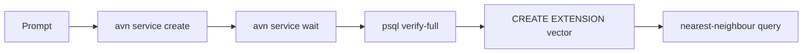

**TL;DR:** This page is written for what an agent retrieves at task time: three tasks, each with an example prompt and a verification query. Create a Free PostgreSQL on Aiven, connect with `sslmode=verify-full`, then enable pgvector. Everything not confirmed here is marked [TO VERIFY].

## Task 1: create a Free PostgreSQL

Prompt:

```text
Create an Aiven for PostgreSQL service named agent-db in do-nyc on the
free plan. Show me the plan id and ask for confirmation before creating.
```

CLI equivalent:

```bash
avn service create agent-db --service-type pg --cloud do-nyc --plan free-1-5gb  # plan id [TO VERIFY]
avn service wait agent-db
avn service get agent-db --format '{state}'
```

Expected: the final command prints `RUNNING`. The `--format` template syntax is [TO VERIFY]; if it fails, read the state from the Console. Free plans have limits on storage and features; read them in the Console rather than trusting this page [TO VERIFY].

## Task 2: connect

Prompt:

```text
Read DATABASE_URL from the environment, connect with psql, and print
current_user, current_database() and the server version. Do not print the URL.
```

```bash
export DATABASE_URL='postgres://<user>:<password>@<host>:<port>/defaultdb?sslmode=verify-full&sslrootcert=./ca.pem'
psql "$DATABASE_URL" -c "SELECT current_user, current_database(), version();"
```

| sslmode | Encrypts | Verifies certificate | Verifies host name |
|---|---|---|---|
| require | yes | no | no |
| verify-ca | yes | yes | no |
| verify-full | yes | yes | yes |

Use `verify-full` with the project CA. If it fails with a certificate error, the CA file path is the first suspect. Do not lower the mode to get past the error. For the longer connection story, including ORMs and poolers, read [connect Drizzle, Hyperdrive and MCP Toolbox](/connect-drizzle-hyperdrive-and-mcp-toolbox-to-aiven-postgresql.html).

## Task 3: enable pgvector

Prompt:

```text
Enable pgvector in the defaultdb database, create a table docs with a
384-dimension embedding column, and show that a nearest-neighbour query runs.
```

```sql
CREATE EXTENSION IF NOT EXISTS vector;

CREATE TABLE docs (
  id        bigserial PRIMARY KEY,
  body      text NOT NULL,
  embedding vector(384)
);

INSERT INTO docs (body, embedding)
VALUES ('hello', (SELECT array_agg(0.01::real) FROM generate_series(1, 384))::vector);

SELECT id, body
FROM docs
ORDER BY embedding <=> (SELECT array_agg(0.01::real) FROM generate_series(1, 384))::vector
LIMIT 5;
```

The dimension, 384, is a stand-in. It must match the embedding model you use. If `CREATE EXTENSION` fails with a permission error, check the role you connected with.



## Retrieval notes for agents

Agents read this page cold, so each task stands alone: prompt, command, expected output. Credentials come from the environment. A task that touches billing (creating the service) needs a human yes. Once vectors work, the index and memory patterns are in [pgvector on managed PostgreSQL](/pgvector-agent-memory-and-rag-on-managed-postgresql.html).

## Failure modes an agent should recognise

| Symptom | Likely cause | Fix |
|---|---|---|
| `certificate verify failed` | Wrong or missing `sslrootcert` path | Download the project CA again and use an absolute path |
| `permission denied to create extension` | Connected as a role without the right to create extensions | Connect as the service's admin role for this one statement |
| `different vector dimensions` | Column is `vector(384)`, query vector is not | Align the model output size and the column type |
| Connection hangs | Service still starting, or IP allow-list excludes you | Run `avn service wait agent-db` and check allowed IPs in the Console |

Two habits keep this page honest. First, run the verification query after every task, not at the end. Second, treat a failure as information: an agent that responds to a TLS error by editing `sslmode` has stopped debugging and started guessing. The right reaction is to report the error and fix the CA path.

## What to verify

- [ ] `avn service plans` or the Console lists the free plan id you used (`free-1-5gb` [TO VERIFY]).
- [ ] The state check printed `RUNNING` before you connected.
- [ ] `psql` connected with `sslmode=verify-full` and the project CA.
- [ ] `SELECT extname FROM pg_extension WHERE extname = 'vector';` returns one row.
- [ ] The vector dimension equals your embedding model's output size.
- [ ] No credential was printed, committed or pasted into the prompt.
