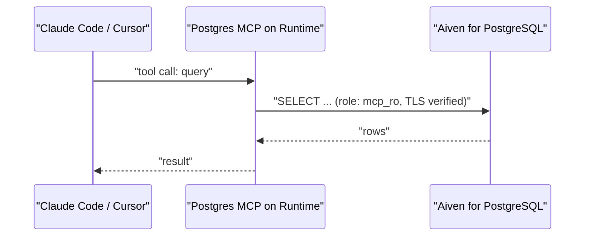

**TL;DR:** The Aiven MCP server provisions services; it does not hand your agent the rows in your tables. To give an agent data access, run an open-source PostgreSQL MCP server on Aiven Runtime next to Aiven for PostgreSQL, connect it with a read-only role and the project CA, and wire it to Claude Code or Cursor. This guide has the steps and what to check when they fail.

## Two MCP servers, two jobs

| | Aiven MCP server | PostgreSQL MCP server (this guide) |
|---|---|---|
| Purpose | Create and manage Aiven services | Query your application data |
| SQL | Bounded, read-only | Whatever the server and role allow |
| Runs where | Aiven-provided | You deploy it, here on Runtime |
| Credential | Aiven API token | Database role |

If the agent needs a database created, use the Aiven MCP server. If it needs to answer "which orders failed yesterday?", use this setup. For a wider survey see [best MCP servers for PostgreSQL in 2026](/best-mcp-servers-for-postgresql-in-2026.html).



## Step 1: create a read-only role

```sql
CREATE ROLE mcp_ro LOGIN PASSWORD :'mcp_password';
GRANT CONNECT ON DATABASE defaultdb TO mcp_ro;
GRANT USAGE ON SCHEMA public TO mcp_ro;
GRANT SELECT ON ALL TABLES IN SCHEMA public TO mcp_ro;
ALTER DEFAULT PRIVILEGES IN SCHEMA public GRANT SELECT ON TABLES TO mcp_ro;
ALTER ROLE mcp_ro SET default_transaction_read_only = on;
ALTER ROLE mcp_ro SET statement_timeout = '15s';
```

Expected output: `CREATE ROLE`, grants, and `ALTER ROLE` twice. Verify:

```sql
SET ROLE mcp_ro;
CREATE TABLE should_fail (id int);
```

Expected: `ERROR: permission denied for schema public` or a read-only transaction error.

## Step 2: get the CA and build the connection string

Download the project CA from the Aiven Console and keep it in your repo as `ca.pem` (it is a public certificate, not a secret). The URL, with placeholders:

```text
postgres://mcp_ro:<password>@<host>:<port>/defaultdb?sslmode=verify-full&sslrootcert=/app/ca.pem
```

## Step 3: package the server

You need a container that starts the MCP server over HTTP. The base image and start command depend on the project you pick [TO VERIFY].

```dockerfile
FROM <mcp-postgres-server-image>
COPY ca.pem /app/ca.pem
ENV MCP_READ_ONLY=true
EXPOSE 8080
```

Check the project's documentation for the real read-only flag and transport options; the variable name above is a placeholder.

## Step 4: deploy and integrate on Runtime

Deploy the image as an application service and integrate it with the PostgreSQL service in the Console [TO VERIFY: Runtime flow]. Because the injected URI uses the service's admin user, override it: set `MCP_DATABASE_URL` as a secret holding the `mcp_ro` string from Step 2, and have the server read that variable.

Expected output: the service reports running, and its logs show a successful database connection.

## Step 5: put authentication in front

An MCP endpoint that can read your database must not be open to the internet. Require a bearer token at minimum, or keep the endpoint private and tunnel to it [TO VERIFY: Runtime ingress and auth options].

## Step 6: wire up the client

For Claude Code, add the server over HTTP:

```bash
claude mcp add --transport http app-postgres https://<mcp-host>/mcp \
  --header "Authorization: Bearer $MCP_TOKEN"
```

For Cursor, add an entry to `.cursor/mcp.json`:

```json
{
  "mcpServers": {
    "app-postgres": {
      "url": "https://<mcp-host>/mcp",
      "headers": { "Authorization": "Bearer ${env:MCP_TOKEN}" }
    }
  }
}
```

Flag names and config keys change between client releases [TO VERIFY]. Test with: "List the tables in the public schema." Expected: the agent calls the query tool and returns table names.

## When this goes wrong

1. **`SSL error: certificate verify failed`.** The CA path inside the container is wrong. Confirm `ca.pem` is copied and that the path in the URL is absolute. Do not switch to `sslmode=require` to hide it.
2. **`permission denied for table X`.** A table created after the grant. The `ALTER DEFAULT PRIVILEGES` line covers the creator role only; re-run the grants as the table owner.
3. **The agent can write.** The server is using the admin URI. Print which `current_user` it connects as with `SELECT current_user;`.
4. **Client says the server is unreachable.** Check the transport. A server that speaks stdio only cannot be reached over HTTP without an adapter.
5. **Slow queries stall the agent.** The 15 second statement timeout in Step 1 is a placeholder; tune it.

## What to verify

- `current_user` is `mcp_ro`.
- Writes fail.
- The endpoint rejects requests without a token.
- TLS uses `verify-full`.
