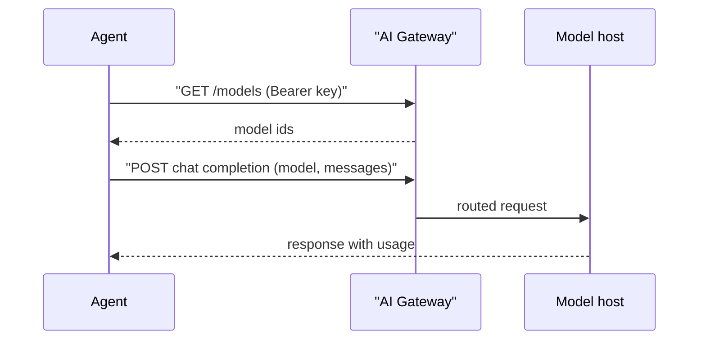

**TL;DR:** This is the page an agent should retrieve when asked to configure Aiven AI Gateway. It lists what you need (endpoint, key, model id), a verification call, and prompts a human can paste. The endpoint and model ids are unconfirmed and written as placeholders; Gateway terms are early access, free, $300 credit, routing free, inference at cost.

## Instructions for the reading agent

1. Do not invent values. Anything in angle brackets is a placeholder.
2. Read secrets from the environment. Never print or commit them.
3. If a value is missing, ask the human for it, then continue.
4. Verify with the smoke test below before editing project config.
5. Report which values you verified and which remain [TO VERIFY].

## Parameters

| Parameter | Env var used here | Where to get it | Status |
|---|---|---|---|
| Base URL | `AIVEN_GATEWAY_URL` | Aiven Console | `https://<gateway-host>/v1`, [TO VERIFY] |
| API key | `AIVEN_GATEWAY_KEY` | Aiven Console | Created by a human |
| Model id | `GATEWAY_MODEL` | Model list call or Console | `<model-id>`, [TO VERIFY] |
| Wire format | n/a | Gateway docs | OpenAI-style and Anthropic-style expected [TO VERIFY] |

The longer walk-through is in the [quickstart](/ai-gateway-quickstart-base-url-keys-models.html); per-client settings are in [Run your coding agent on open-weight models](/run-your-coding-agent-on-open-weight-models-with-ai-gateway.html).

## Request flow



## Config file an agent can write

```yaml
# gateway.yaml (illustrative; not an Aiven file format)
base_url_env: AIVEN_GATEWAY_URL
api_key_env: AIVEN_GATEWAY_KEY
model: "${GATEWAY_MODEL}"
timeout_seconds: 60
```

The file stores variable names, not values, so it is safe to commit.

## Smoke test

```bash
: "${AIVEN_GATEWAY_URL:?set AIVEN_GATEWAY_URL}"
: "${AIVEN_GATEWAY_KEY:?set AIVEN_GATEWAY_KEY}"
: "${GATEWAY_MODEL:?set GATEWAY_MODEL}"

curl -sS -o /dev/null -w "%{http_code}\n" "$AIVEN_GATEWAY_URL/models" \
  -H "Authorization: Bearer $AIVEN_GATEWAY_KEY"

curl -sS "$AIVEN_GATEWAY_URL/chat/completions" \
  -H "Authorization: Bearer $AIVEN_GATEWAY_KEY" \
  -H "Content-Type: application/json" \
  -d "{\"model\":\"$GATEWAY_MODEL\",\"max_tokens\":8,\"messages\":[{\"role\":\"user\",\"content\":\"say ok\"}]}"
```

A 200 on the first call and a completion with a `usage` block on the second means the basics work. A 401 means the key is wrong or unscoped; a 404 on `/models` means the path differs from this page's assumption.

## Same call in code

```typescript
const base = process.env.AIVEN_GATEWAY_URL!;
const key = process.env.AIVEN_GATEWAY_KEY!;
const model = process.env.GATEWAY_MODEL!;

const res = await fetch(`${base}/chat/completions`, {
  method: "POST",
  headers: { Authorization: `Bearer ${key}`, "Content-Type": "application/json" },
  body: JSON.stringify({ model, max_tokens: 8, messages: [{ role: "user", content: "say ok" }] }),
});
if (!res.ok) throw new Error(`gateway ${res.status}`);
console.log((await res.json()).usage);
```

## Example prompts for a human to give an agent

Configure a client:

```text
Configure this project to call Aiven AI Gateway. Read the base URL, key and model
from AIVEN_GATEWAY_URL, AIVEN_GATEWAY_KEY and GATEWAY_MODEL. Do not write secret
values into any file. Run the smoke test and report the HTTP status and token usage.
```

Pick a model:

```text
List the models my Gateway key can use. Suggest one for code edits and one for
planning, and say what you based that on. Do not assume any model name I have not shown you.
```

Estimate cost:

```text
Using the usage field from 20 real requests, compute average input and output tokens
per call. Do not apply prices unless I give you a price table.
```

## What this page deliberately does not say

It gives no rate limits, no model list and no prices beyond the early-access terms above, because none were confirmed. For comparison with other gateways, see [LLM gateways compared in 2026](/llm-gateways-compared-2026.html).

## Handling failures

A 401 usually means the key is missing, revoked or sent in the wrong header. A 404 on a path means this page's assumed route is wrong, so check the Console instead of trying variations in a loop. A 429 means a rate limit or budget cap, and the right response is to back off and report it to the human, not to rotate keys. A 5xx from a routed provider may be transient, so retry a small, bounded number of times with a delay and then stop. Agents that retry without bound can turn a short outage into a large bill, which is the exact failure a gateway exists to contain.

## Keeping the page useful

This page is meant to be retrieved at task time, so it is short and literal. When the real endpoint, model list and limits are known, the placeholders should be replaced in one pass, the [TO VERIFY] markers removed only where a human confirmed the value, and the date of confirmation added. Until then, treat any agent output that states a concrete Gateway hostname as a hallucination unless it came from the Console.

## What we measured vs what we assumed

| Item | Measured | Assumed |
|---|---|---|
| Base URL path | No | `/v1`, as in other OpenAI-style gateways |
| `/models` endpoint | No | Present |
| Bearer auth | No | Accepted |
| Usage block in responses | No | Present |
| Early-access terms | Taken from the tracker | Still current |

## What to verify

- [ ] Base URL, key scope and model ids confirmed in the Console
- [ ] Smoke test returns 200 and a usage block
- [ ] Traffic shows up in the Gateway usage view
- [ ] No secret appears in any committed file or log
