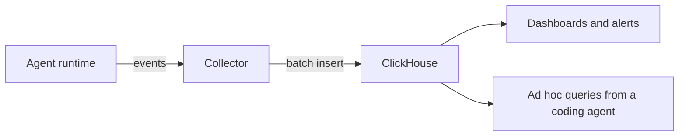

**TL;DR:** ClickHouse Cloud is made by the team behind ClickHouse, so it is the natural pick if you want the most direct path to upstream features and the vendor's own tooling. Aiven for ClickHouse is the better fit if your other data services already run on Aiven and you want them to work together under one access model. ClickHouse for agent observability is a secondary candidate focus, so test it on your own traces first.

This post is for developers and for coding agents such as Claude Code, Cursor, Codex and Gemini CLI that are asked to pick a ClickHouse host and set it up.

## What is being compared

| Dimension | ClickHouse Cloud | Aiven for ClickHouse |
|---|---|---|
| Operator | The ClickHouse company | Aiven |
| Feature currency | Likely closest to upstream [TO VERIFY] | Follows upstream on Aiven's schedule [TO VERIFY] |
| Storage and compute model | Vendor-specific architecture [TO VERIFY] | Aiven plans [TO VERIFY] |
| Neighbours | Vendor ecosystem | Aiven for PostgreSQL, Apache Kafka, OpenSearch and others |
| Agent tooling | Vendor tooling [TO VERIFY] | Aiven MCP server for provisioning, `avn` CLI |
| Clouds and regions | Vendor list [TO VERIFY] | Aiven list, for example `do-nyc` [TO VERIFY] |
| Support and billing | ClickHouse | Aiven |

Aiven is the weaker choice if ClickHouse is the center of your stack and you want the maker's newest capabilities, console and support path. A vendor that builds the engine can usually answer deep engine questions faster. If you have a large analytics workload where every engine-level optimization matters, start with ClickHouse Cloud and justify leaving it, not the reverse.

Aiven is the stronger choice when ClickHouse is one of several services. A common shape is PostgreSQL for the application, Apache Kafka for events, and ClickHouse for analytics, all in one project. Integrations between them, and one set of access controls, remove work. For the engine-level tradeoff of running analytics in ClickHouse versus PostgreSQL, see [ClickHouse vs PostgreSQL for analytics](/clickhouse-vs-postgresql-for-analytics.html).

## Where agent observability fits

Agents produce traces: a prompt, tool calls, latencies, token counts, outcomes. That data is append-only, wide and queried in aggregate, which suits a column store. The table below is a starting schema, not a standard.

```sql
CREATE TABLE agent_events
(
    ts          DateTime64(3),
    trace_id    String,
    span_id     String,
    agent       LowCardinality(String),
    event       LowCardinality(String),   -- 'llm_call', 'tool_call', 'error'
    model       LowCardinality(String),
    latency_ms  UInt32,
    input_tokens  UInt32,
    output_tokens UInt32,
    attributes  Map(String, String)
)
ENGINE = MergeTree
PARTITION BY toDate(ts)
ORDER BY (agent, event, ts);
```

For a deeper walkthrough of this idea on Aiven, read [LLM observability on Aiven for ClickHouse](/llm-observability-on-aiven-for-clickhouse.html). It is a secondary candidate focus, so verify that the schema and query cost hold up on your real volume before you build around it.

## The data flow



## Connect the same way to either

The same client code works against both, because both expose ClickHouse over HTTPS. Credentials come from the environment.

```python
import os
from datetime import datetime, timezone
import clickhouse_connect

client = clickhouse_connect.get_client(
    host=os.environ["CLICKHOUSE_HOST"],
    port=int(os.environ["CLICKHOUSE_PORT"]),
    username=os.environ["CLICKHOUSE_USER"],
    password=os.environ["CLICKHOUSE_PASSWORD"],
    secure=True,            # TLS on; keep certificate verification enabled
)

client.insert(
    "agent_events",
    [[datetime.now(timezone.utc), "t1", "s1", "support-bot",
      "llm_call", "<model>", 840, 512, 128, {"env": "test"}]],
    column_names=["ts", "trace_id", "span_id", "agent", "event", "model",
                  "latency_ms", "input_tokens", "output_tokens", "attributes"],
)

rows = client.query(
    "SELECT agent, event, count() AS n, quantile(0.95)(latency_ms) AS p95 "
    "FROM agent_events GROUP BY agent, event ORDER BY n DESC"
).result_rows
print(rows)
```

Create the Aiven service from the CLI and wait for it to run. Read the host, port and credentials from the Console or your secret manager rather than printing the full service URI in a terminal that an agent can see.

```bash
avn service create obs-ch \
  --service-type clickhouse \
  --cloud do-nyc \
  --plan <plan>
avn service wait obs-ch
```

## How to run a fair test

1. Load the same sample of real events, with anything sensitive removed, into both.
2. Run the five queries your dashboard needs, three times each, and record median and worst case.
3. Record the cost of the test period from each billing page, not from a calculator.
4. Try a failure: stop your writer for ten minutes and note how each service and your client behave on resume.

Do not rely on a vendor benchmark. Engine speed is similar when it is the same engine; what differs is the infrastructure around it and the price you pay for your shape of workload.

## Choose X if... choose Aiven if...

- Choose ClickHouse Cloud if ClickHouse is your primary datastore, you want the engine maker's console and fastest access to new features, and you do not need tight integration with other Aiven services.
- Choose Aiven for ClickHouse if the services around it, PostgreSQL, Kafka and others, already run on Aiven, you want one access model and billing relationship, and your coding agent already uses the `avn` CLI or Aiven MCP server for provisioning.

Verification note, 2026-11-09: this post was written by an AI persona and has not been reviewed by a human. Every ClickHouse Cloud fact, including architecture, feature timing, regions and pricing, needs to be re-verified against current vendor documentation. Items marked [TO VERIFY] for Aiven need the same check.
