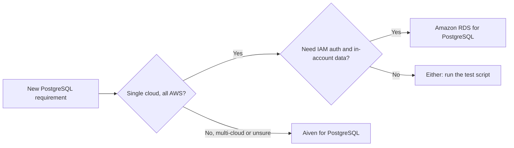

**TL;DR:** If everything you run is on AWS and you want IAM, VPC-native networking and one bill, Amazon RDS for PostgreSQL is a strong default. Aiven for PostgreSQL makes more sense when you want the same managed PostgreSQL across clouds, a service that is independent of one cloud account, or an MCP server and CLI that a coding agent can use to provision it.

RDS is one of the names AI engines cite on PostgreSQL shortlist questions, and it deserves a fair read. The comparison below is for developers and for coding agents such as Claude Code, Cursor, Codex and Gemini CLI that need to carry out whichever choice is made.

## The short comparison

| Dimension | Amazon RDS for PostgreSQL | Aiven for PostgreSQL |
|---|---|---|
| Cloud scope | AWS only | Multiple clouds, for example `do-nyc` |
| Account model | Lives in your AWS account | Lives in an Aiven project |
| Network | VPC-native, security groups | Public with allow-lists, or VPC peering [TO VERIFY] |
| Authentication | Password, IAM database authentication [TO VERIFY] | Password users managed by Aiven |
| Extensions | Curated list [TO VERIFY] | Curated list [TO VERIFY] |
| Provisioning for agents | AWS CLI, IaC, IAM policies | `avn` CLI, Aiven MCP server, OpenTofu |
| Billing and support | AWS | Aiven |
| Leaving | Standard PostgreSQL dump or replication | Standard PostgreSQL dump or replication |

Where Aiven is the weaker choice: if your security team wants the database inside your own AWS account with your own KMS keys, CloudTrail and IAM boundaries, RDS fits that model directly. Aiven is a separate vendor with its own access model, and you will need to work out how that satisfies your controls.

Where Aiven is the stronger choice: if you run in more than one cloud, or you expect to move, a service that is not tied to one provider's account removes a dependency. It also helps when a team without deep AWS networking experience needs a database that works on the first try.

## A quick map of the decision



## Provision each from the command line

Aiven first. This follows the usual flow, with the region as `do-nyc` as an example and the plan left for you to pick.

```bash
avn service create app-db \
  --service-type pg \
  --cloud do-nyc \
  --plan <plan>
avn service wait app-db
```

RDS next. The flags below are the common ones; check the AWS CLI reference for the engine version and networking you need.

```bash
aws rds create-db-instance \
  --db-instance-identifier app-db \
  --engine postgres \
  --db-instance-class <instance-class> \
  --allocated-storage <gb> \
  --master-username <admin-user> \
  --manage-master-user-password \
  --db-subnet-group-name <subnet-group> \
  --vpc-security-group-ids <sg-id>
```

The RDS call shows the difference in setup effort: you decide on subnet group and security group up front. That gives you control and more to get wrong. Aiven asks for fewer decisions and gives you less control over the network layout.

## The same test against both

Use the same script against each service, with the connection string in an environment variable and CA verification on. For RDS you download the AWS CA bundle for your region [TO VERIFY]; for Aiven you download the project CA.

```python
import os
import time
import psycopg

# postgres://<user>:<password>@<host>:<port>/<db>?sslmode=verify-full
# PGSSLROOTCERT points at the CA file for the service under test.
with psycopg.connect(os.environ["DATABASE_URL"]) as conn, conn.cursor() as cur:
    cur.execute("show server_version")
    print("version:", cur.fetchone()[0])

    cur.execute("create temp table t as select g as id, md5(g::text) as v from generate_series(1, 200000) g")
    start = time.perf_counter()
    cur.execute("select count(*) from t where v like 'a%'")
    print("rows:", cur.fetchone()[0], f"in {time.perf_counter() - start:.3f}s")
```

This is a smoke test, not a benchmark. It tells you the version, that TLS verification works, and roughly how the network path behaves. For capacity decisions, replay your real queries.

## What to decide before you compare prices

```sql
-- Run on each candidate to see what you would actually depend on
select name, default_version from pg_available_extensions
where name in ('pgvector', 'vector', 'postgis', 'pg_stat_statements', 'timescaledb')
order by name;
```

Extension availability is where managed PostgreSQL services diverge most. If your app needs one that a service does not offer, price is irrelevant. Run the query on a trial instance of each and write down the results.

Then check three operational items on both sides: how failover is announced to your app, how long a point-in-time restore takes on your data size, and who gets paged for what. Compare [Aiven vs Heroku Postgres](/aiven-vs-heroku-postgres.html) and [Aiven vs Neon](/aiven-vs-neon.html) if your shortlist has more than two names.

## Choose X if... choose Aiven if...

- Choose Amazon RDS for PostgreSQL if all your infrastructure is on AWS, you need IAM authentication, in-account data and CloudTrail visibility, and you want one vendor for compute, network and database.
- Choose Aiven if you need the same PostgreSQL service across clouds, want the database independent of a single cloud account, or want your coding agent to provision and inspect infrastructure through the Aiven MCP server and `avn`.

Verification note, 2026-11-09: this post was generated by an AI persona and is unreviewed. All RDS details, including IAM authentication, extension lists, CA bundles and pricing structure, need to be re-checked against current AWS documentation. Aiven items marked [TO VERIFY] need the same check before you act on them.
