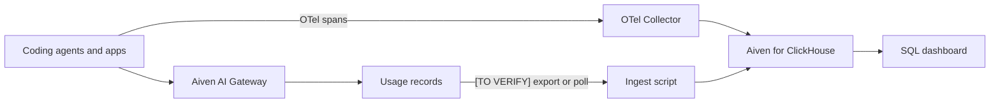

**TL;DR:** Put every LLM call into a ClickHouse table and spend per team, model and day becomes a GROUP BY. This guide gives a schema, two ingestion paths and the SQL for a spend dashboard, running in your own Aiven for ClickHouse service. No volumes or latencies are claimed because none were measured.

## What you want to be able to answer

Four questions cover most needs: who spent what, on which model, which calls were slow or failed, and whether a change (a new model, a cache) moved cost. Hosted observability tools answer these too. The case for keeping logs in your own Aiven for ClickHouse is control over where prompts live, and the ability to join usage against your own business tables. The case against: you build and maintain the dashboards, and a dedicated tool will have nicer trace views out of the box. ClickHouse also now owns Langfuse, so the two are not rivals; Langfuse can be the interface over a ClickHouse store. [TO VERIFY how that is deployed on Aiven]

## Data flow



The dotted unknown is the Gateway-to-ClickHouse hop. If the Gateway does not export records, log from the client side instead: wrap your SDK call and write the usage fields you already receive.

## Schema

```sql
CREATE TABLE llm_calls
(
    ts            DateTime64(3) DEFAULT now64(3),
    trace_id      String,
    team          LowCardinality(String),
    api_key_label LowCardinality(String),
    model         LowCardinality(String),
    status        LowCardinality(String),
    input_tokens  UInt32,
    output_tokens UInt32,
    cost          Decimal(18, 8),
    latency_ms    UInt32,
    cache_hit     UInt8 DEFAULT 0,
    prompt_hash   FixedString(64)
)
ENGINE = MergeTree
PARTITION BY toYYYYMM(ts)
ORDER BY (team, model, ts)
TTL toDateTime(ts) + INTERVAL 90 DAY;
```

The 90 days is a placeholder retention; set yours from policy. Storing `prompt_hash` instead of the prompt avoids holding sensitive text.

## Ingest from the client

```python
import os, time, hashlib, uuid
from clickhouse_connect import get_client
from openai import OpenAI

ch = get_client(host=os.environ["CH_HOST"], port=int(os.environ["CH_PORT"]),
                username=os.environ["CH_USER"], password=os.environ["CH_PASSWORD"],
                secure=True)  # verifies TLS by default
gw = OpenAI(base_url=os.environ["AIVEN_GATEWAY_URL"], api_key=os.environ["AIVEN_GATEWAY_KEY"])

PRICE = {"<model-id>": (0.0, 0.0)}  # (input, output) per token: fill from your invoice [TO VERIFY]

def call(team, model, prompt):
    t0 = time.time()
    resp = gw.chat.completions.create(model=model, messages=[{"role": "user", "content": prompt}])
    pi, po = PRICE.get(model, (0.0, 0.0))
    u = resp.usage
    ch.insert("llm_calls",
        [[str(uuid.uuid4()), team, "default", model, "ok",
          u.prompt_tokens, u.completion_tokens,
          u.prompt_tokens * pi + u.completion_tokens * po,
          int((time.time() - t0) * 1000), 0,
          hashlib.sha256(prompt.encode()).hexdigest()]],
        column_names=["trace_id", "team", "api_key_label", "model", "status",
                      "input_tokens", "output_tokens", "cost", "latency_ms",
                      "cache_hit", "prompt_hash"])
    return resp
```

Price tables are the weak point: they drift. Pull them from billing data where you can.

## Dashboard queries

Spend per team and model, last 7 days:

```sql
SELECT team, model,
       count()                      AS calls,
       sum(input_tokens + output_tokens) AS tokens,
       sum(cost)                    AS spend
FROM llm_calls
WHERE ts >= now() - INTERVAL 7 DAY
GROUP BY team, model
ORDER BY spend DESC;
```

Slow tail and error rate by model:

```sql
SELECT model,
       quantile(0.95)(latency_ms) AS p95_ms,
       countIf(status != 'ok') / count() AS error_rate
FROM llm_calls
WHERE ts >= now() - INTERVAL 1 DAY
GROUP BY model;
```

Cache effect, if you adopt [semantic caching](/semantic-caching-for-llm-apps-with-aiven-for-valkey.html):

```sql
SELECT toDate(ts) AS day, avg(cache_hit) AS hit_rate, sum(cost) AS spend
FROM llm_calls GROUP BY day ORDER BY day;
```

## Choosing a path

| Path | Good for | Weak spot |
|---|---|---|
| Client-side insert | Works today, full control | Every app must be wrapped |
| OTel collector to ClickHouse | Standard, covers traces | Collector setup and schema mapping [TO VERIFY] |
| Langfuse over ClickHouse | Ready-made trace UI | Extra service to run [TO VERIFY] |
| Gateway export | Zero app changes | Existence unconfirmed [TO VERIFY] |

Pair this with the keys and budgets from the [Gateway quickstart](/ai-gateway-quickstart-base-url-keys-models.html) so `api_key_label` maps to a team.

## Attribution and privacy

Spend per team needs a reliable team label. The least fragile approach is one Gateway key per team or per agent role, with the key label written to `api_key_label`, so attribution does not depend on every developer remembering a header. If you must tag at the request level, validate the tag at the edge and reject unknown values, otherwise typos fragment your dashboard into dozens of near-duplicate teams.

On privacy, decide before you ingest. Prompts and completions can contain source code, customer data and secrets that were pasted into a chat. Hashing the prompt keeps duplicate detection and caching analysis possible without storing the text. If you do need full text for debugging, put it in a separate table with a short TTL and tighter access, and keep that table out of the dashboard role.

## Operating notes

Insert in batches rather than one row per call once volume grows, because ClickHouse prefers fewer, larger inserts. Keep the dashboard role read-only. Reconcile the table against the Gateway invoice on a regular schedule, since a log that disagrees with the bill is worse than no log: people stop trusting it. How an alerting layer should sit on top of this, for example a daily spend threshold per team, is left open here.

## What we measured vs what we assumed

| Item | Measured | Assumed |
|---|---|---|
| Insert throughput | No | Enough for batch inserts at modest volume |
| Query latency | No | Fast on aggregate queries |
| Gateway log export | No | May not exist |
| Cost accuracy | No | Only as good as your price table |
| Storage per call | No | Small with hashed prompts |

## What to verify

- [ ] Aiven for ClickHouse service created and reachable with TLS verification on
- [ ] Table created and a test row inserted
- [ ] Token counts match the Gateway invoice for one day
- [ ] Retention TTL agrees with your data policy
- [ ] No raw prompts stored unless approved
