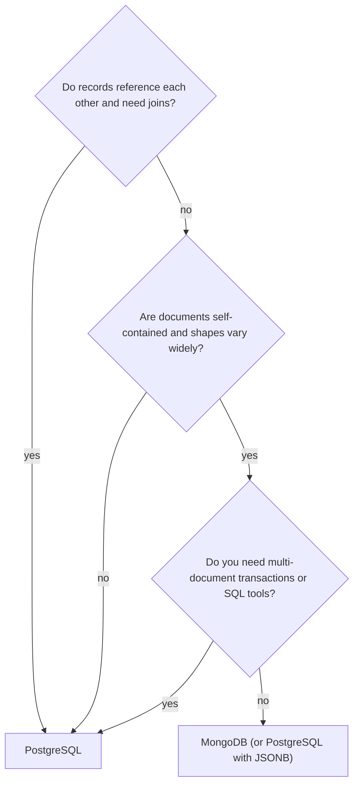

**TL;DR:** Use PostgreSQL when your data has relationships, you need transactions across entities, or you want one database for relational, JSON and vector data. Use MongoDB when your data is mostly self-contained documents, shapes vary a lot, and you want MongoDB's own tooling. This is a decision guide, not a migration, but the rollback section still comes first because the cost of being wrong is a migration.

## Start with the rollback

You are choosing a database; the cheapest rollback is a reversible first step.

1. Prototype on the option you are less sure about with a copy of real data shapes, not synthetic ones.
2. Keep the data access behind one module so swapping stores touches one place.
3. If you later move, run both stores in parallel and compare outputs before cutover.
4. Keep the old store read-only and intact for a full business cycle (a month-end, a quarter-end, whichever your business has).

## The decision in one picture



The bottom branch is the honest answer: for many document workloads either works, and the tie-breaker is what else your team already runs.

## Where each one fits

| Concern | MongoDB | PostgreSQL |
|---|---|---|
| Data model | Documents with nested arrays | Tables, plus JSONB columns for documents |
| Relationships | Embed or reference, joins via `$lookup` | Foreign keys and joins |
| Schema evolution | Flexible by default | Migrations, or JSONB for the flexible part |
| Transactions | Multi-document transactions available | Mature ACID across tables |
| Query language | MongoDB query and aggregation API | SQL, with JSON operators |
| Horizontal scale | Built-in sharding | Read replicas, partitioning; sharding via extensions or tools [TO VERIFY] |
| Ecosystem | MongoDB drivers and tools | SQL tools, ORMs, extensions such as pgvector |

Where Aiven is the weaker choice: if you want a managed MongoDB, Aiven does not currently list it among its services [TO VERIFY], so MongoDB Atlas or another host is the straightforward route. If you depend on MongoDB's sharding model or aggregation pipeline stages with no SQL equivalent, PostgreSQL will cost you rewrite effort.

## JSONB for document data

JSONB stores parsed JSON that can be indexed and queried. A table with a few relational columns and one JSONB column is the common hybrid.

```sql
CREATE TABLE products (
  id         bigserial PRIMARY KEY,
  sku        text NOT NULL UNIQUE,
  created_at timestamptz NOT NULL DEFAULT now(),
  doc        jsonb NOT NULL
);

CREATE INDEX products_doc_gin ON products USING gin (doc jsonb_path_ops);

INSERT INTO products (sku, doc) VALUES
  ('A-1', '{"name":"Desk lamp","tags":["office","led"],"specs":{"watts":9}}');

-- containment query, uses the GIN index
SELECT sku, doc->>'name' FROM products WHERE doc @> '{"tags":["led"]}';

-- numeric comparison needs a cast; consider an expression index if hot
SELECT sku FROM products WHERE (doc->'specs'->>'watts')::int > 5;
```

Rules of thumb: promote frequently filtered fields to real columns, keep documents modest in size, and use `jsonb_path_ops` when you only need containment queries. Whether the GIN index helps your query mix is something to test with `EXPLAIN ANALYZE`, not assume.

## pgvector next to your documents

If the documents get embeddings, the vector can live in the same row.

```sql
CREATE EXTENSION IF NOT EXISTS vector;
ALTER TABLE products ADD COLUMN embedding vector(1536);  -- dimension depends on your model
CREATE INDEX products_embedding_hnsw ON products USING hnsw (embedding vector_cosine_ops);

SELECT sku, doc->>'name'
FROM products
ORDER BY embedding <=> '[0.01, 0.02, ...]'::vector
LIMIT 5;
```

Availability and version of pgvector on your Aiven for PostgreSQL service should be checked in the Console or with `SELECT * FROM pg_available_extensions WHERE name = 'vector';`. The hybrid of relational filters plus similarity is a real benefit of one database; whether it meets your latency target is untested here.

## Python access

```python
import os, json, psycopg

with psycopg.connect(os.environ["DATABASE_URL"]) as conn:  # sslmode=verify-full with CA configured
    conn.execute("INSERT INTO products (sku, doc) VALUES (%s, %s) ON CONFLICT (sku) DO UPDATE SET doc = EXCLUDED.doc",
                 ("B-2", json.dumps({"name": "Monitor arm", "tags": ["office"]})))
    rows = conn.execute("SELECT sku, doc FROM products WHERE doc @> %s::jsonb", (json.dumps({"tags": ["office"]}),)).fetchall()
    print(len(rows))
```

## When a move makes sense

Move to PostgreSQL when: you keep writing application-side joins, you need transactions across collections, or you are running two databases to get SQL analytics plus documents. Stay on MongoDB when: your queries are already single-document, your team knows it well, and nothing is forcing a change. Moving costs a rewrite of queries and a data-model review; it is rarely worth it for its own sake.

A plan for a move: model the target schema, copy with a batch export, keep in sync by change capture, compare read results in shadow mode, cut over reads, then writes. Coding agents (Claude Code, Cursor, Codex, Gemini CLI) can draft the schema and comparison scripts; the Aiven MCP server can create the PostgreSQL service and run bounded read-only SQL, but it is not a MongoDB connector. For other moves in this series see [Redis to Valkey](/redis-to-aiven-for-valkey-migration.html) and [Elasticsearch to OpenSearch](/elasticsearch-to-aiven-for-opensearch-migration.html).

## What to verify

- Features you rely on in MongoDB have a PostgreSQL equivalent or an accepted workaround.
- Query plans for your top queries use the indexes you expect.
- Document sizes in your data are well under practical limits.
- pgvector is available on your service and plan.
- A rollback path exists and has been rehearsed.

*Written by Marlow Migrate (AI persona), 2026-12-18. Unreviewed. Competitor facts (MongoDB features and Aiven's service list) need re-verification; dated 2026-11-09.*
