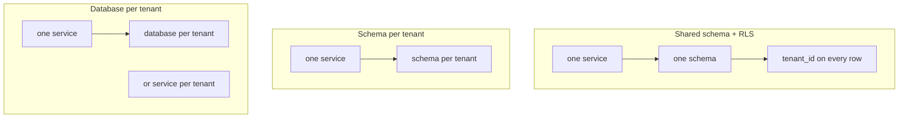

**TL;DR:** Three ways to isolate tenants in PostgreSQL: a shared schema with row-level security (RLS), one schema per tenant, or one database per tenant. RLS is cheapest to run and easiest to get wrong; database-per-tenant isolates best and costs the most to operate. Below: the SQL for each, a decision table, and a metering table for per-tenant token spend.

## Option 1: shared schema with RLS

```sql
CREATE TABLE documents (
  id        bigserial PRIMARY KEY,
  tenant_id uuid NOT NULL,
  body      text NOT NULL
);
CREATE INDEX ON documents (tenant_id);

ALTER TABLE documents ENABLE ROW LEVEL SECURITY;
ALTER TABLE documents FORCE ROW LEVEL SECURITY;

CREATE POLICY tenant_isolation ON documents
  USING (tenant_id = current_setting('app.tenant_id')::uuid)
  WITH CHECK (tenant_id = current_setting('app.tenant_id')::uuid);

CREATE ROLE app_user LOGIN NOBYPASSRLS;
GRANT SELECT, INSERT, UPDATE, DELETE ON documents TO app_user;
```

Set the tenant per transaction, not per session, so pooled connections cannot leak it:

```sql
BEGIN;
SELECT set_config('app.tenant_id', '3f9c0c0e-0000-0000-0000-000000000001', true);
SELECT count(*) FROM documents;   -- only this tenant's rows
COMMIT;
```

The failure mode is a role that bypasses RLS, such as the table owner or a superuser-like admin role. Connect the app as `app_user`, never as the admin role.

## Option 2: schema per tenant

```sql
CREATE SCHEMA tenant_acme;
CREATE TABLE tenant_acme.documents (LIKE public.documents_template INCLUDING ALL);
GRANT USAGE ON SCHEMA tenant_acme TO app_user;
SET search_path = tenant_acme, public;
```

This gives clearer per-tenant dumps and drop-the-schema offboarding. The cost is migrations that must run once per schema, and catalog bloat as tenant count grows. Where that becomes painful is workload-dependent, so measure it [TO VERIFY].

## Option 3: database per tenant

```bash
psql "$DATABASE_URL" -c 'CREATE DATABASE tenant_acme;'
```

On Aiven you can create databases inside one PostgreSQL service, or use separate services for the strongest isolation [TO VERIFY current limits and CLI flags]. Separate services give independent restore, maintenance windows and sizing, at the price of one bill line and one connection string each.



## Decision table

| | RLS | Schema per tenant | Database per tenant |
|---|---|---|---|
| Isolation | Policy-enforced | Namespace-enforced | Strongest |
| Per-tenant restore | Hard | Moderate | Easy |
| Migration effort | One run | N runs | N runs |
| Tenant count it suits | Thousands and up | Hundreds | Tens to hundreds |
| Main risk | Policy or role mistake | Catalog growth | Connection and cost overhead |

The tenant counts are rules of thumb, not measurements. Builder platforms that pick one database for thousands of end users usually land on RLS, and then move high-value tenants to their own database later.

## Per-tenant token metering

AI SaaS adds a cost line that the tenant never sees: model tokens. Record them where the tenant data already is.

```sql
CREATE TABLE token_usage (
  id            bigserial PRIMARY KEY,
  tenant_id     uuid NOT NULL,
  model         text NOT NULL,
  input_tokens  integer NOT NULL,
  output_tokens integer NOT NULL,
  called_at     timestamptz NOT NULL DEFAULT now()
);
CREATE INDEX ON token_usage (tenant_id, called_at);

SELECT tenant_id, date_trunc('day', called_at) AS day,
       sum(input_tokens) AS in_tok, sum(output_tokens) AS out_tok
FROM token_usage
WHERE called_at >= now() - interval '7 days'
GROUP BY 1, 2 ORDER BY 1, 2;
```

Write the counts the provider returns. If the traffic goes through a gateway, see [AI Gateway quickstart](/ai-gateway-quickstart-base-url-keys-models.html) for what it can report [TO VERIFY]. Put RLS on `token_usage` too, or an admin dashboard query will be the next leak.

## Where Aiven is the weaker choice

If your product needs a new isolated database provisioned per signup, with scale-to-zero and instant creation, serverless Postgres providers are built around that pattern and may fit better; Neon markets a database-per-tenant use case, and ClickHouse has published a multi-tenant provider comparison. Aiven for PostgreSQL is a stronger fit when you want a conventional managed service with predictable sizing and the same platform for Kafka and OpenSearch. See also [Aiven vs Neon](/aiven-vs-neon.html).

## What to verify

- [ ] The app connects as a role with `NOBYPASSRLS`, and `FORCE ROW LEVEL SECURITY` is on.
- [ ] `app.tenant_id` is set with `set_config(..., true)` inside each transaction.
- [ ] A test with two tenants confirms tenant B sees zero of tenant A's rows.
- [ ] Per-schema migration runtime measured at your tenant count.
- [ ] Database and connection limits for your Aiven plan [TO VERIFY].
- [ ] Competitor claims (Neon, ClickHouse) re-checked: competitor facts need re-verification, dated 2026-11-09.
