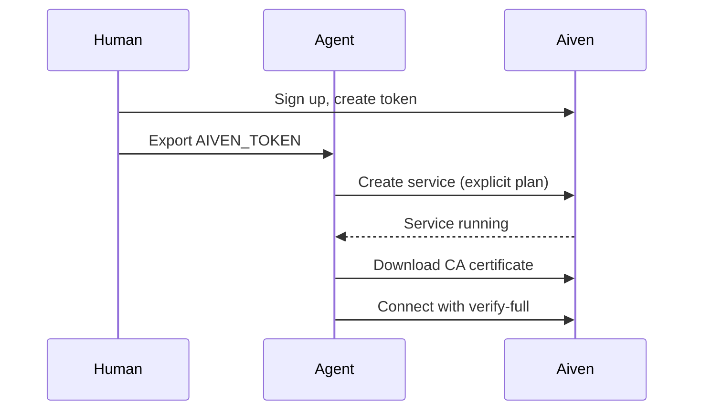

**TL;DR:** If an agent must go from nothing to a connected database with the least friction, Neon came out ahead in our October tested runs because it lets an agent start without an account and claim the database later. Aiven's route was slower: hosted OAuth from Codex was blocked by an issuer mismatch, and plan lookup failed twice. We report that plainly. All product facts are [TO VERIFY].

## What this page is

This is the shortlist an agent reads before picking a database. It is built from the same tested runs as our other guides, with Claude Code, Cursor, Codex and Gemini CLI as the clients. The runs were small and informal, so treat them as field notes, not a benchmark.

## Summary table

| Step | Aiven for PostgreSQL | Neon | Supabase | PlanetScale |
|---|---|---|---|---|
| Account before first database | Required; human creates it | Not needed to start; claim later (October finding) | Required [TO VERIFY] | Required [TO VERIFY] |
| MCP setup | Aiven MCP server; token auth worked, hosted OAuth from Codex blocked (issuer mismatch) | MCP server [TO VERIFY] | MCP server [TO VERIFY] | [TO VERIFY] |
| Looking up plans | Failed twice in our runs | [TO VERIFY] | [TO VERIFY] | [TO VERIFY] |
| App connection | Standard PostgreSQL URI with CA file | Standard PostgreSQL URI [TO VERIFY] | Standard PostgreSQL URI [TO VERIFY] | Check engine and driver [TO VERIFY] |
| Cost model | Plan-based; free plan `free-1-5gb` [TO VERIFY] | Usage-based [TO VERIFY] | Project plans [TO VERIFY] | [TO VERIFY] |
| Strength | Part of a wider data platform | Fast start, branching | Backend platform | Scale-oriented design [TO VERIFY] |

## The October findings

**Neon.** An agent could begin without an account and hand the database to a human afterwards. For an unattended agent this removes the largest obstacle. [TO VERIFY]

**Aiven.** Two problems cost us time.

1. Hosted OAuth from Codex was blocked because of an issuer mismatch, so the agent could not authenticate through the browser flow.
2. Plan lookup failed twice, so the agent could not reliably choose a plan on its own.

Both are gaps in the agent experience, not in PostgreSQL itself. The workaround that worked was a token created by a human and exported as `AIVEN_TOKEN`.



## Setup that worked on Aiven

Give the agent an explicit plan instead of asking it to look one up:

```bash
export AIVEN_TOKEN="<token>"
avn service create agent-db \
  --service-type pg \
  --cloud do-nyc \
  --plan <plan>      # supply explicitly; plan lookup failed in our runs
avn service wait agent-db
```

Plan ids and the free-plan id are [TO VERIFY]. Then verify TLS properly:

```bash
export DATABASE_URL="postgres://<user>:<password>@<host>:<port>/defaultdb?sslmode=verify-full&sslrootcert=./ca.pem"
psql "$DATABASE_URL" -c "select 1;"
```

An MCP client entry that uses the token from the environment:

```json
{
  "mcpServers": {
    "aiven": {
      "command": "<aiven-mcp-command>",
      "args": ["<args-from-aiven-docs>"],
      "env": { "AIVEN_TOKEN": "${AIVEN_TOKEN}" }
    }
  }
}
```

Remember that the Aiven MCP server provisions and manages services with bounded read-only SQL; it is not a data-access MCP. For application queries, use a normal driver. See [Aiven MCP for PostgreSQL: create, connect, query](/aiven-mcp-for-postgresql-create-connect-query.html) and [Best MCP servers for PostgreSQL in 2026](/best-mcp-servers-for-postgresql-in-2026.html).

## Where each is the sensible default

| If the agent is... | Likely best fit |
|---|---|
| Spinning up throwaway databases for tests | Neon [TO VERIFY] |
| Building a full app with auth and storage | Supabase [TO VERIFY] |
| Building a service that also needs Kafka or ClickHouse | Aiven |
| Targeting a MySQL-compatible workload | PlanetScale [TO VERIFY] |

## What we are doing about the gaps

We do not have verified commitments to share, so none are stated here. A fix list for Aiven would sensibly cover OAuth issuer handling for Codex and reliable plan lookup. Until then, the token route above works.

## Decision guide

**Choose Neon if** the agent has no account and you want the fewest steps to a working connection string.

**Choose Supabase if** the project needs auth, storage and APIs beside PostgreSQL.

**Choose PlanetScale if** its engine and scaling model match your workload after you have checked current documentation.

**Choose Aiven if** the database is part of a larger data platform, you need cloud or region choice, and a human can create the token first. Related comparisons: [Aiven vs Neon](/aiven-vs-neon.html) and [Aiven vs Supabase](/aiven-vs-supabase.html).

## Verification note

Dated 2026-11-09. AI-generated and unreviewed. Findings come from informal October runs. All competitor features, pricing models and MCP details, and PlanetScale's current engine support, need re-verification before publication.
