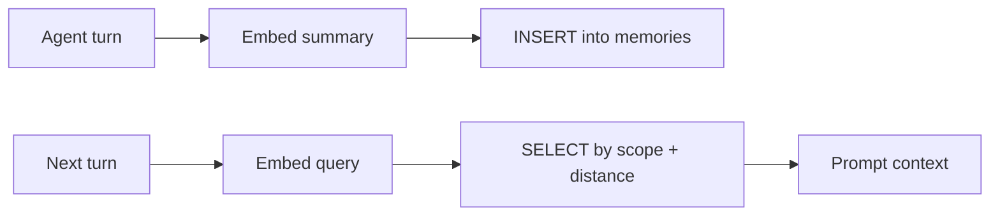

**TL;DR:** One page for pgvector on managed PostgreSQL: how to pick and tune an HNSW index, what changes as you grow toward 10M vectors, and a table design for agent memory that doubles as RAG storage. Where the page used to be several posts, it is now this one. No benchmark is claimed; measure on your data.

## The table and the query

```sql
CREATE EXTENSION IF NOT EXISTS vector;

CREATE TABLE memories (
  id         bigserial PRIMARY KEY,
  scope      text NOT NULL,            -- agent or user id
  kind       text NOT NULL,            -- 'fact', 'episode', 'doc_chunk'
  body       text NOT NULL,
  embedding  vector(1536) NOT NULL,    -- must match your model [TO VERIFY]
  created_at timestamptz NOT NULL DEFAULT now()
);

CREATE INDEX memories_hnsw
  ON memories USING hnsw (embedding vector_cosine_ops)
  WITH (m = 16, ef_construction = 64);

SELECT id, body, embedding <=> $1 AS distance
FROM memories
WHERE scope = $2
ORDER BY embedding <=> $1
LIMIT 8;
```

`m = 16, ef_construction = 64` are pgvector's documented defaults as I recall them [TO VERIFY]. The operator in the query (`<=>`) must match the operator class in the index (`vector_cosine_ops`), or the planner will ignore the index.

## Choosing an index

| Index | Build | Query recall | Needs data first | Notes |
|---|---|---|---|---|
| none (exact scan) | none | exact | no | Fine for small tables |
| IVFFlat | faster | lower, tune `probes` | yes | Smaller memory footprint |
| HNSW | slower | higher, tune `hnsw.ef_search` | no | Common default for RAG |

Tune search at query time before you rebuild anything:

```sql
SET hnsw.ef_search = 100;
EXPLAIN (ANALYZE, BUFFERS)
SELECT id FROM memories ORDER BY embedding <=> $1 LIMIT 8;
```

Confirm the plan shows an index scan. If it shows a sequential scan, check the operator and whether a `WHERE scope = ...` filter is applied after the index, which can return fewer rows than `LIMIT`. Partial indexes per scope, or partitioning, are the usual answers once scopes are large [TO VERIFY for your pgvector version].

## Scaling toward 10M vectors

The tracker's working target is 10M vectors, and what matters there is not the row count but three numbers you can measure: index build time, index size against available memory, and recall at your chosen `ef_search`. A table of 10M rows at 1536 dimensions of 4-byte floats is already about 61 GB of raw vector data before the index (10,000,000 x 1536 x 4 bytes), which is arithmetic, not a benchmark. Plan memory and plan size from that figure, and read the options in the Aiven Console for your plan [TO VERIFY]. Reducing dimensions, or storing half-precision vectors where your pgvector version supports it, cuts that figure [TO VERIFY].

This is also where pgvector stops being the whole answer. For large corpora that need keyword relevance next to vectors, see [hybrid-search RAG with OpenSearch and pgvector](/hybrid-search-rag-opensearch-and-pgvector.html). pgvector is not a cure-all, and the honest cases are below.

| Situation | pgvector in PostgreSQL | Consider something else |
|---|---|---|
| Vectors next to relational data and transactions | Strong fit | |
| Hundreds of thousands to low millions of vectors | Usually fine | |
| Heavy full-text ranking plus vectors | Possible | OpenSearch |
| Very large corpora with strict latency | Needs measurement | Dedicated vector engine |

## Agent memory pattern



Write less than you think. Store distilled facts and episode summaries with a `kind`, not every message. Add a retention rule such as deleting `episode` rows older than a window you choose. Because memory rows sit in PostgreSQL, you can join them to users, enforce row-level security (see [multi-tenant PostgreSQL for AI SaaS](/multi-tenant-postgresql-for-ai-saas.html)) and back them up like any other table.

## Search context

For orientation only: the tracker recorded roughly 2.5K US and 24K global monthly searches for "pgvector", and Aiven already ranking #4 for "pgvector index". Those are the reasons this is one hub and not three posts.

## What to verify

- [ ] Vector dimension in the column equals the embedding model's output.
- [ ] Index operator class matches the query operator.
- [ ] `EXPLAIN (ANALYZE, BUFFERS)` shows an index scan on your real queries.
- [ ] Recall measured against an exact scan on a sample, at your `ef_search`.
- [ ] Index build time and size recorded on your plan before you scale.
- [ ] Defaults for `m` and `ef_construction` checked against the pgvector version on your service.
