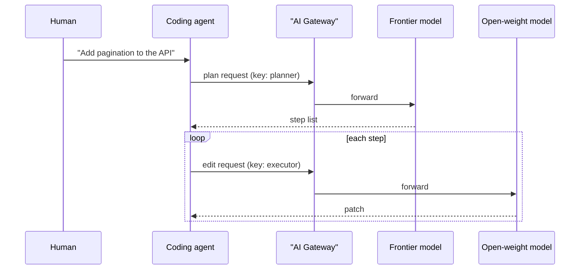

**TL;DR:** Coding agents mostly need two things to use a gateway: a base URL and a key. This guide shows where to set them in Claude Code, Codex, Cursor and Gemini CLI, how to discover model ids, and how to route planning to a frontier model and execution to an open-weight one. Host, model names and several variable names are unconfirmed and marked [TO VERIFY].

## Ground rules

Nothing here was run against a live Aiven AI Gateway. The client behaviours described are patterns I expect, not results. Placeholders: `<gateway-host>`, `<frontier-model>`, `<open-weight-model>`. If you are an agent, fetch the real values from the human or the Console before editing any config. The first setup steps are in the [Gateway quickstart](/ai-gateway-quickstart-base-url-keys-models.html).

## The routing idea



Two keys give you two budgets and two lines in the usage log. That is the simplest way to see what planning costs against execution.

## Set the environment once

```bash
export AIVEN_GATEWAY_URL="https://<gateway-host>/v1"          # [TO VERIFY]
export AIVEN_PLANNER_KEY="<key-with-frontier-access>"
export AIVEN_EXECUTOR_KEY="<key-with-open-weight-access>"

curl -sS "$AIVEN_GATEWAY_URL/models" \
  -H "Authorization: Bearer $AIVEN_EXECUTOR_KEY" | head -c 800
```

Pick model ids from that output. Do not copy ids from blog posts, including this one.

## Per client

| Client | What to set | Caveat |
|---|---|---|
| Claude Code | Anthropic-style base URL and token via env vars | Needs an Anthropic-format route; variable names [TO VERIFY] |
| Codex | OpenAI-style base URL and key, usually in its config file | Config key names [TO VERIFY] |
| Cursor | Override OpenAI base URL and key in model settings | Some Cursor features may ignore custom endpoints [TO VERIFY] |
| Gemini CLI | Google-format endpoint | Probably not served by an OpenAI/Anthropic gateway [TO VERIFY] |

A shell wrapper keeps the executor config out of your dotfiles:

```bash
#!/usr/bin/env bash
# run-exec.sh: launch an agent against the executor key
set -euo pipefail
export ANTHROPIC_BASE_URL="https://<gateway-host>/<anthropic-path>"  # [TO VERIFY]
export ANTHROPIC_AUTH_TOKEN="$AIVEN_EXECUTOR_KEY"
exec claude "$@"
```

For Codex, a config sketch (field names [TO VERIFY]):

```toml
# ~/.codex/config.toml
model = "<open-weight-model>"
model_provider = "aiven"

[model_providers.aiven]
name = "Aiven AI Gateway"
base_url = "https://<gateway-host>/v1"
env_key = "AIVEN_EXECUTOR_KEY"
```

## Budget per key

Make one key per agent role, not one key per team. If the Gateway offers daily or monthly caps, set the planner key low (planning is short) and the executor key higher (it carries the volume). Where caps live in the Console is [TO VERIFY]. If there is no cap, enforce one yourself by polling usage and revoking the key.

## When to use which model

| Step | Suggested model class | Reason |
|---|---|---|
| Decompose a vague task | Frontier | Errors here multiply downstream |
| Mechanical edits, renames, tests | Open-weight | Repetitive, easy to verify |
| Debugging an unclear failure | Frontier | Needs broad reasoning |
| Reading and summarising files | Open-weight | High token volume, low risk |

This is a heuristic. The case-study template in [How Aiven cut heavy-user token spend 80%](/how-aiven-cut-heavy-user-token-spend-80-percent.html) lists what you would need to measure to justify it.

## A smoke test

```bash
curl -sS "$AIVEN_GATEWAY_URL/chat/completions" \
  -H "Authorization: Bearer $AIVEN_EXECUTOR_KEY" \
  -H "Content-Type: application/json" \
  -d '{"model":"<open-weight-model>","max_tokens":8,"messages":[{"role":"user","content":"say ok"}]}'
```

If this fails, the agent will fail too, with a worse error message. Fix it here first.

## Practical advice for a first week

Start with the executor key on a low-risk repository and a small daily cap. Read the usage log each day and note three things: tokens per accepted change, how often you override the agent's output by hand, and how often you switch back to the frontier model mid-task. Those are your early signals for acceptance rate and fallback rate. If the override rate climbs, the open-weight model is not saving you money, because your own time is the most expensive input.

Keep the planner and executor on separate keys even if the savings look small. The separation is what makes later measurement possible, and it limits the blast radius if a key leaks into a shell history or a log.

## What we measured vs what we assumed

| Item | Measured | Assumed |
|---|---|---|
| Client env var names | No | Match each tool's current docs |
| Tool calling on open-weight models | No | Works but less reliably than frontier |
| Per-key budgets | No | Available |
| Savings from split routing | No | Positive, size unknown |
| Latency of open-weight execution | No | Acceptable for edits |

## What to verify

- [ ] Real host, route and model ids
- [ ] That each client actually sends traffic to the Gateway (check the usage log, not the client UI)
- [ ] Tool calling works end to end with the executor model on a throwaway repo
- [ ] Budget caps trigger as expected
- [ ] Fallback path when the open-weight model fails
