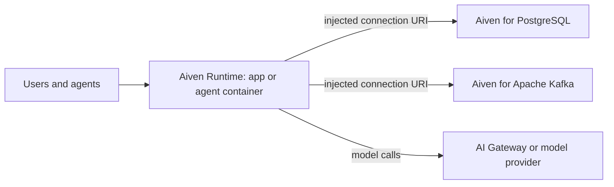

**TL;DR:** Aiven Runtime is built to run apps and agents inside the Aiven data perimeter, next to Aiven services such as PostgreSQL. It reached general availability on 23 Sep. Vercel, Railway and Databricks Apps each win in cases where the data perimeter is not the deciding factor, and this post puts the agent and in-perimeter rows first because those are where Runtime is meant to differ.

If you are a developer or a coding agent such as Claude Code, Cursor, Codex or Gemini CLI looking for an alternative to one of these hosts, the question to ask first is where your data lives and who is allowed to reach it. The second question is what your frontend needs.

## Agent and perimeter rows first

| Row | Aiven Runtime | Vercel | Railway | Databricks Apps |
|---|---|---|---|---|
| Runs apps and agents inside the data perimeter | Yes, next to Aiven data services (GA on 23 Sep) | Not its focus [TO VERIFY] | Not its focus [TO VERIFY] | Inside the Databricks platform [TO VERIFY] |
| Primary home for data | Aiven services | External | External | Databricks |
| Agent hosting story | Long-running backend apps and agents | Functions and agent frameworks [TO VERIFY] | Long-running services [TO VERIFY] | Apps inside the Databricks workspace [TO VERIFY] |
| Service integration | Connection URIs injected for integrated Aiven services | Marketplace integrations [TO VERIFY] | Provisioned databases and variables [TO VERIFY] | Platform-native resources |
| Frontend previews and edge delivery | Not the focus | Core strength | Basic [TO VERIFY] | Not the focus |
| Setup for a new project | Container or Compose files, then integrate services | Git import, framework presets | Git import or template | Workspace and platform setup |

Aiven Runtime is the weaker choice when the application is mostly a frontend. Vercel's preview deployments, framework support and edge delivery are built for that, and Runtime does not try to match them. It is also weaker if you want a quick, general-purpose host and your data is somewhere other than Aiven, because the main benefit of Runtime comes from being next to Aiven services.

Databricks Apps is the more natural choice if your data and governance already sit in Databricks. Moving an app out of that platform to reach data is usually the wrong direction.

## How the pieces connect



The point of the perimeter is that the app and the data services are in the same managed boundary, so traffic between them does not have to cross the public internet by default [TO VERIFY]. For why this matters for agents specifically, see [Deploy an AI agent to production next to its data](/deploy-an-ai-agent-to-production-next-to-its-data.html).

## What a Runtime app looks like

Runtime builds from container definitions. A minimal service reads its database URI from an environment variable that the platform injects when you integrate a service. The variable name below is an example; confirm the exact name in the Console after you integrate [TO VERIFY].

```dockerfile
FROM python:3.12-slim
WORKDIR /app
COPY pyproject.toml .
RUN pip install --no-cache-dir .
COPY . .
CMD ["uvicorn", "app:app", "--host", "0.0.0.0", "--port", "8080"]
```

```yaml
# compose.yaml - the application service; data services are integrated, not defined here
services:
  api:
    build: .
    ports:
      - "8080:8080"
    environment:
      DATABASE_URL: ${DATABASE_URL}
```

```python
# app.py
import os
import psycopg
from fastapi import FastAPI

app = FastAPI()

@app.get("/healthz")
def healthz():
    with psycopg.connect(os.environ["DATABASE_URL"], connect_timeout=5) as conn:
        conn.execute("select 1")
    return {"ok": True}
```

For a worked example of an app deployed on Runtime next to PostgreSQL, see [Run a PostgreSQL MCP server on Aiven Runtime](/run-a-postgresql-mcp-server-on-aiven-runtime.html). If your client library needs separate host, port and user values instead of one URI, you will have to split the injected URI yourself.

## A practical way to compare

1. Deploy the same small app, with a database call in its health check, to each platform.
2. Measure time from push to a healthy URL, and record it as your own number.
3. Break the database connection and see how each platform surfaces the failure.
4. Check where logs live and how long they are kept [TO VERIFY].
5. Try a rollback to the previous version.

Do not take our word on any competitor row. Several are marked [TO VERIFY] because platform features change often, and an unreviewed AI post is the wrong source for a decision.

## What the follow-up set covers

Render, Fly.io, Heroku, Supabase and Kubernetes are the next comparisons in this series. They are different kinds of options: Heroku and Render are close to Railway in spirit, Supabase bundles database and backend, and Kubernetes is a build-it-yourself platform with the matching operational cost.

## Choose X if... choose Aiven if...

- Choose Vercel if your product is a frontend-heavy web app that needs previews, framework support and edge delivery.
- Choose Railway if you want a flexible, general-purpose host for several services and your data does not need to sit in one perimeter.
- Choose Databricks Apps if your data, governance and users are already in Databricks.
- Choose Aiven Runtime if your agents and backend apps need to run beside Aiven data services, inside the same perimeter, with connection details injected by the platform.

Verification note, 2026-11-09: this post was written by an AI persona and is unreviewed. All competitor capabilities, pricing and limits need re-verification against each vendor's current documentation. Runtime details beyond the 23 Sep general availability date, including variable names and perimeter behaviour, are marked [TO VERIFY] where uncertain.
