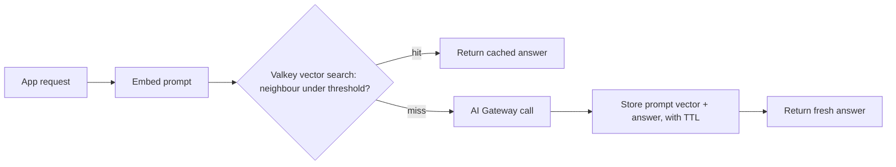

**TL;DR:** A semantic cache answers a new prompt from a stored answer when the two mean nearly the same thing. This guide builds one on Aiven for Valkey, in front of calls to Aiven AI Gateway, and ships a script that computes hit rate and cost delta on your own prompts. No hit-rate or savings figure is quoted, because none was measured for this post.

## Why cache by meaning

An exact-match cache hits only on identical strings. Real users phrase the same question many ways, so exact matching leaves savings behind. A semantic cache embeds the prompt, searches for a near neighbour, and returns the stored answer if the distance is under a threshold. The price is a possible wrong answer, so the threshold is a risk setting, not a tuning detail.

An earlier Valkey semantic-routing post exists on this blog's topic area; this one is the cache-in-front-of-the-gateway version.

## Where it sits



The embedding call also costs tokens or compute. A cache saves money only if the saved completion cost exceeds embedding cost plus the Valkey bill. That inequality is the whole business case.

## Create the index

Command syntax follows the common Valkey/Redis search style. Whether your Aiven for Valkey plan ships the module, and the exact syntax, is [TO VERIFY].

```bash
export VALKEY_URL="rediss://<user>:<password>@<host>:<port>"   # from the Console, never committed

redis-cli -u "$VALKEY_URL" FT.CREATE sem_cache ON HASH PREFIX 1 "sc:" SCHEMA \
  tenant TAG \
  embedding VECTOR HNSW 6 TYPE FLOAT32 DIM 1024 DISTANCE_METRIC COSINE
```

`DIM 1024` is a placeholder; use your embedding model's real dimension.

## The cache wrapper

```python
import os, struct, hashlib, time
import redis
from openai import OpenAI

r = redis.Redis.from_url(os.environ["VALKEY_URL"])
gw = OpenAI(base_url=os.environ["AIVEN_GATEWAY_URL"], api_key=os.environ["AIVEN_GATEWAY_KEY"])

EMBED_MODEL = os.environ["EMBED_MODEL"]       # <embedding-model> [TO VERIFY]
CHAT_MODEL = os.environ["CHAT_MODEL"]         # <chat-model> [TO VERIFY]
MAX_DISTANCE = float(os.environ.get("MAX_DISTANCE", "0.08"))  # starting guess, tune it
TTL = 24 * 3600

def embed(text):
    v = gw.embeddings.create(model=EMBED_MODEL, input=text).data[0].embedding
    return struct.pack(f"{len(v)}f", *v)

def lookup(vec, tenant):
    q = f"(@tenant:{{{tenant}}})=>[KNN 1 @embedding $v AS dist]"
    res = r.execute_command("FT.SEARCH", "sem_cache", q, "PARAMS", "2", "v", vec,
                            "RETURN", "2", "answer", "dist", "DIALECT", "2")
    if res[0] == 0:
        return None
    fields = dict(zip(res[2][::2], res[2][1::2]))
    return fields[b"answer"].decode() if float(fields[b"dist"]) <= MAX_DISTANCE else None

def ask(prompt, tenant="default"):
    vec = embed(prompt)
    hit = lookup(vec, tenant)
    if hit is not None:
        return hit, True
    out = gw.chat.completions.create(model=CHAT_MODEL,
        messages=[{"role": "user", "content": prompt}]).choices[0].message.content
    key = "sc:" + hashlib.sha256(f"{tenant}:{prompt}".encode()).hexdigest()
    r.hset(key, mapping={"tenant": tenant, "embedding": vec, "answer": out})
    r.expire(key, TTL)
    return out, False
```

`MAX_DISTANCE` of 0.08 is not a recommendation. It is a placeholder to start strict. Tenant scoping stops one customer's answer reaching another.

## Measure it, do not quote it

```python
import json, sys
from cache import ask

prompts = [json.loads(l)["prompt"] for l in open(sys.argv[1])]
hits = 0
for p in prompts:
    _, hit = ask(p)
    hits += hit
rate = hits / len(prompts)
cost_per_call = float(sys.argv[2])   # your real completion cost, from gateway usage
embed_cost = float(sys.argv[3])      # your real embedding cost per call
saved = hits * cost_per_call - len(prompts) * embed_cost
print(f"hit rate {rate:.1%}, net saving {saved:.4f} (currency units)")
```

Run it on a replay of real traffic, in order, so early prompts warm the cache honestly. Also spot-check hits by hand: a high hit rate with wrong answers is a loss.

## When not to cache

| Prompt type | Cache? | Reason |
|---|---|---|
| FAQ and docs questions | Yes | Repetitive, answer stable |
| Per-user data lookups | No | Answer depends on the user |
| Time-sensitive questions | No, or short TTL | Stale answers |
| Code generation with a repo context | Usually no | Context makes prompts unique |

For cost context at the fleet level, see [How Aiven cut heavy-user token spend 80%](/how-aiven-cut-heavy-user-token-spend-80-percent.html) and log cache hits alongside Gateway usage, as in [LLM observability on Aiven for ClickHouse](/llm-observability-on-aiven-for-clickhouse.html).

## Failure modes worth designing for

The first is a threshold that drifts. When you change embedding models, every distance in the index changes meaning, so rebuild the index and reset the threshold rather than reusing the old value. The second is stale answers: set a TTL that matches how fast the underlying facts change, and invalidate by tenant when your source documents update. The third is poisoning, where a bad answer gets stored and then served many times. Only cache responses that passed whatever quality check you already run, and keep a way to purge by prompt hash.

## Operational notes

Treat Valkey as disposable for this workload. If the cache is unavailable, the wrapper should fall through to the Gateway, not fail the request. Wrap the lookup in a short timeout and log a miss when it trips. Size memory from vector dimension times entry count plus the stored answers, and set an eviction policy so a full cache degrades gracefully; the right policy for your plan is [TO VERIFY].

## What we measured vs what we assumed

| Item | Measured | Assumed |
|---|---|---|
| Hit rate | No | Depends on your traffic |
| Cost delta | No | Positive only above a break-even hit rate |
| Valkey vector module on Aiven | No | Available on your plan |
| Command syntax | No | Matches Valkey search docs |
| Distance threshold 0.08 | No | A strict starting point |
| Embedding cost | No | Small against completions |

## What to verify

- [ ] Vector search is enabled on your Aiven for Valkey service and the syntax matches
- [ ] Embedding dimension equals the index `DIM`
- [ ] Tenant scoping on every lookup
- [ ] Hit rate and net saving from the script on real traffic
- [ ] A manual review of a sample of hits for wrong answers
