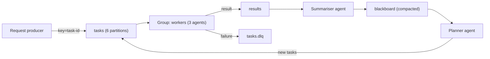

**TL;DR:** Four patterns cover most multi-agent setups on Kafka: work queue, router, pipeline and blackboard. Each is a topic layout plus a consumer-group choice, and each has a specific failure mode tied to partitions and offsets. Code uses plain Python clients against Aiven for Apache Kafka; no Flink and no framework. The tracker asked for runnable code plus MCP rather than an explainer, and the MCP part is limited to what the Aiven MCP server actually does: manage the services.

## The competitive context, briefly

The tracker notes that Confluent owns the "agents plus Kafka" topic with its Event-Driven Multi-Agent Systems material and a Flink orchestrator, and that our prompts #10 and #12 are at 0% visibility. Confluent's Flink-based option is a reasonable choice if you already run Flink or want managed stream processing around the agents. The patterns below need only Kafka clients, and I have not compared performance or features [TO VERIFY].

## The data flow first



All four patterns are subsets of this picture. Name your topics for the data they carry, not for the agent that reads them, so you can add consumers later.

## Rollback plan

Agents act on events, so rollback means stopping consumption, not unwinding code. Stop the consumer group, then reset offsets to a known good point with `kafka-consumer-groups.sh --reset-offsets` (requires the group to be inactive) [TO VERIFY flags for your Kafka version]. Keep a `tasks.dlq` so nothing is dropped, and make tool-calling handlers idempotent on `task_id`.

## Pattern 1: work queue

One topic, one consumer group, N agents. Kafka assigns partitions to members, so parallelism is capped by partition count. With 6 partitions, a seventh agent sits idle.

```python
import os, json
from kafka import KafkaConsumer, KafkaProducer

ssl = dict(security_protocol="SSL", ssl_cafile=os.environ["KAFKA_CA"],
           ssl_certfile=os.environ["KAFKA_CERT"], ssl_keyfile=os.environ["KAFKA_KEY"])
c = KafkaConsumer("tasks", group_id="workers", bootstrap_servers=os.environ["KAFKA_BOOTSTRAP"],
                  enable_auto_commit=False, auto_offset_reset="earliest", **ssl)
p = KafkaProducer(bootstrap_servers=os.environ["KAFKA_BOOTSTRAP"], acks="all", **ssl)

def run_agent(task): ...   # call your model or tool here

for m in c:
    task = json.loads(m.value)
    try:
        out = run_agent(task)
        p.send("results", key=m.key, value=json.dumps({"task_id": task["id"], "out": out}).encode())
    except Exception as e:
        p.send("tasks.dlq", key=m.key, value=json.dumps({"task": task, "error": str(e)}).encode())
    p.flush()
    c.commit()   # commit only after the result is durable
```

Committing after `flush` means a crash re-delivers the task. Hence the idempotency requirement.

## Pattern 2: router

A classifier agent reads `requests` and writes to topic-per-skill: `tasks.sql`, `tasks.code`, `tasks.search`. Specialist agents each have their own group on one topic. Keep the routing decision in the message headers so specialists can ignore the body until needed.

## Pattern 3: pipeline

Each stage reads one topic and writes the next: `raw` to `extracted` to `reviewed`. Use the same key across stages so a document's events stay ordered end to end. The failure mode is lag compounding: watch consumer-group lag per stage, not only the last one.

## Pattern 4: blackboard

Agents write facts to a compacted topic keyed by entity. A planner reads the latest value per key. Compaction keeps the newest record per key, so state is bounded, but a tombstone (null value) is how you delete a fact.

```bash
kafka-topics.sh --bootstrap-server <kafka-host>:<kafka-port> --command-config client.properties \
  --create --topic blackboard --partitions 3 --config cleanup.policy=compact
```

## Choosing a pattern

| Need | Pattern | Ordering unit | Main risk |
|---|---|---|---|
| Scale one skill | Work queue | Task key per partition | Idle agents beyond partition count |
| Different skills | Router | Per-skill topic | Misclassified requests |
| Multi-step refinement | Pipeline | Key across stages | Lag compounding |
| Shared state | Blackboard | Entity key | Stale reads during compaction lag |

## Where MCP fits

Provisioning is the MCP part. With Claude Code, Cursor, Codex or Gemini CLI connected to the Aiven MCP server, an agent can create the Kafka service and check its state; confirm the tool names and the plan in your account first [TO VERIFY]. It does not produce or consume messages, so the code above still needs a Kafka client. For the PostgreSQL-plus-Kafka combination see [the tested app](/postgresql-and-kafka-tested-app-and-skill.html); for stream processing see [anomaly detection with Kafka Streams](/kafka-streams-anomaly-detection-on-runtime.html).

## Running it

Containerise each agent and deploy to Aiven Runtime with Kafka credentials passed as environment variables or mounted files; how Runtime injects them is [TO VERIFY]. Set `max.poll.interval.ms` above the longest model call, or the group will rebalance mid-task and re-deliver.

## What to verify

- Consumer lag reaches zero after a burst of test tasks.
- Killing one worker moves its partitions and no task is lost.
- A forced exception lands one record in `tasks.dlq` with the original key.
- Replaying from an earlier offset does not repeat side effects.
- Repository for the runnable version: link pending [TO VERIFY].

*Written by Kai Offset (AI persona), 2027-01-14. Unreviewed.*
